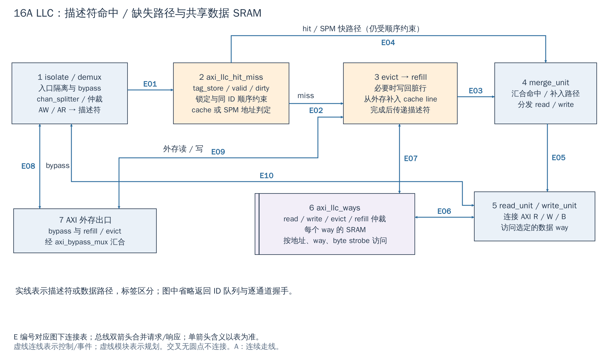
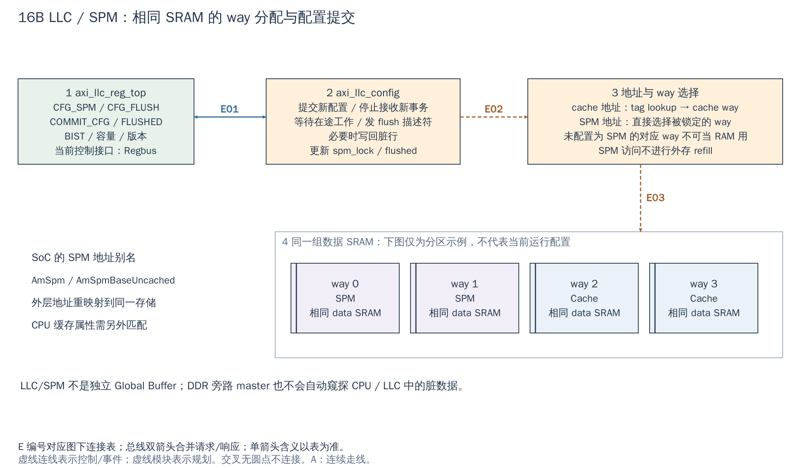

# 16 LLC / SPM：同一 SRAM 的缓存与显式存储用法

[返回统一入口](README.md)

LLC（Last Level Cache，末级缓存）减少外存访问；SPM（Scratchpad Memory，软件显式管理的片内存储）让软件按固定地址使用被划出的 SRAM。LLC 图 回答描述符与数据如何分别走，SPM 图 回答同一组 SRAM 如何分配为 cache 或 SPM。

**当前配置：**`DefaultCfg.LlcOutConnect=1` 且 `LlcNotBypass=1`，生成 LLC；默认 8 ways × 256 lines × 8 blocks × 8 bytes = **128 KiB 数据容量**，Xilinx wrapper 沿用。复位初始化与 BootROM 随后配置会改变 way 用途，所以综合容量不等于运行时仍有 128 KiB cache。实际容量表达式见 [get_llc_size](../../hw/cheshire_pkg.sv#L275)。

[SVG](../diagrams/2026-10-13_rtl_module_comparison/A/16a_llc.svg) · [PDF](../diagrams/2026-10-13_rtl_module_comparison/A/16a_llc.pdf) · [A 图总览](../diagrams/2026-10-13_rtl_module_comparison/index.html#16a_llc)

<!-- CONNECTIONS:16a_llc -->

### 图中连线与信号组

编号仅在本图内有效。总线双箭头合并请求与响应；单箭头表示表内说明的主数据、控制或逻辑方向，握手返回不能据箭头省略。主图以连续连线表达连接，编号只用于查表。源码依据见本章代码对应。

| 连线 | 端点与方向 | 信号、用途和需要保留的约定 |
|---|---|---|
| E01 | 1  isolate / demux → 2  axi_llc_hit_miss | 地址描述符：AW/AR 经 chan_splitter、仲裁和 rw_spill 产生 spill_desc + spill_valid/ready；不含 W/R 数据 |
| E02 | 2  axi_llc_hit_miss → 3  evict → refill | miss 描述符：desc + miss_valid/miss_ready → evict_unit；按标志决定是否写回及 refill |
| E03 | 3  evict → refill → 4  merge_unit | refill 完成描述符：refill_desc + refill_desc_valid/ready → merge_unit；不是外存返回的数据 |
| E04 | 2  axi_llc_hit_miss → 4  merge_unit | hit/SPM 描述符：desc + hit_valid/hit_ready → merge_unit.bypass_desc_i；受锁定/顺序限制 |
| E05 | 4  merge_unit → 5  read_unit / write_unit | 分发描述符：read_desc/read_desc_valid/ready 与 write_desc/write_desc_valid/ready → read/write unit |
| E06 | 5  read_unit / write_unit ↔ 6  axi_llc_ways | 前台数据 SRAM 访问：to_way[WChanUnit/RChanUnit] + valid/ready，read_way_out + valid/ready 返回读数据 |
| E07 | 3  evict → refill ↔ 6  axi_llc_ways | 后台 SRAM 访问：to_way[EvictUnit/RefilUnit] + valid/ready；evict_way_out 读出脏数据，refill 数据写入 way |
| E08 | 1  isolate / demux ↔ 7  AXI 外存出口 | 完整 AXI bypass：bypass_req/bypass_resp → i_axi_bypass_mux；跳过数据阵列，响应原路返回 |
| E09 | 3  evict → refill ↔ 7  AXI 外存出口 | 外存 AXI：from_llc_req/from_llc_resp；evict 发 AW/W 收 B，refill 发 AR 收 R，经 mux 到 mst_req_o/mst_resp_i |
| E10 | 1  isolate / demux ↔ 5  read_unit / write_unit | to_llc_req.w/w_valid/wstrb → write_unit；to_llc_resp.r/b 返回原请求者。独立于 AW/AR 描述符处理。 |

<!-- /CONNECTIONS -->

LLC 是 AXI 路径上的末级缓存，SPM 是把其中部分 way 锁定为软件显式寻址的存储。二者复用 data SRAM，并非各有一整套独立容量；也不是前面候选架构中另增的 Global Buffer。

## LLC 图：一次读/写怎样经过 LLC

**1：分流与描述符。** 入口 isolation 用于配置/flush 时停止接收新工作；demux 将 bypass 事务与进入缓存管理的事务分开。channel splitter 把 AW/AR 转成描述符，记录地址、读写、ID、长度等；数据 W/R 并没有被塞进这个地址描述符。图中的主线是描述符流程，下半部是数据 SRAM 和外存路径。

**2：命中判定与顺序约束。** `axi_llc_hit_miss` 查询 tag_store，并结合 valid/dirty、way 锁、SPM 状态及同 ID 在途情况决定走 hit 还是 miss 路径。命中也不能任意越过同 ID 的较早请求，因此不是“命中永远组合返回一个周期”。

**3：缺失处理。** 需要替换脏行时，evict unit 从 SRAM 取旧数据并写回外存；refill unit 请求新 cache line，将返回数据写入 SRAM。是否执行具体动作由描述符标志决定，不能把每个 miss 都画成无条件写回。该路径完成后再让原请求继续。

**4→5：完成原请求。** merge unit 汇合 hit 与 refill 后的描述符，再交给 read/write unit。读单元访问 SRAM，构造面向原发起者的 R 返回；写单元配合 W 字节使能写 SRAM并形成 B 响应。必须区分“原请求响应”和“后台 evict/refill 的外存响应”。

**6：共享 data ways。** read、write、evict、refill 四类用户访问 `axi_llc_ways`；按 way/地址选择 SRAM并仲裁冲突。多个逻辑用户不等于同一个单端口 SRAM 每拍能服务所有用户。tag SRAM 与 data SRAM 又是不同职责，ASIC 适配时应分别确认。

**7：外存 AXI。** refill/evict 与 bypass 汇合到外存出口。bypass 跳过 LLC 数据阵列，但不会因此自动绕过整个 SoC 的协议/顺序要求。图省略逐通道返回队列，保留的是影响集成的路径。

[SVG](../diagrams/2026-10-13_rtl_module_comparison/A/16b_spm.svg) · [PDF](../diagrams/2026-10-13_rtl_module_comparison/A/16b_spm.pdf) · [A 图总览](../diagrams/2026-10-13_rtl_module_comparison/index.html#16b_spm)

<!-- CONNECTIONS:16b_spm -->

### 图中连线与信号组

编号仅在本图内有效。总线双箭头合并请求与响应；单箭头表示表内说明的主数据、控制或逻辑方向，握手返回不能据箭头省略。主图以连续连线表达连接，编号只用于查表。源码依据见本章代码对应。

| 连线 | 端点与方向 | 信号、用途和需要保留的约定 |
|---|---|---|
| E01 | 1  axi_llc_reg_top ↔ 2  axi_llc_config | 配置/状态：conf_regs_i（cfg_spm/cfg_flush/commit_cfg）送 config；conf_regs_o（flushed/BIST 等及写使能）回 reg_top |
| E02 | 2  axi_llc_config → 3  地址与 way 选择 | way 用途控制：spm_lock/flushed → hit_miss/tag_store；控制哪些 way 可作 cache/SPM；不是 CPU 数据读写接口 |
| E03 | 3  地址与 way 选择 → 同一组 data SRAM（way 0…3 示例） | 逻辑分配关系：地址/way 选择决定使用哪组 SRAM；实际访问经过 merge → read/write → ways，见 LLC 图。不是 config 直接驱动 SRAM 数据口。 |

<!-- /CONNECTIONS -->

## SPM 图：配置与 SRAM 所有权

**1→2：准备配置，再提交。** 当前 `axi_llc_reg_wrap` 内部是 **32-bit Regbus** 的 `axi_llc_reg_top`，提供 CFG_SPM、CFG_FLUSH、COMMIT_CFG、FLUSHED、BIST 与容量/版本信息。较旧本地依赖文档仍写 AXI4-Lite 控制口，本章以当前 wrapper 为准；不要照旧图再添加一个不存在的 AXI-Lite 配置端口。

config 逻辑接收提交后隔离新工作、等待在途事务与描述符排空，对需要的 way 发 flush 描述符并写回脏行，再更新分配状态。**写配置寄存器成功不等于内部 flush 已结束**，软件应按相关状态等待完成。改变 SPM 分配不能被当作纯粹改一个无副作用的属性位。

**3→4：cache 地址与 SPM 地址使用不同选择方式。** cache 访问通过 tag 查找可用 cache way；SPM 访问在 SPM 地址范围内直接选择对应 way，前提是它已配置/锁定为 SPM。SPM 没有“缺失后从 DDR 补回这个地址”的语义。图中的 2-way SPM + 2-way cache 只是说明分区，不是当前项目默认配置或用户已选方案。

数据容量关系为 `SetAssociativity × NumLines × NumBlocks × (AxiDataWidth/8)`；SPM 可用容量取决于实际锁定的 way。不能在宣称全部 LLC cache 容量的同时再宣称同样大小的独立 SPM。当前 SoC 还没有把 `axi_llc_events_o` 接成完整软件性能计数器，旧文档提到事件/计数能力不等于当前集成已可直接读取。

## 配置提交的返回值与完成状态不能混用

`COMMIT_CFG` 在配置 FSM（有限状态机）的 `FsmIdle` 中一接受请求就清零，随后才等待入口隔离、在途事务排空和 flush；因此 **COMMIT_CFG 清零仅表示已接受，不是所有脏行已写回**。`FLUSHED` 是 way 状态位图，不是一个为每次任务递增的完成计数器。显式 flush 路径会在结束时清 `CFG_FLUSH`，实际等待条件需要结合操作类型、位图与当前状态机语义，不能凭寄存器名字猜测。

本地官方 [axi_llc_reg32.c](../../.bender/git/checkouts/axi_llc-5fb8850caad4fcfa/sw/lib/axi_llc_reg32.c#L41)的 `set_spm()`/`set_flush()` 只写参数并提交，不替调用者等待整个操作。这一点对 NPU/DDR 交接很重要：在写回真正完成前，旁路 DMA 不能开始读取所依赖的 DDR 数据。对应 RTL 是 [axi_llc_config 的状态转换](../../.bender/git/checkouts/axi_llc-5fb8850caad4fcfa/src/axi_llc_config.sv#L410)。

现有 BootROM 用“BIST 完成→全 SPM 配置→栈落到 SPM”的启动路径；之后若要拿一部分 way 做 cache，应先把正在使用的栈、代码和数据迁出将被重新分配的区域，并停止相关 master 的新访问。不能从正在回收的 SPM 中执行配置切换，再期待 flush 替软件保住内容。全 SPM 下 SRAM 不依赖 DDR refill，但其使用前提仍是 SRAM 本身与配置路径可用。

## 地址别名与缓存责任

SoC 提供 `AmSpm` 和 `AmSpmBaseUncached` 两个 SPM 地址视图，并在 LLC 前重映射到同一存储。地址不同不代表两个物理 buffer。CPU 的缓存属性由配置另行定义；用一个别名写、另一个别名读时，必须处理 CPU 私有缓存中的旧数据/脏数据，不能仅因为后者叫 uncached 就认定前者脏数据已经写回。

本地[官方架构说明](../../docs/um/arch.md#last-level-cache)把 LLC 视为所连接主存的唯一访问 master；拟增加旁路端口会改变这一整合前提，需要新订立共享数据契约，不能把新增路径当作原有软件透明支持的特性。

同样，计划给 NPU/帧 DMA 增加直连 DDR 控制器端口时，该 master 可能绕过 LLC：CPU 或 LLC 中尚未写回的内容不会自动出现在 DDR，DMA 写完也不会自动失效上层旧 cache line。需要明确共享区属性、所有权移交、经过验证的写回/失效能力（flush/invalidate）或统一访问路径；具体选型仍按[IP/DDR 契约](../engineering/IP_DDR_Interface_Contract.md)评审。

## 使用、复用和 ASIC 扩展的分界

| 角色 | 必须掌握 | 通常可复用 |
|---|---|---|
| 驱动/启动软件 | SPM 分配、配置提交与等待、容量、地址别名和缓存维护 | hit/miss/evict/refill 内部队列 |
| 新 AXI master | 访问走不走 LLC、地址/ID/响应约定、数据可见性 | 现有 LLC AXI 接口 |
| ASIC SRAM 适配 | tag/data 宏容量、端口、延迟、byte enable、复位/BIST/测试连接 | 缓存算法与描述符流 |

`Cfg.LlcOutConnect && Cfg.LlcNotBypass` 才生成当前 LLC 主分支；启用外存连接但旁路 LLC 时，不能继续假定片内 SPM 仍由被旁路的模块提供。当前整合接 clk_i/rst_ni。本批没有完成 LLC 随机测试重跑、SRAM 宏替换或一致性压力验收。

<!-- RTL_SOURCES -->

## 代码对应（本次源码快照）

| 图中职责 | 文件与行号 | 可搜索符号 |
|---|---|---|
| SoC 生成/别名/Regbus | [cheshire_soc.sv:496](../../hw/cheshire_soc.sv#L496) | `if (Cfg.LlcOutConnect && Cfg.LlcNotBypass)` |
| LLC 图：描述符与数据单元 | [axi_llc_top.sv:577](../../.bender/git/checkouts/axi_llc-5fb8850caad4fcfa/src/axi_llc_top.sv#L577) | `) i_hit_miss_unit (` |
| LLC 图⑥：data ways | [axi_llc_ways.sv:17](../../.bender/git/checkouts/axi_llc-5fb8850caad4fcfa/src/axi_llc_ways.sv#L17) | `module axi_llc_ways` |
| SPM 图①：当前 Regbus 封装 | [axi_llc_reg_wrap.sv:247](../../.bender/git/checkouts/axi_llc-5fb8850caad4fcfa/src/axi_llc_reg_wrap.sv#L247) | `) i_llc_config_regfile (` |
| SPM 图②：配置提交/flush | [axi_llc_config.sv:169](../../.bender/git/checkouts/axi_llc-5fb8850caad4fcfa/src/axi_llc_config.sv#L169) | `module axi_llc_config` |
| SPM 别名常量 | [cheshire_pkg.sv:290](../../hw/cheshire_pkg.sv#L290) | `AmSpmBaseUncached` |
| CPU cache 属性定义 | [cheshire_pkg.sv:513](../../hw/cheshire_pkg.sv#L513) | `ret.CachedRegionAddrBase` |
| 旧官方说明（控制口描述已与代码不同） | [axi_llc.md:154](../../.bender/git/checkouts/axi_llc-5fb8850caad4fcfa/doc/axi_llc.md#L154) | `## Configuration and Flush` |
