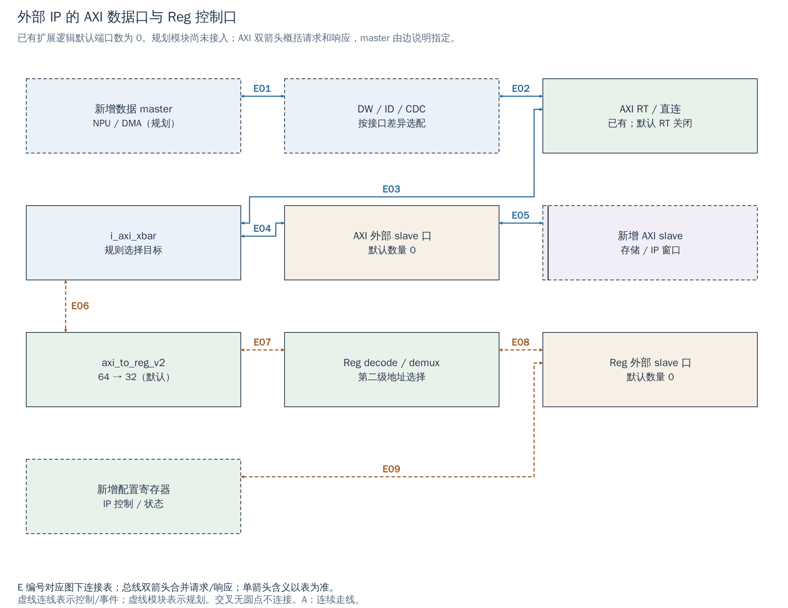

# 17 外部 AXI 接入：控制窗口、搬运主口与适配边界

[返回统一入口](README.md)

新 IP 通常有两个不同的角色：CPU 访问它的配置寄存器时，它是 **slave / subordinate（被访问端）**；它主动搬运 DDR 数据时，它是 **master / manager（事务发起端）**。Cheshire 为这两种角色保留了不同接口，不能把“给 IP 分配一个地址”理解成已经接好了它的 DMA 数据通路。

本章以当前 `cheshire_soc` 的外部端口和适配器为边界，回答接入时需要改哪些配置、核对哪些信号。详细寄存器握手见 [Regbus](00_regbus.md)，新的 DDR 旁路另见 [19 章](19_ddr_lvds_pipeline.md)。

## 当前已有的结构和未启用的接口

默认配置为 AXI 数据 64-bit、地址 48-bit、输入 ID 2-bit；这些值来自 `DefaultCfg`，不是 AXI 协议的固定值。`AxiExtNumMst`、`AxiExtNumSlv`、`RegExtNumSlv` 及外部规则数由 `default: '0` 置零，因此接口类型和生成逻辑存在，默认并没有接一个可工作的外部 IP。

当前 FPGA 的 `gen_cheshire_xilinx_cfg()` 继承这些值，覆盖 RTC、Serial Link、USB 和 Ara 相关选项；没有把新增 NPU/ISP/LVDS 接到外部口。仿真 `fixture_cheshire_soc` 也把外部 master 请求、slave 返回和外部 IRQ 输入绑零。仿真配置 3 提供 Ara 2 lanes / VLEN 2048；这不等于新 IP 已接入，更不证明当前执行过该配置。

图中显示三类扩展通路及其共同译码位置。实线对应已有 RTL 连接；“规划”模块及连接表示新 IP 接入时需要补上的逻辑。双向总线箭头概括请求和响应，不表示两个端点都能发起 AXI 事务。

[SVG](../diagrams/2026-10-13_rtl_module_comparison/A/17_axi_extension.svg) · [PDF](../diagrams/2026-10-13_rtl_module_comparison/A/17_axi_extension.pdf) · [A/C 对比](../diagrams/2026-10-13_rtl_modules_native_c/index.html#17_axi_extension)

<!-- CONNECTIONS:17_axi_extension -->

### 图中连线与信号组

编号仅在本图内有效。总线双箭头合并请求与响应；单箭头表示表内说明的主数据、控制或逻辑方向，握手返回不能据箭头省略。A/C 均以连续连线表达连接，编号只用于查表。源码依据见本章代码对应。

| 连线 | 端点与方向 | 信号、用途和需要保留的约定 |
|---|---|---|
| E01 | 新增数据 master ↔ DW / ID / CDC | 规划/待确认连接：新增设备发起 AW/AR/W，适配器返回 B/R；位宽、ID、时钟子集待该 IP 接口确定。 |
| E02 | DW / ID / CDC ↔ AXI RT / 直连 | 规划/待确认连接：拟接 axi_ext_mst_req_i / axi_ext_mst_rsp_o，经 AxiIn.ext_base 进入 axi_in_req；端口数需要显式启用。 |
| E03 | AXI RT / 直连 ↔ i_axi_xbar | gen_axi_rt 在启用时生成 i_axi_rt_unit_top；默认 gen_no_axi_rt 直连 axi_in_req 与 axi_rt_in_req。 |
| E04 | i_axi_xbar ↔ AXI 外部 slave 口 | gen_axi_out 的外部 AXI 规则将请求路由到 AxiOut.ext_base；输出 ID 包含输入端口编号。 |
| E05 | AXI 外部 slave 口 ↔ 新增 AXI slave | 规划/待确认连接：拟接 axi_ext_slv_req_o / axi_ext_slv_rsp_i；外部 IP 是被访问端，AW/AR/W 由 SoC 侧发起。 |
| E06 | i_axi_xbar ↔ axi_to_reg_v2 | Reg 窗口先进入 AxiOut.reg_demux，经过现有原子适配和 cut（此处合并）后到 axi_to_reg_v2。 |
| E07 | axi_to_reg_v2 ↔ Reg decode / demux | reg_req / reg_rsp 包含 addr、write、wdata、wstrb、valid / rdata、error、ready；默认数据 32-bit。 |
| E08 | Reg decode / demux ↔ Reg 外部 slave 口 | gen_reg_out 外部规则二次译码；demux 不自动从地址中减去设备基址。 |
| E09 | Reg 外部 slave 口 ↔ 新增配置寄存器 | 规划/待确认连接：拟接 reg_ext_slv_req_o / reg_ext_slv_rsp_i；新寄存器块及时钟域适配需要额外实现。 |

<!-- /CONNECTIONS -->

## 三类端口怎样选择

| 新 IP 的用途 | SoC 端口 | IP 扮演的角色 | 地址与配置责任 |
|---|---|---|---|
| NPU 或 DMA 主动读写系统可见存储 | `axi_ext_mst_req_i / axi_ext_mst_rsp_o` | AXI master | `AxiExtNumMst` 增加输入；它访问的是已有或新增的 **目标窗口**，不是给该 master 自己分一个数据地址 |
| CPU 或其他 master 访问 IP 的 AXI 寄存器/存储窗口 | `axi_ext_slv_req_o / axi_ext_slv_rsp_i` | AXI slave | `AxiExtNumSlv`、`AxiExtNumRules`、`AxiExtRegionIdx/Start/End` 定义目的端和范围 |
| CPU 配置低吞吐控制寄存器 | `reg_ext_slv_req_o / reg_ext_slv_rsp_i` | 32-bit Regbus slave | `RegExtNumSlv`、`RegExtNumRules`、`RegExtRegionIdx/Start/End` 定义窗口；异域时另加 CDC |

顶层 `ext_mst/ext_slv` 的命名以**外部设备角色**为参照；Crossbar 自身端口名则从互联角度命名。看到 `axi_ext_slv_req_o` 时，应读成“SoC 向外部 slave 发请求”，不要因为是输出就把设备也称作 master。

如果新增 DMA 数据口连接 `axi_ext_mst_req_i`，并访问 `LlcOutRegionStart..End`，它仍会走当前主 Xbar 的 LLC 目标。**这条现成扩展口不能自动实现用户要求的 DDR 旁路。** 旁路需要在 LLC 下游另建合流或使用 DDR 控制器的独立端口；控制寄存器仍可留在 Regbus。

## 译码怎样把请求送到新 IP

`gen_axi_out(Cfg)` 创建主 Xbar 的地址规则：外部 AXI 规则指向 `AxiOut.ext_base + AxiExtRegionIdx[k]`；外部 Reg 规则先全部指向现有 `reg_demux` 目标。后者经过 AXI→Reg 转换后，再由 `gen_reg_out(Cfg)` 和 `i_reg_demux_decode` 选择具体外部 Reg 端口。因此，Reg 扩展窗口同时参与两级译码。

区间使用 `[Start, End)`，即包含起始地址、不包含结束地址。规则数量和物理端口数量是两回事：多条不相交规则可以指向同一个 slave。当前转接和 demux 不为外部 IP 自动减去基址；地址是否转成局部偏移，须由接入 wrapper 或 IP 的译码约定决定。

集成时必须同时检查地址是否重叠、窗口实际容量、未实现地址的错误响应和 CPU 对该窗口的物理属性。AXI 路由规则决定“送到哪里”；`gen_cva6_cfg()` 的 cache / executable / idempotent 区域决定“CPU 怎样访问”。二者是不同配置，新增一条 Xbar 规则不会自动更改后者。

新寄存器块通常应安排在经过评审的 MMIO 区；新 GB 是 RAM，不应为了方便随意套用带副作用 MMIO 的访问约束。本轮没有分配 NPU/ISP/LVDS/PLL/DDR 控制寄存器地址，现行分配入口仍为 [IP/DDR 契约](../engineering/IP_DDR_Interface_Contract.md)。

## ID、在途事务和位宽为什么不能直接接错

AXI ID 用于关联返回事务及约束顺序。当前主 Xbar 的输入 ID 宽度为 `Cfg.AxiMstIdWidth`；输出 ID 宽度为：

`Cfg.AxiMstIdWidth + $clog2(AxiIn.num_in)`。

新增 master 会改变 `AxiIn.num_in`，因而可能增加所有输出端的 ID 位数。当前 `CHESHIRE_TYPEDEF_AXI` 还在启用 LLC 时为其外存出口增加一位 ID。应通过同一份最终 `Cfg` 生成全部类型，不能沿用旧顶层手写的位宽，更不能把 ID 高位直接截掉。

Outstanding 指“已经接收、尚未完成的事务数量”。`AxiMaxMstTrans/AxiMaxSlvTrans` 约束 Crossbar 的在途跟踪；新 IP 的命令队列、ID 重排能力、适配器和 DDR 端口也各有上限。某处容纳 24 个事务，不代表整条路径都能无条件保持 24 个在途请求。对同一 ID 的顺序、多个 ID 的响应交错，以及 AW/W 独立停顿，都要由真正的接口契约约束。

| 适配需求 | 当前可参考实现 | 集成时需要感知的边界 |
|---|---|---|
| 数据宽度不同 | Ara 的 `i_ara_axi_dw_converter`；FPGA DDR 的 `i_axi_dw_converter` | 按字节地址、`SIZE/LEN/WSTRB/LAST` 拆分或合并传输，不能截掉高位数据；检查窄访问、非对齐、突发和响应合并 |
| ID 数量/宽度不同 | CPU 的 `axi_id_serialize`；FPGA DDR 的 `axi_iw_converter` | 适配器保存返回映射，必要时串行化并限制在途数；不是 ID 截位 |
| 时序路径过长 | `axi_cut`、Xbar 的 `CUT_ALL_PORTS` | 在同一时钟域插入握手寄存器；增加延迟但**不是跨时钟域** |
| 两侧时钟不同 | FPGA DDR 的 `axi_cdc`；依赖库的 `reg_cdc` | 数据和握手成组跨域；两端复位、停钟、排空和重新上线另有平台责任 |
| AXI 与简单寄存器接口不同 | 主路径 `axi_to_reg_v2`；设备局部 wrapper | 控制口可复用桥接，但不能假定所有 IP 都能接受 burst、窄读或读副作用 |

这些模块的源码存在，不表示已为新增 NPU/ISP 自动插入。若供应商端口已匹配位宽、ID 与时钟，就不必机械叠加适配层；若需要，按实际差异选择并验收。

## 限流和错误监控的实际覆盖范围

`Cfg.AxiRt=1` 时，`axi_rt_unit_top` 位于所有 `axi_in_req` 与主 Xbar 之间，可对经过该处的 master 限流；默认 `AxiRt=0`，现有 FPGA 也未覆盖为 1。其预算机制不能自动约束绕过主 Xbar 的新 DDR 旁路流量，更不能代替 DDR 仲裁器的服务保证。

`Cfg.BusErr=1` 时，当前 SoC 只明确为 **CVA6、iDMA 和 VGA** 实例化 `axi_err_unit_wrap`。它旁观请求/响应并记录读写错误；并没有自动包住 `axi_ext_mst_req_i` 上的每个新增 master。新设备必须处理自身 `RRESP/BRESP`，再决定是否额外接入通用监控器、状态寄存器和 IRQ。监控器也不会凭空为永不返回响应的 slave 产生超时结束。

## 一次新 IP 接入的建议实施顺序

以下是后续工程流程，本轮只整理文档，未执行这些 RTL 改动。

1. 列清控制 slave、数据 master、IRQ、时钟复位；确定数据访问走主 Xbar 还是 LLC 下游旁路。
2. 先冻结端口类型和地址窗口，再更新唯一 `Cfg`、自动类型、地址表、CPU 属性及软件头文件，核对 ID 扩展影响。
3. 只加入确实需要的 DW/ID/CDC/协议适配；为未映射、复位中、未就绪的访问规定可观察结果。
4. 先用只读版本/状态寄存器检查 MMIO；再进行单笔数据、字节掩码、边界和错误访问；最后增加 burst、并发 ID 和背压。
5. 搬运正确后，再验证完成通知、共享缓存可见性和 buffer 复用，不能只比较 AXI 波形有没有握手。

## 代码对应与阅读边界

| 要核对的内容 | 工程来源与可搜索符号 |
|---|---|
| 官方扩展机制与 typedef 用法 | [集成说明](../../docs/tg/integr.md)，`Instantiating Cheshire`；[架构说明](../../docs/um/arch.md)，`Interconnect` |
| 外部端口方向、Xbar 参数与绑定 | [cheshire_soc.sv](../../hw/cheshire_soc.sv)，`axi_ext_mst_req_i`、`AxiXbarCfg`、`gen_ext_axi_mst`、`gen_ext_axi_slv` |
| 地址规则与默认值 | [cheshire_pkg.sv](../../hw/cheshire_pkg.sv)，`gen_axi_out`、`gen_reg_out`、`DefaultCfg` |
| 类型与 ID 扩展公式 | [typedef.svh](../../hw/include/cheshire/typedef.svh)，`CHESHIRE_TYPEDEF_AXI` |
| 已有 DW/ID/CDC 串接 | [dram_wrapper_xilinx.sv](../../target/xilinx/src/dram_wrapper_xilinx.sv)，`i_axi_dw_converter`、`i_axi_iw_converter`、`i_axi_cdc_mig` |
| 可选限流与实际错误监控 | [cheshire_soc.sv](../../hw/cheshire_soc.sv)，`gen_axi_rt`、`gen_cva6_bus_err`、`gen_dma_bus_err`、`gen_vga_bus_err` |
| FPGA 与仿真配置 | [FPGA top](../../target/xilinx/src/cheshire_top_xilinx.sv)，`gen_cheshire_xilinx_cfg`；[仿真配置](../../target/sim/src/tb_cheshire_pkg.sv)，`TbCheshireConfigs`；[fixture](../../target/sim/src/fixture_cheshire_soc.sv) |

本章依据 2026-10-13 的源码快照静态核对。适配器可复用性仍需针对最终 IP 子集验证；没有新增地址、RTL 编译、仿真或性能结果。
