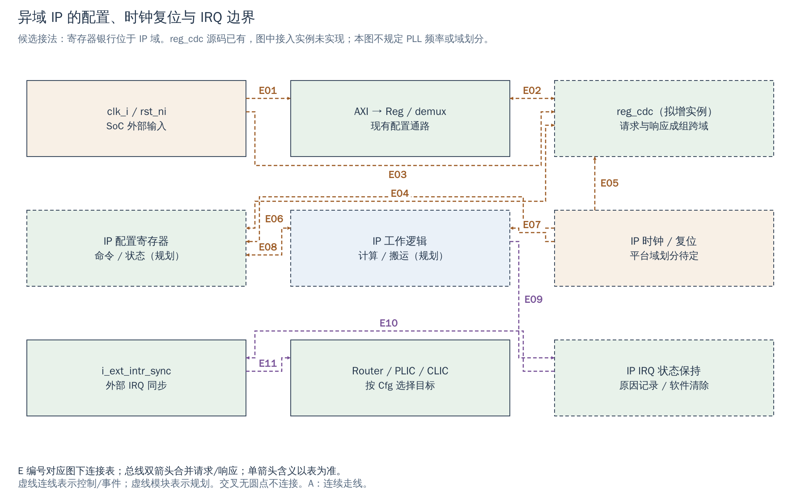

# 18 时钟、复位与启动：新 IP 何时可配置、何时可工作

[返回统一入口](README.md)

“CPU 写入配置成功”“IP 已退出复位”“DDR 可以存放代码”是三个不同条件。扩展 NPU/ISP/LVDS/DDR 时，应先建立可访问的控制域，再让数据域上线。本章把现有时钟/复位连接、可复用 CDC 和启动软件责任连起来；详细时序值仍由实际 PLL、DDR 和工艺资料决定。

## 当前的时钟不是由 Regbus 协议决定的

`cheshire_soc` 接收外部 `clk_i/rst_ni`；当前主 AXI、Regbus、CVA6、Ara、LLC 和多数外设的数字逻辑都使用这组时钟复位。Regbus 是单次寄存器访问协议，**不会自行分频成低速总线**。UART 的波特率、SPI 的 SCK 或 VGA 的像素节拍可以由计数使能产生，它们不必等于内部寄存器银行的时钟频率。

当前 FPGA wrapper 使用 `i_clkwiz` 产生 `soc_clk` 与 `usb_clk`，并用 `i_rstgen` 对 SoC 复位释放进行同步。`rtc_i` 是独立输入，在 FPGA 中由 `soc_clk` 分频得到，再由 CLINT 同步/边沿检测驱动计时；这不代表 ASIC 最终 RTC 与 SoC 必须同源。

USB 有明确的 `usb_clk_i/usb_rst_ni`；DDR wrapper 则使用 MIG 的 UI 时钟 `dram_axi_clk`，与 `soc_clk_i` 之间实例化 AXI CDC。仿真 fixture 把 USB 时钟绑 0，因此不能从 `Cfg.Usb=1` 推断该仿真已验证 USB。具体频率只对相应 FPGA IP 配置成立，本轮不将其用作 ASIC 目标频率。

下图聚焦一种**拟新增的异域 IP 控制接法**：现有 Regbus 到 `reg_cdc`，再到 IP 域寄存器；IRQ 返回现有外部中断同步器。`reg_cdc` 的 RTL 已存在，这个新接入实例尚未加入 SoC。图中的时钟线表示时钟/复位输入，配置线表示一次访问，不把两者混为数据流。

[SVG](../diagrams/2026-10-13_rtl_module_comparison/A/18_clock_reset_startup.svg) · [PDF](../diagrams/2026-10-13_rtl_module_comparison/A/18_clock_reset_startup.pdf) · [A 图总览](../diagrams/2026-10-13_rtl_module_comparison/index.html#18_clock_reset_startup)

<!-- CONNECTIONS:18_clock_reset_startup -->

### 图中连线与信号组

编号仅在本图内有效。总线双箭头合并请求与响应；单箭头表示表内说明的主数据、控制或逻辑方向，握手返回不能据箭头省略。主图以连续连线表达连接，编号只用于查表。源码依据见本章代码对应。

| 连线 | 端点与方向 | 信号、用途和需要保留的约定 |
|---|---|---|
| E01 | clk_i / rst_ni → AXI → Reg / demux | 当前 AXI-to-Reg 与 Reg demux 直接使用 SoC clk_i/rst_ni；Regbus 自身没有固定分频。 |
| E02 | AXI → Reg / demux ↔ reg_cdc（拟增实例） | 规划/待确认连接：拟从 reg_ext_slv_req_o/reg_ext_slv_rsp_i 接 reg_cdc 的 src_req_i/src_rsp_o；外部 Reg 端口需启用。 |
| E03 | clk_i / rst_ni → reg_cdc（拟增实例） | 规划/待确认连接：拟接 reg_cdc 的 src_clk_i/src_rst_ni 到 SoC 域；这只解决源侧时钟复位。 |
| E04 | reg_cdc（拟增实例） ↔ IP 配置寄存器 | 规划/待确认连接：拟由 reg_cdc dst_req_o/dst_rsp_i 访问 IP 域寄存器；目标响应跨回源域之后才使源 ready 完成。 |
| E05 | IP 时钟 / 复位 → reg_cdc（拟增实例） | 规划/待确认连接：目标域时钟复位接 reg_cdc dst_clk_i/dst_rst_ni；未运行的目标域不能默认完成访问。 |
| E06 | IP 时钟 / 复位 → IP 配置寄存器 | 规划/待确认连接：候选接法中配置银行与 IP 逻辑同域；具体信号名、频率、复位释放条件待 IP/平台确认。 |
| E07 | IP 时钟 / 复位 → IP 工作逻辑 | 规划/待确认连接：IP 工作逻辑时钟/复位输入待定义；局部停钟和复位须处理在途事务。 |
| E08 | IP 配置寄存器 ↔ IP 工作逻辑 | 规划/待确认连接：拟由同域寄存器发布配置、启动命令并读取状态；接收、生效、完成的区分由 IP 契约规定。 |
| E09 | IP 工作逻辑 → IP IRQ 状态保持 | 规划/待确认连接：规划的事件记录和 IRQ 保持；具体状态位和清除方式尚未定义。 |
| E10 | IP IRQ 状态保持 → i_ext_intr_sync | 规划/待确认连接：拟将保持到确认的 IRQ 接 intr_ext_i；当前 SoC 用 Cfg.NumExtIntrSyncs 级同步，不保证捕获任意短脉冲。 |
| E11 | i_ext_intr_sync → Router / PLIC / CLIC | 现有同步输出进入 intr.ext，经可选 Router 或 fanout 送中断目标；不是 IRQ 同步器直接发 trap。 |

<!-- /CONNECTIONS -->

## 控制寄存器放在哪个时钟域

有两种常见选择，应由运行时重配置和停钟需求决定。

| 接法 | 一次写配置如何到达计算逻辑 | 必须补的责任 |
|---|---|---|
| 寄存器银行留在 SoC 控制域 | Regbus 先更新 shadow 配置，再通过命令握手把一致的一组参数送往 IP 域 | 多位参数不能逐位同步；需定义提交、接收、生效和状态返回。数据域停钟时控制口仍可读状态 |
| 寄存器银行也放在 IP 域 | `reg_cdc` 把整个 req 送到目标域，目标 rsp 返回后才完成 SoC 侧访问 | IP 域无时钟/复位中时，访问可能一直等待；必须设计可访问的上电控制、隔离/错误返回或禁止访问条件 |

图采用第二种接法作接口机制示例，不表示已选定产品方案。`reg_cdc_src` 在 Idle 接受待转发请求，进入 Busy 后等待返回；只有返回响应到达，才使 `src_rsp_o.ready` 完成本次 Regbus 访问。它传送的是有握手保护的事务，不是给 `addr/wdata` 每位串两个触发器。

对于 PLL、复位控制器等“负责打开其他域”的设备，控制口自身尤其不能依赖那个尚未打开的时钟。建议保留安全时钟驱动的控制路径；具体常开域、无毛刺切换单元和频率表仍待 P01/IP 方确认。

## 时钟切换和局部复位必须处理在途事务

`axi_cut` 只做同域流水寄存，不能用于 CDC；`axi_cdc` 负责请求/响应跨域，但也不会自动完成任意一端突然复位后的事务撤销。软件看到一次配置写结束，只说明寄存器握手完成，不说明 AXI 请求已排空或 DDR 写已完成。

受控停钟/局部复位的建议顺序是：停止接收新任务 → 停止新增数据请求 → 按 IP 定义排空或明确作废在途事务 → 建立隔离 → 切换时钟/复位 → 等待时钟及内部初始化完成 → 在各域安全释放复位 → 重建配置和任务身份 → 恢复接收。超时后不能直接把旧 buffer 交给新任务，因为设备可能仍有迟到写入。

若设备无法排空，需要 IP 明确提供 abort/reset 语义及旧响应、旧 IRQ 的隔离方法。通用 CDC 模块、PLIC 和 CPU 的 fence 都不能替设备补出这个协议。具体复位同步和时序约束见 [ASIC 适配手册](../engineering/ASIC_Adaptation_and_Evidence.md)。

## Platform ROM 在启动链中的位置

Platform ROM 是平台提供的早期程序入口；它不是 DDR 控制器里的训练 ROM，也不是另一个 CPU。官方集成说明给它的职责包括配置时钟、PAD、存储器和 PHY；当前入口来自只读 `Cfg.PlatformRom`，默认值为 0，即不调用。

保留内部 LLC 的当前 Boot ROM 汇编先等待 LLC BIST，设置全部 way 为 SPM，提交配置并调整栈，然后到 `_prom_check_run` 检查平台入口。**该 BIST 是 LLC 的初始化状态，不是 DDR 训练完成。** 不保留 LLC 时，这一段会跳过；平台必须另行保证首次栈访问之前已有可写存储和有效栈。

用户已确认未来沿官方钩子初始化安全启动资源。建议的平台流程如下，尚未在本工程实现：

1. 硬件先提供可运行的安全时钟、复位和 ROM/片内工作存储；CPU 不应等待自己尚未执行的 PLL 配置才获得第一拍时钟。
2. 早期程序及其栈、常量和必要驱动驻留在 DDR 以外；配置 PLL/PAD 与 DDR 控制器/PHY 所需资源。
3. 按厂商规定执行初始化和训练，区分 lock、reset release、training done、error 等状态；超时进入可诊断的失败路径。
4. 对已就绪 DDR 做受控的小范围访问检查，再向加载器和所有数据 master 发布可用条件。
5. 之后才允许把镜像、栈、页表或 DMA buffer 放进 DDR，并初始化 NPU/ISP/帧 DMA 的任务与 IRQ。

当前存在已登记的 **S01-B01 返回路径问题**：`_prom_check_run` 的 `jalr t0` 返回后会落到 `boot_next_stage`，不是直接继续 `_boot/main`。正常返回的钩子方案须先按既有修复任务处理并验收。此外，当前 ROM 将 SPM 顶端减 8 后调用 C 入口的栈对齐也已有待核查记录。本轮未修改启动代码；详细事实、官方修复来源及验收见 [Platform ROM 专题](../03_Platform_ROM_Clock_IP_Configuration.md#s01-b01)。

## 完成、硬件错误和 CPU 异常分别从哪里观察

| 事件 | 观察路径 | 新 IP 需要补什么 |
|---|---|---|
| 任务完成或设备内部错误 | IP 状态寄存器 + 持续到软件确认的 IRQ；经 `intr_ext_i` 同步后送 PLIC/可选 CLIC | 原因、任务身份、已完成范围、清除语义；短脉冲不能假定一定穿过电平同步器 |
| AXI 返回 SLVERR/DECERR | 发起 master 的 `RRESP/BRESP`；可选 `axi_err_unit_wrap` 记录请求地址/ID 与错误 | 新 master 的错误消费与停止/恢复策略；现有 BusErr 并未自动包住外部口 |
| CPU 自身取指/访存异常 | CPU trap，记录 cause/epc 等，由 trap handler 处理 | MMIO 探测的异常恢复；设备 DMA 出错并非 CPU 当前指令必然产生同步异常 |
| DDR 训练失败、PLL 失锁、LVDS 溢出 | 供应商或自研模块的状态/IRQ/恢复控制 | 这些事件不能默认化为普通 AXI 错误；明确系统仍能使用的诊断时钟、存储与串口 |

当前 `i_clkwiz.locked()`、MIG 的 `init_calib_complete()` 和 Debug Module 的 `ndmreset_o()` 没有形成完整的平台放行/复位闭环。这个源码事实说明还需补平台管理，不等于本轮观测到旧 FPGA 必然启动失败。新 IP 失败时，优先确认时钟复位与 MMIO 可达，再看 IRQ、数据路径和缓存可见性；JTAG SBA 可辅助访问系统地址，但不能绕过未就绪存储的物理条件。

## 代码对应与待输入项

| 要核对的内容 | 工程来源与可搜索符号 |
|---|---|
| SoC 时钟、复位和独立 USB 输入 | [cheshire_soc.sv](../../hw/cheshire_soc.sv)，`clk_i`、`rst_ni`、`usb_clk_i`、`usb_rst_ni` |
| FPGA 时钟、复位及 RTC | [cheshire_top_xilinx.sv](../../target/xilinx/src/cheshire_top_xilinx.sv)，`i_clkwiz`、`i_rstgen`、`rtc_clk_q` |
| Regbus 完整事务跨域 | [reg_cdc.sv](../../.bender/git/checkouts/register_interface-902ad5bfde7bb98c/src/reg_cdc.sv)，`reg_cdc_src`、`Idle`、`Busy`、`src_ready_o` |
| DDR AXI 的两端时钟复位 | [dram_wrapper_xilinx.sv](../../target/xilinx/src/dram_wrapper_xilinx.sv)，`i_axi_cdc_mig`、`dram_axi_clk`、`init_calib_complete` |
| 早期栈、SPM 与平台钩子 | [cheshire_bootrom.S](../../hw/bootrom/cheshire_bootrom.S)，`_wait_llc_bist`、`_prom_check_run`、`boot_next_stage`；[官方平台入口说明](../../docs/tg/integr.md#platform-rom) |
| 外部 IRQ 同步及 BusErr 实例 | [cheshire_soc.sv](../../hw/cheshire_soc.sv)，`gen_ext_in_intr_syncs`、`gen_cva6_bus_err`、`gen_dma_bus_err`、`gen_vga_bus_err` |
| 错误采样原理 | [axi_err_unit_wrap.sv](../../.bender/git/checkouts/unbent-a93c32aef5b319fd/src/axi_err_unit_wrap.sv)，`write_err`、`read_err`、`err_irq_o` |

仍待确认：PLL 安全参考与锁定/切换协议、每个 IP 的时钟域和独立复位语义、DDR ready/error 与初始化表、局部复位后数据保持要求。这些输入决定真实域划分和启动状态机；目前不填具体频率、超时值、状态位地址或中断号。
