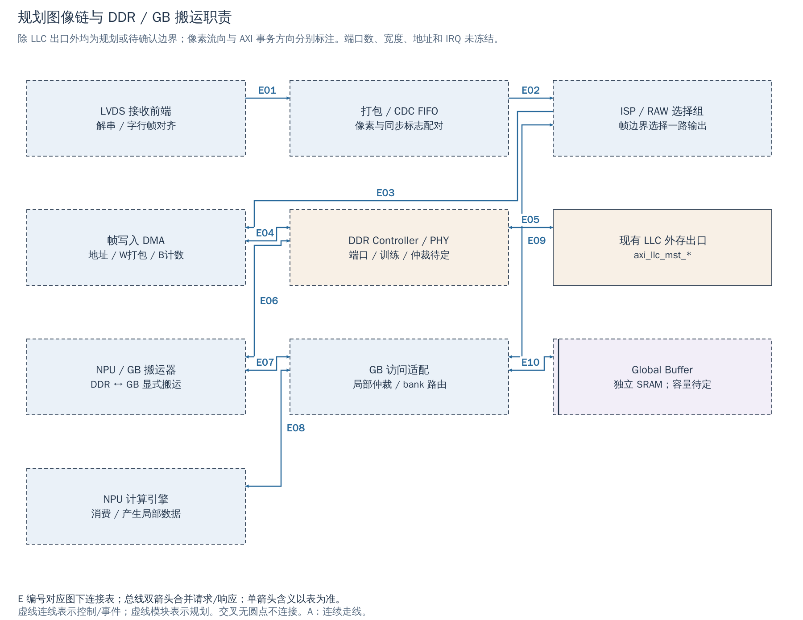

# 19 图像与 DDR 数据链：采集、帧写入和 NPU 搬运的分工

[返回统一入口](README.md)

图像采集不是一次普通的“内存复制”：LVDS 接收器面对持续到来的引脚数据，帧写入器把像素组织成 AXI 写事务，NPU 搬运器又把已经存入 DDR 的块搬到计算工作区。三者的时序、错误和完成条件不同，因此需要分别规定接口。

本章解释规划链路中必须落实的模块职责。**LVDS、ISP、NPU、帧写入 DMA、独立 Global Buffer 及新的 DDR 合流，目前都没有在 `cheshire_soc` 中实现。** 图中仅 LLC 外存出口是当前已有接口；其余是规划结构或待供应商确认的边界。地址、寄存器号、IRQ 号和厂商端口数均未在本章冻结。

## 当前 DDR 接口究竟到哪里

SoC 提供 `axi_llc_mst_req_o / axi_llc_mst_rsp_i`，包含 AXI 请求与响应，不直接包含 DDR DQ/DQS 引脚。当前 FPGA 在外层通过 `dram_wrapper_xilinx` 接 Xilinx MIG：数据位宽转换 → ID 转换 → AXI CDC → MIG 的 AXI 端口与物理引脚。VCU118 分支的 AXI 数据宽度配置为 512-bit；这既不是 SoC 的 64-bit 数据宽度，也不是未来外购 IP 的既定宽度。

用户已确认外购 DDR 可以提供 **AXI4 版本**，故不再默认添加 AXI3 桥。控制器负责 AXI 请求到存储命令的处理与调度，PHY 负责与实际 DDR 器件的物理传输和训练相关接口；两者可能是配套交付，也可能需要明确分工。当前仓库没有足以替代供应商接口包的 ASIC DDR/PHY 集成实现。

图聚焦“谁产生请求、谁处理流、谁保存数据”，省略 CPU 和外设全景。AXI 箭头以 master 发起事务的方向为准，读数据及 B/R 响应返回；像素箭头表示像素数据方向；GB 双向线只表示本地读写能力，具体 SRAM 端口和仲裁尚待设计。

[SVG](../diagrams/2026-10-13_rtl_module_comparison/A/19_ddr_lvds_pipeline.svg) · [PDF](../diagrams/2026-10-13_rtl_module_comparison/A/19_ddr_lvds_pipeline.pdf) · [A/C 对比](../diagrams/2026-10-13_rtl_modules_native_c/index.html#19_ddr_lvds_pipeline)

<!-- CONNECTIONS:19_ddr_lvds_pipeline -->

### 图中连线与信号组

编号仅在本图内有效。总线双箭头合并请求与响应；单箭头表示表内说明的主数据、控制或逻辑方向，握手返回不能据箭头省略。A/C 均以连续连线表达连接，编号只用于查表。源码依据见本章代码对应。

| 连线 | 端点与方向 | 信号、用途和需要保留的约定 |
|---|---|---|
| E01 | LVDS 接收前端 → 打包 / CDC FIFO | 规划/待确认连接：规划接收数据和字/行/帧状态成组交付打包与跨域；传感器协议、lane 组织和背压能力待确认。 |
| E02 | 打包 / CDC FIFO → ISP / RAW 选择组 | 规划/待确认连接：规划从 FIFO 向 ISP/选择组交付 RAW；组内可经 ISP 或 RAW 旁路，在帧边界选择；不是同时输出两路。 |
| E03 | ISP / RAW 选择组 → 帧写入 DMA | 规划/待确认连接：规划把选定的一路 RAW 或 ISP 结果交给帧 DMA；格式、有效字节和丢帧标志须明确定义。 |
| E04 | 帧写入 DMA ↔ DDR Controller / PHY | 规划/待确认连接：帧 DMA 作为 master 产生 AW/W，DDR 端返回 B；完成需等待该帧相关响应并处理错误。所需适配与目标端口待定。 |
| E05 | 现有 LLC 外存出口 ↔ DDR Controller / PHY | 规划/待确认连接：已有 axi_llc_mst_req_o/rsp_i 拟接新的 DDR 合流/控制器端口；当前 FPGA 实际连接是 dram_wrapper_xilinx/MIG。 |
| E06 | NPU / GB 搬运器 ↔ DDR Controller / PHY | 规划/待确认连接：NPU/GB 搬运器作为 DDR master；绕过 LLC。是否与独立 NPU master 合流、是否需要额外端口尚待确定。 |
| E07 | NPU / GB 搬运器 ↔ GB 访问适配 | 规划/待确认连接：搬运器将 DDR 返回写进 GB，或从 GB 读出再写 DDR；本地接口协议/位宽尚未冻结。 |
| E08 | NPU 计算引擎 ↔ GB 访问适配 | 规划/待确认连接：NPU 计算引擎经局部适配访问 GB；与搬运器竞争 bank/端口，不能将逻辑双向线理解成无限带宽。 |
| E09 | ISP / RAW 选择组 ↔ GB 访问适配 | 规划/待确认连接：规划保留 ISP 工作区访问 GB 的候选；是否需要、接口和并行能力取决于算法及 bank 预算。 |
| E10 | GB 访问适配 ↔ Global Buffer | 规划/待确认连接：规划把多个局部访问者仲裁到实际 SRAM bank/端口；SRAM 延迟、掩码、容量与冲突语义待定。 |

<!-- /CONNECTIONS -->

## LVDS 接收、跨域与 ISP 分别解决什么问题

**LVDS 接收前端**首先解决差分电气输入、采样、解串以及训练/字对齐，再按传感器协议恢复像素、行界和帧界。LVDS 只描述一类物理接口，不能从名称推出 lane 数、每像素位数、同步码或数据排列；这些必须来自实际传感器和接收 IP 规格。普通 GPIO 同步器不能替代高速解串接收器。

**像素打包与 CDC/FIFO**把接收域的数据组织成后续可处理的单元，并保存属于同一数据的行/帧标志。若数据与帧标志分别无握手跨域，就可能在输出侧错误配对。异步 FIFO 需要明确每个条目的像素数、有效字节和标志；具体采用哪个库模块和深度尚未确定。

接收端是否能背压尤其关键。即使 FIFO 输出采用 ready/valid，上游传感器也未必能在当前行暂停发送；此时 FIFO 满不能简单靠 `ready=0` 解决。必须规定最大连续输入率、最长下游无服务时间、溢出检测、坏帧作废与下一帧重新同步。平均帧率满足 DDR 带宽，不保证短时服务间隔足够。

**ISP**处理像素，按算法保留必要的行缓冲或访问规划中的工作存储；RAW 旁路与 ISP 输出应在明确的帧边界选择，避免一帧前半段 RAW、后半段处理结果。图将 ISP 和帧边界选择画成一个功能组；它不是现有 RTL 实例，也没有暗示 RAW/ISP 已支持同时录制。若未来要同时存两路，需增加帧写入上下文或独立写入器及相应带宽预算。

## 帧写入 DMA 如何把像素变成 AXI 写

帧写入器是规划新增的流到内存模块，其核心职责至少包括：

1. 从帧配置得到 buffer 基址、每行有效字节、行数及 stride（相邻行起点的字节间距）。这些是建议的配置语义，不是已有寄存器名。
2. 将像素打包为 AXI W beat，按尾部有效字节形成 WSTRB；按目标支持的长度和 4 KiB 边界生成 AW burst、WLAST。
3. 在 AW/W 各自停顿时保持地址与数据的对应，计数已发和已完成的写事务；不能因为 AW 已发出就丢弃对应像素。
4. 收集每个 B 响应、设备溢出和格式错误，形成这一帧的最终状态与实际写入范围。

**收到输入帧尾并不等于帧写完 DDR。** 正常完成至少要求该帧全部预期输入已接收、相关 AXI 写已按契约完成，且没有使该帧无效的错误。是否允许其他端口立刻读取，还需 DDR 子系统对跨端口顺序和可见性的保证，不能单凭中断到达判断。

帧写入器通常只需要 AXI 写数据面，配置口完全可以是 32-bit Regbus。若厂商已有 AXI4/AXI-Lite 配置口，则按其真实接口接入或桥接；“DMA 数据口用 AXI4”不要求“配置口也必须用 AXI4”。完整 Regbus 接法见 [00 章](00_regbus.md)。

## 系统 iDMA、NPU 搬运器和 Global Buffer 不互相替代

| 对象 | 它负责的工作 | 本工程的状态与边界 |
|---|---|---|
| Cheshire iDMA | 从可寻址 source 读内存，再向可寻址 destination 写内存；可配置 1D/2D | RTL 已有，控制窗口直接挂 AXI；内部仍有寄存器前端。现有控制位宽和错误处理缺口见 [14 章](14_idma.md)；不能直接当成已实现的像素流采集器 |
| 帧写入 DMA | 消费像素流、生成地址/stride/AXI 写、判断一帧是否有效 | 规划新增；需要行帧语义、溢出/背压及写响应管理 |
| NPU / GB 搬运器 | DDR↔GB 的块搬运，服务权重、输入、激活和回写 | 规划新增；可能为 NPU 自有引擎或独立模块，需明确命令接口、局部端口和完成语义 |
| NPU 计算引擎 | 从局部工作区取数并计算 | 规划新增；计算完成不自动代表所有输出已回写 DDR |
| 独立 Global Buffer（GB） | 片上 SRAM 工作存储，供 NPU/Ara 等访问 | 用户已确认独立存储方向；容量、bank、读写端口、时钟和仲裁待定；不是 LLC/SPM 别名 |

当前候选三路 DDR 分组是：SoC/LLC 出口、统一的 NPU/GB 搬运出口、图像帧写入口。只有 NPU 与 GB 确实共用一个 DDR 发起端时，才能按这三路讨论；若保留独立 NPU master 和 GB DMA，必须保留额外通路或显式合流，不能在图中删掉一条需求。

供应商多 AXI 端口不等于拥有独立的 DDR 物理带宽。端口仲裁后仍会竞争 bank、读写切换、刷新和总线资源。NPU 发起端的 256-bit 需求也不能直接当成 DDR DQ 宽度、厂商 AXI 端口宽度或 GB 原生 SRAM 端口宽度。

## 运行一帧前，软硬件需要共同完成什么

以下为后续集成的建议流程，尚无本工程实现或测试用例可证明完成：

1. 启动阶段确认 DDR ready、控制口可访问和数据域复位完成；为每个 buffer 记录容量、布局、缓存属性和当前拥有者。
2. 软件选择空闲 buffer，配置地址/尺寸/stride、任务或帧身份，清理旧状态，再在允许的帧边界启用采集。
3. 接收与写入硬件记录格式、FIFO 溢出、AXI 错误；错误帧不得只因为收到了帧尾就通知消费者为正常数据。
4. 写入器确认这一帧完成后发布状态/IRQ；软件核对身份和状态，并按共享区协议建立可见性，再移交给 NPU 搬运或其他消费者。
5. 搬运器把需要的块装入 GB；在完成和所有权确认之后启动 NPU/Ara。消费者释放后才允许下一帧复用同一块存储。

复位或超时应另走终止流程。只有确认旧任务不会继续写入，才能回收 buffer；中断清除、停止发命令和 buffer 释放不能视为同一件事。所有权与 CPU/Ara 属性见 [20 章](20_accelerator_memory.md)。

## 仍需 IP 资料回答的问题

| 所需信息 | 影响的工程判断 |
|---|---|
| DDR Controller/PHY 配对版本、端口数、AXI 宽度/ID/在途/子集、控制接口 | 采用供应商多口还是外部互联，DW/ID/CDC 放在哪里，哪些地址/访问合法 |
| DDR 初始化、训练、BIST、ready/error、复位恢复及跨端口可见性 | 启动何时能访问 DDR，何时可以发布帧完成，失败怎样恢复 |
| LVDS 协议、lane/像素组织、持续峰值、能否暂停、同步/训练方法 | 接收器、打包、CDC 条目格式、FIFO 容量和坏帧策略 |
| ISP 输入输出布局、行缓冲需求、延迟、背压、RAW 选择语义 | 帧边界切换、stride、缓存大小和重叠运行条件 |
| NPU/搬运器端口、tile 大小、GB 容量/bank、最小服务保证 | 是否共用 DDR 口，计算与搬运能否双缓冲并行，Ara 如何分享 GB |

详细数值填写和验收沿用 [IP/DDR 契约第 4–9、12 节](../engineering/IP_DDR_Interface_Contract.md)，不在这里复制第二份地址/参数表。带宽须分别统计 DDR 读写、GB 本地访问和各阶段峰值；理论峰值不能代替持续吞吐或最长无服务间隔。

## 代码与资料对应

| 本章边界 | 来源与可搜索符号 |
|---|---|
| 当前仅一个 SoC LLC 外存出口 | [cheshire_soc.sv](../../hw/cheshire_soc.sv)，`axi_llc_mst_req_o`、`gen_llc`、`gen_llc_bypass` |
| 当前 FPGA DDR 适配实例 | [dram_wrapper_xilinx.sv](../../target/xilinx/src/dram_wrapper_xilinx.sv)，`TARGET_VCU118`、`i_axi_dw_converter`、`i_axi_iw_converter`、`i_axi_cdc_mig`、`init_calib_complete` |
| 系统 iDMA 与其限制 | [cheshire_idma_wrap.sv](../../hw/cheshire_idma_wrap.sv)，`idma_backend_rw_axi`、`idma_reg64_2d`、`ErrorCap`；[14 章](14_idma.md) |
| 当前未有 Ara→GB 分流 | [cheshire_soc.sv](../../hw/cheshire_soc.sv)，`i_ara_axi_inval_filter`→`i_ara_axi_dw_converter`→`AxiIn.ara` |
| 已确认需求、规划和验收责任 | [IP/DDR 契约](../engineering/IP_DDR_Interface_Contract.md)，第 7、8、12 节；[ASIC 适配](../engineering/ASIC_Adaptation_and_Evidence.md) |

本章不把候选图作为现有 netlist 或运行证明。没有新增 DDR/IP 实例、驱动、地址、仿真或板测结果。
