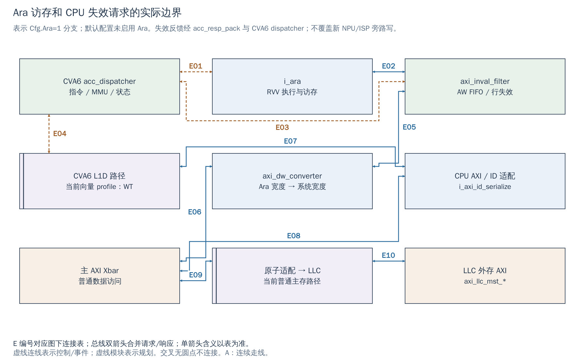

# 20 CPU、Ara 与新加速器：访问属性和共享数据交接

[返回统一入口](README.md)

共享一个地址并不保证共享同一时刻的数据。新 NPU/ISP 接入后，必须分别回答：CPU 用什么属性访问、Ara 或 DMA 走哪条路径、数据最后停留在哪一层，以及谁有权继续写这个 buffer。本章解释这些问题在当前 RTL 中分别由哪里决定。

## 先区分 Ara 和外部 NPU 的控制方式

Ara 是挂在 CVA6 向量执行接口上的 RVV 加速器：CVA6 通过 `acc_req/acc_resp` 交换指令执行、状态及 MMU 相关信息；Ara 的 load/store 再通过独立 AXI master 访问数据。软件使用向量指令，并不是向一个虚构的 Ara MMIO “START 寄存器”写任务。

计划中的 NPU 则需要自己定义配置/任务接口和数据 master，通常由 CPU 经 MMIO 提交任务、通过状态或 IRQ 回收结果。它不会因为也叫加速器就自动获得 Ara 的指令接口、地址转换或失效通路。NPU DMA 是否接收物理地址、地址宽度和允许窗口必须明确；当前 SoC 外部 AXI 端口没有自动添加 IOMMU 地址转换。

`DefaultCfg.Ara=0`；当前 VCU118 加源脚本选向量 CVA6 profile，并定义 `ARA/NR_LANES=2/VLEN=2048`。仿真配置数组提供编号 3 的 Ara 配置，但 fixture 默认编号 0；真正编译时还必须使 CVA6 profile、宏和 SoC Cfg 一致。以下图表示 **启用 Ara 时的已有 RTL 分支**，不是宣称所有默认运行都含 Ara。

当前该向量 profile 的 `CVA6ConfigDcacheType=config_pkg::WT`，即 write-through（写穿）D-cache。写穿不等于每次 CPU 写都已到 DDR：核心仍可能有待提交/待发写，后面也可能由 LLC 保存脏数据。后文提到“不同 profile 的脏行”是扩展时的核对项，不是在声称当前 L1D 使用 write-back。

图要回答两个问题：Ara 数据如何进入现有内存系统；失效请求究竟能观察哪一条写路径。它省略 cache 内部 hit/miss，保留与集成有关的命令、访存和失效接口。

[SVG](../diagrams/2026-10-13_rtl_module_comparison/A/20_accelerator_memory.svg) · [PDF](../diagrams/2026-10-13_rtl_module_comparison/A/20_accelerator_memory.pdf) · [A 图总览](../diagrams/2026-10-13_rtl_module_comparison/index.html#20_accelerator_memory)

<!-- CONNECTIONS:20_accelerator_memory -->

### 图中连线与信号组

编号仅在本图内有效。总线双箭头合并请求与响应；单箭头表示表内说明的主数据、控制或逻辑方向，握手返回不能据箭头省略。主图以连续连线表达连接，编号只用于查表。源码依据见本章代码对应。

| 连线 | 端点与方向 | 信号、用途和需要保留的约定 |
|---|---|---|
| E01 | CVA6 acc_dispatcher ↔ i_ara | CVA6 向 Ara 发送指令/相关 MMU 信息，Ara 返回执行状态；SoC 同时通过 acc_resp_pack 包装失效状态。 |
| E02 | i_ara ↔ axi_inval_filter | axi_ara_wide_req/rsp；默认按 32*AraNrLanes 决定数据位宽，2 lanes 为 64-bit。 |
| E03 | axi_inval_filter ↔ CVA6 acc_dispatcher | inval_addr/valid 经 acc_resp_pack.acc_resp 返回 CVA6；inval_ready/acc_cons_en 经 acc_req.acc_req 反馈到过滤器。并非直接额外 snoop 端口。 |
| E04 | CVA6 acc_dispatcher ↔ CVA6 L1D 路径 | CVA6 acc_dispatcher 转出 inval_addr_o/inval_valid_o 并接收 inval_ready_i；相应 D-cache 分支接收失效，必须匹配最终 profile。 |
| E05 | axi_inval_filter ↔ axi_dw_converter | axi_ara_wide_req_inval/rsp_inval 进入现有 DW 转换器；当前没有 GB 地址分流实例。 |
| E06 | axi_dw_converter ↔ 主 AXI Xbar | axi_ara_narrow_req/rsp 接主 Xbar 输入（可选 AXI RT 合并表示）；访问 LLC 地址仍走普通主存路径。 |
| E07 | CVA6 L1D 路径 ↔ CPU AXI / ID 适配 | L1D 属于 CPU 内部访存子系统，随 CPU AXI 汇合输出后由 i_axi_id_serialize 映射 ID；图省略 I-cache/MMU 等其他 CPU 请求源。 |
| E08 | CPU AXI / ID 适配 ↔ 主 AXI Xbar | 经核心用户信号分配与 ID serialize 的 CPU AXI 接入主 Xbar（可选 AXI RT 合并表示）。 |
| E09 | 主 AXI Xbar ↔ 原子适配 → LLC | axi_out_req[AxiOut.llc] 经 i_llc_atomics 与 cut 到 LLC；图合并已在16章展开的内部结构。 |
| E10 | 原子适配 → LLC ↔ LLC 外存 AXI | LLC miss/refill、evict/writeback 和旁路最终使用 axi_llc_mst_req_o/rsp_i；接入 AXI/LLC 不自动等于新设备缓存一致。 |

<!-- /CONNECTIONS -->

## 现有 Ara 失效过滤器能做什么

Ara 的 AXI 经过 `i_ara_axi_inval_filter`，再经 `i_ara_axi_dw_converter` 到 `AxiIn.ara`。数据宽度由 `32 × Cfg.AraNrLanes` 得到，2 lanes 时是 64-bit；主 Xbar 仍取 `Cfg.AxiDataWidth`。当前没有按 GB 地址分流的独立出口，4 lanes 或新 GB 路径也没有因此自动实现。

`axi_inval_filter` 监听**自己经过的 AW 写地址**：当 `en_i=acc_cons_en` 时，把已握手的写地址放入 FIFO，按 L1 cache line 范围生成 `inval_addr/valid`，等待 `inval_ready` 接收。其他 AXI 通道贯通；FIFO 满会对新的 AW 施加背压。SoC 把失效信息装入 `acc_resp_pack`，经 CVA6 的 accelerator dispatcher 送到相应 D-cache 路径。

这说明它是有明确位置和使能条件的失效机制。新增 DDR 旁路 NPU/帧 DMA 的 AW **不经过此过滤器**，其写入就不会自动触发这条 CPU L1D 失效请求。过滤器也不扫描所有 DDR 端口、不替 CPU 写回脏行、不让所有 LLC 数据同步更新。图中的失效反馈不应理解成全系统 snoop 总线。

本地官方 `arch.md` 提到 self-invalidation coherence；这个表述有其已有 CPU/cache 方案和访问路径前提。集成新的非一致性 master 时，要逐项核对最终 CVA6 cache profile、`acc_cons_en`、软件同步和新路径，不能直接把官方概述扩展为“NPU 已有硬件一致性”。

## 地址译码、PMA 和页表分别决定什么

PMA（Physical Memory Attributes，物理内存属性）描述物理地址的访问性质。当前 `gen_cva6_cfg()` 生成 non-idempotent、executable、cached 三组区域；它们不是 Xbar 的路由表，也不是 Linux 的虚拟内存映射。

| 层次 | 当前在哪里决定 | 对新 IP 的影响 |
|---|---|---|
| AXI / Reg 地址译码 | `gen_axi_out()`、`gen_reg_out()` | 地址请求实际到达哪个 slave；未映射访问不因 CPU 认为是 RAM 就自动存在 |
| CPU 物理属性 | `gen_cva6_cfg()` 的 `NonIdempotent* / ExecuteRegion* / CachedRegion*` | CPU 能否把该范围作为可缓存、可执行、可重复访问的存储；与副作用寄存器的语义不同 |
| CPU 虚拟地址与权限 | 具体程序/OS 的页表和特权配置 | CPU 的 VA 如何变成 PA、哪些代码能访问；不会自动给外部 DMA 安排相同转换 |
| LLC 缓存行为 | LLC 入口属性、cached region、SPM 分配及 bypass 路径 | CPU 不缓存某地址，不等于 LLC 必然也绕过；须检查实际到达 LLC 的事务与配置 |
| 设备发出的地址 | IP 命令/描述符与其地址生成器 | 必须约定物理范围、长度、对齐和边界；不能直接把普通进程指针交给无地址转换的 DMA |

默认外部片上区域 `0x2000_0000..0x8000_0000` 被 `Cva6ExtCieLength/OnTop` 切为一段 CIE 和一段非 CIE；CIE 表示 cacheable、idempotent、executable。`DefaultCfg` 令低侧 `0x2000_0000..0x4000_0000` 为 CIE，其余到 `0x8000_0000` 为非 CIE。它只是当前 CPU 属性分区，**不是已经分配给 NPU/GB 的地址**。

默认 `LlcOutRegionStart..End` 被加入 CPU cached region。若未来在同一 DDR 范围放不一致性 DMA buffer，需要制定能实际覆盖 CPU 和 LLC 的属性/维护方案；仅在驱动里写 `volatile` 或把设备接到另一个 AXI 端口没有改变这些硬件规则。

## LLC、SPM、GB 的保存位置不同

| 存储 | 内容在哪里 | 共享时要确认什么 |
|---|---|---|
| CPU 私有 cache | CPU 内部 cache line | 是否存在旧数据、待发写或该 profile 的脏行；需要的维护/等待操作是否真实可用 |
| LLC cache way | LLC SRAM 中的缓存副本 | 旁路 master 只访问 DDR 时，这里可能仍保留另一个版本；不能只处理 CPU L1 |
| Cheshire SPM | 分配为 SPM 的 LLC way | 显式片上存储容量和别名；启用/重分配方式见 [16 章](16_llc_spm.md)，不等于独立外部 SRAM |
| 新 Global Buffer | 规划的独立 SRAM bank | NPU/Ara/搬运器的可达路径、端口与 bank 冲突、所有权和地址；目前未实现 |
| DDR | Controller/PHY 后的外部存储 | 所有端口的写完成与可见性、初始化、缓存副本和共享原子观察范围 |

SPM 的 cached/uncached 别名最终指向同一物理 SRAM，不是两块 buffer。用 uncached 别名读取，不会自动把另一缓存别名的待写数据推进到 SRAM。新 GB 也不能让同一个物理地址在 CPU 看来是 DDR、在 Ara 看来却是另一块独立 SRAM；应为同一物理地址维持一致的存储含义，再决定哪些 master 可达。

## 一个可评审的 buffer 所有权流程

下面是给新增非一致性加速器的**建议契约**，并非当前驱动已实现的 API。首版可优先评估全路径不缓存的独立共享区，或已经逐层验证的缓存维护方案；二者都要配合明确的所有权。

1. **准备。** CPU 或驱动分配 buffer，记录实际物理地址、容量、布局与当前 owner。避免与 CPU 锁或普通对象共用可写回 cache line，也避免混用缓存/非缓存别名。
2. **CPU 交给设备。** CPU 完成输入/描述符写入，执行所选方案要求的等待、顺序和缓存维护，使设备将读到目标版本，然后写配置/doorbell。操作必须由当前 profile 和软件栈支持，不能只给一个泛化的 `flush()` 名字当作已实现。
3. **设备拥有。** 设备读取/更新该 buffer；CPU 不同时修改同一范围。计算结束、搬运结束和结果回写结束分别计数，以明确的任务身份返回状态。
4. **设备交给 CPU 或下一设备。** 确认任务真正完成及数据在约定共享点可见，检查错误，然后进行消费者侧所需的维护/顺序操作；最后移交读写权。
5. **回收。** 所有消费者释放，且不存在可能迟到的旧写，才能将地址复用于下一帧。超时、复位或错误帧走独立的作废流程。

CPU fence 用于相应访问的顺序约束；不能仅凭它的名字断言所有层的写回或失效已经完成，应核对当前 CVA6 的实际处理及 LLC/设备契约。中断说明发生了事件，也不是数据版本证明。AXI B 响应在具体目标接口表示写事务完成，跨 DDR 端口、cache 和 CPU 的完整可见性仍由系统契约保证。

## 原子操作的观察范围也会受旁路影响

现有 `axi_riscv_atomics_structs` 位于 LLC 上游，为该路径处理 AMO（原子读改写）及 LR/SC（保留加载/条件存储）。本地官方原子适配说明要求其下游具有相应独占或一致性条件。若新 NPU/ISP 在下游直接写 DDR，同地址写入可能不经过该观察点，不能假定 CPU 的 LR/SC 保留状态一定因此失效。

第一版若不需要设备参与共享锁/原子数据，建议明确禁止设备写 CPU 原子同步对象，只通过单独 MMIO、状态及所有权交接通信；如果确有共享原子需求，则必须重新设计观察范围并验证。具体约束见 [IP/DDR 契约第 6 节](../engineering/IP_DDR_Interface_Contract.md)。

## 代码对应与未验证事项

| 要核对的内容 | 工程来源与可搜索符号 |
|---|---|
| Ara 命令/失效包装与数据路径 | [cheshire_soc.sv](../../hw/cheshire_soc.sv)，`acc_resp_pack`、`AraDataWideWidth`、`i_ara_axi_inval_filter`、`i_ara_axi_dw_converter` |
| AW 观察与失效 FIFO | [axi_inval_filter.sv](../../.bender/git/checkouts/ara-2c7b103275a16c87/hardware/src/axi_inval_filter.sv)，`aw_fifo_push`、`inval_valid_o`、`aw_fifo_full` |
| CVA6 对失效请求的接收 | [acc_dispatcher.sv](../../.bender/git/checkouts/cva6-20c9d7cbe0dd6995/core/acc_dispatcher.sv)，`acc_cons_en_i`、`inval_valid_o`；[cva6.sv](../../.bender/git/checkouts/cva6-20c9d7cbe0dd6995/core/cva6.sv)，`inval_addr_i`、`inval_valid_i` |
| CPU 物理属性 | [cheshire_pkg.sv](../../hw/cheshire_pkg.sv)，`gen_cva6_cfg`、`NonIdempotentAddrBase`、`CachedRegionAddrBase` |
| LLC 及原子适配位置 | [cheshire_soc.sv](../../hw/cheshire_soc.sv)，`gen_llc_atomics`、`gen_llc`；[原子模块官方说明](../../.bender/git/checkouts/axi_riscv_atomics-40ad8d2d0e0daa8b/README.md) |
| 当前向量 profile 的 L1D 类型 | [cv64a6_imafdcv_sv39_config_pkg.sv:74](../../.bender/git/checkouts/cva6-20c9d7cbe0dd6995/core/include/cv64a6_imafdcv_sv39_config_pkg.sv#L74)，`CVA6ConfigDcacheType = config_pkg::WT` |
| 当前 FPGA 和仿真 Ara 选择 | [add_sources.vcu118.tcl](../../target/xilinx/scripts/add_sources.vcu118.tcl)，`cv64a6_imafdcv_sv39_config_pkg.sv`、`NR_LANES=2`；[tb_cheshire_pkg.sv](../../target/sim/src/tb_cheshire_pkg.sv)，`gen_cheshire_ara_cfg` |
| 当前向量 profile 的 D-cache 类型 | [cv64a6_imafdcv_sv39_config_pkg.sv](../../.bender/git/checkouts/cva6-20c9d7cbe0dd6995/core/include/cv64a6_imafdcv_sv39_config_pkg.sv)，`CVA6ConfigDcacheType=config_pkg::WT` |

本章静态核对不证明缓存维护 API、Ara/NPU 并发、GB 分流或旁路原子行为已验收。当前应优先冻结唯一 CPU/cache profile 和共享区契约，再用真实访问路径验证 CPU→设备、设备→CPU、设备→设备及错误回收四种交接。
