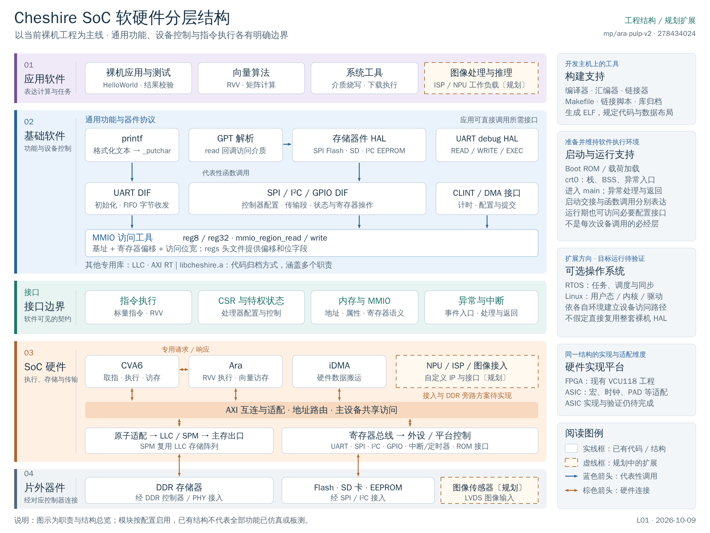

# 软硬件层次与工具索引

返回[软件参考手册](README.md) · [工程文档入口](../00_README.md)

按器件和接口逐项查型号、RTL、仿真及驱动，见[片外器件与接口实现参考](../EXTERNAL_DEVICES_AND_INTERFACES.md)。

本页将 Cheshire SoC 的分层结构对应到当前工程的源码、工具和脚本，供阅读代码和选择操作入口时查阅。分层原理见主教材[程序的组成、构建、启动与运行关系](../learning/runtime.html#software-stack)；具体编译参数、API 和调试命令分别见[构建手册](BUILD_AND_SDK.md)、[库接口参考](LIBRARIES.md)和[运行与调试](RUNTIME_AND_DEBUG.md)。

核对基准：2026-10-11，分支 `mp/ara-pulp-v2`，提交 `eaf55be17`。下表说明代码与规则的职责，不表示所列工具已在本机安装、全部配置已启用或流程已运行通过。

## 1. 层次、运行位置与开发工具

图为 2026-10-09 的结构快照；本页文件映射按上方基准重新核对。原图及可编辑文件见[图稿说明](../diagrams/2026-10-09_software_hardware_layers/README.md)。

| 图中区域 | 表达的职责 | 对应实体及运行位置 |
| --- | --- | --- |
| 应用软件 | 提出计算、测试或设备操作需求 | C/汇编源经编译后由目标 CVA6 执行；RVV 计算涉及 Ara |
| 基础软件 | 提供通用功能、器件协议和控制器接口 | printf、GPT、HAL、DIF、MMIO 工具等编入目标程序 |
| 软硬件接口 | 规定软件怎样使用处理器、存储和设备 | ISA、CSR、地址/寄存器语义、异常与中断；是接口契约，不是单独的软件模块 |
| SoC 硬件 | 执行指令、存储和搬运数据、连接外设 | RTL 在主机上仿真或综合，综合实现后成为 FPGA/ASIC 硬件 |
| 片外器件 | 提供外部存储和数据输入输出 | DDR、Flash、SD 卡等实体，经控制器及物理接口连接 |
| 构建支持 | 将源码变成程序和硬件配置 | Make、编译器、链接器、生成器在开发主机上运行 |
| 启动与运行支持 | 准备程序环境并处理运行中的事件 | Boot ROM、应用 crt0、异常入口等在目标端执行；主机加载器属于另一种角色 |
| 可选 OS 与实现平台 | 扩展执行环境，或选择硬件实现方式 | RTOS/Linux 属于目标软件环境；FPGA/ASIC 属于硬件实现维度 |

应用本身也是软件，图中将它与基础软件分开，是为了区分业务需求和公共支持。不同软件模块不必沿一条固定阶梯调用：普通 UART 输出为 `main → printf → _putchar → UART DIF → MMIO`，Flash 读取为 `应用/启动代码 → 器件 HAL → SPI DIF → MMIO`，应用也可直接调用 DIF。

`lib` 表示代码组织与复用形式，`.a` 表示静态归档文件。HAL、DIF、启动代码和通用函数都可以被归档进同一个库。`crt0`、编译器和链接脚本不属于每次设备操作都会经过的调用层。

## 2. 各层的源码与脚本对应

下表使用两个目录简称，均指当前本地依赖快照：

- **ARA**：[`.bender/git/checkouts/ara-2c7b103275a16c87`](../../.bender/git/checkouts/ara-2c7b103275a16c87)。
- **OTP**：[`.bender/git/checkouts/opentitan_peripherals-7b624fb57f78de9a`](../../.bender/git/checkouts/opentitan_peripherals-7b624fb57f78de9a)。

其他依赖的真实位置以 [Bender.local](../../Bender.local) 为准。目录名后缀不能单独当作上游 commit。

| 层次 / 模块 | 当前源码或文件入口 | 对应工具、脚本与用途 |
| --- | --- | --- |
| 应用：裸机与测试 | [sw/tests](../../sw/tests)，如 `helloworld.c`、`dma_2d.spm.c` | [sw/sw.mk](../../sw/sw.mk) 调用 RISC-V GCC 生成 ELF，随后由仿真或板级装载路径运行 |
| 应用：向量算法 | `ARA/cheshire/sw/src/`、`ARA/apps/`；[fmatmul_test_4x4.c](../../sw/tests/fmatmul_test_4x4.c) | [Ara 软件 Makefile](../../.bender/git/checkouts/ara-2c7b103275a16c87/cheshire/sw/Makefile) 添加 V 扩展及 lane/VLEN 宏，再调用 Cheshire 构建 |
| 应用：烧写与装载程序 | [flash.c](../../sw/boot/flash.c)、[zsl.c](../../sw/boot/zsl.c) | 编译为目标端程序；`flash_disk.sh` 与 GDB 脚本组织 flash 程序的加载和执行 |
| 基础软件：格式化与分区解析 | [printf.c](../../sw/deps/printf/printf.c)、[gpt.c](../../sw/lib/gpt.c) | 由 GCC 编译并链接进程序；没有单独的“printf 执行工具”或“GPT 运行服务” |
| 基础软件：器件/协议 HAL | [sw/lib/hal](../../sw/lib/hal)、[sw/include/hal](../../sw/include/hal) | 提供 Flash、SD、EEPROM、UART debug 等 C 接口，使用公共软件构建规则 |
| 基础软件：本地 DIF | [sw/lib/dif](../../sw/lib/dif)、[sw/include/dif](../../sw/include/dif) | UART、CLINT、DMA 等控制接口；DMA 部分实现位于头文件，随调用方编译 |
| 基础软件：OpenTitan DIF | [OTP 的 DIF 目录](../../.bender/git/checkouts/opentitan_peripherals-7b624fb57f78de9a/sw/device/lib/dif) | SPI、I²C、GPIO 等控制器接口，`sw/sw.mk` 纳入相关 C 源及 autogen 部分 |
| 基础软件：MMIO | [util.h](../../sw/include/util.h)、[mmio.h](../../.bender/git/checkouts/opentitan_peripherals-7b624fb57f78de9a/sw/device/lib/base/mmio.h) | `reg8/reg32`、`mmio_region_*` 最终通过 CPU 访存指令读写设备寄存器 |
| 基础软件：LLC / AXI RT | [axi_llc_reg32.c](../../.bender/git/checkouts/axi_llc-5fb8850caad4fcfa/sw/lib/axi_llc_reg32.c)、[axirt.c](../../.bender/git/checkouts/axi_rt-7cef46f372eaf0fb/sw/lib/axirt.c) | 专用配置接口，由 `sw/sw.mk` 与其他支持代码一起归档进 `libcheshire.a` |
| 接口：地址与寄存器 | [common.ldh](../../sw/link/common.ldh)、[params.h](../../sw/include/params.h)、[regs](../../sw/include/regs)、[硬件寄存器描述](../../hw/regs) | 链接器赋予地址符号；`regtool.py` 生成寄存器 C 定义与 RTL；MMIO 依据这些地址操作 |
| 接口：指令、CSR、异常 | [util.h](../../sw/include/util.h)、[encoding.h](../../sw/tests/encoding.h)、[crt0.S](../../sw/lib/crt0.S) | GCC/汇编器生成指令，objdump 检查机器码；GDB/仿真器检查目标状态 |
| SoC：处理器、互连、存储、外设 | [cheshire_soc.sv](../../hw/cheshire_soc.sv)、[cheshire_pkg.sv](../../hw/cheshire_pkg.sv)，以及本地 CVA6/Ara/AXI/LLC/iDMA 依赖 | Bender 组织清单；Questa/VCS 编译并仿真 RTL；Vivado 综合并实现 FPGA |
| 片外 DDR | [dram_wrapper_xilinx.sv](../../target/xilinx/src/dram_wrapper_xilinx.sv)、[impl_ip.tcl](../../target/xilinx/scripts/impl_ip.tcl) | Vivado 生成 FPGA DDR IP；仿真侧采用对应存储模型，可选 DRAMSys；不等于已接入采购的 ASIC DDR IP |
| 片外 Flash / SD / EEPROM | 器件 HAL、`flash.c`、[fixture](../../target/sim/src/fixture_cheshire_soc.sv) 和 [VIP](../../target/sim/src/vip_cheshire_soc.sv) | HAL 操作真实器件；主机烧写脚本组织下载，仿真通过器件模型/激励检查交互 |
| 图像输入、ISP、NPU | 规划中的自定义模块与软件接口 | 当前没有完整的本工程集成、驱动和验收脚本；图中虚线表示待实现 |

MMIO 是设备寄存器访问机制，只覆盖软硬件交互的一部分。普通计算通过指令执行，RAM 通过普通访存访问，CSR 通过对应指令操作。Ara 由 CVA6 的向量指令路径配合专用接口驱动，并有独立的 AXI 访存通路，不能统一画成由 MMIO 启动的外设。

## 3. 主机工具与开发流程

下表中的工具和脚本在开发主机运行，输出程序文件、仿真环境或 FPGA 配置。开源工程并不意味着全流程工具均开源：现有流程使用的 Vivado、Questa/ModelSim、VCS 属于商业工具。

| 环节 | 使用工具 | 本地规则 / 脚本 | 产物或作用 |
| --- | --- | --- | --- |
| 总体调度 | GNU Make | [Makefile](../../Makefile)、[cheshire.mk](../../cheshire.mk) | 串联软件、硬件生成、仿真准备与 FPGA 目标 |
| RTL 依赖与清单 | Bender | [Bender.yml](../../Bender.yml)、[Bender.lock](../../Bender.lock)、[Bender.local](../../Bender.local) | 解析依赖与目标选择，导出仿真/Vivado 加源脚本 |
| Ara 组合配置 | Make、Bender | [ARA/cheshire/Makefile](../../.bender/git/checkouts/ara-2c7b103275a16c87/cheshire/Makefile) | 选择向量 CPU profile、排除 first-pass decoder stub，并向清单传递 Ara/lane/VLEN 配置 |
| 编译、汇编与链接 | RISC-V GCC、GNU 汇编器/链接器 | [sw/sw.mk](../../sw/sw.mk)、[sw/link](../../sw/link) | `.c/.S → .o → .elf`，确定代码、数据和入口布局 |
| 库归档 | `riscv64-unknown-elf-ar` | `sw/sw.mk` 的 `libcheshire.a` 规则 | 将目标对象打包为静态库供链接使用 |
| 镜像转换与指令检查 | `objcopy`、`objdump` | `sw/sw.mk` 的 `.bin/.memh/.dump` 规则 | 从 ELF 生成二进制、内存初始化文件和反汇编 |
| 寄存器生成 | Python、OpenTitan `regtool.py` | `cheshire.mk` 的 `REGTOOL`、`sw/sw.mk` 的 `--cdefines` 规则 | HJSON → 寄存器 RTL、C 偏移和位字段；工具来自 register_interface 的 vendor 目录 |
| Boot ROM 生成 | GCC、objcopy、Python | [hw/bootrom](../../hw/bootrom)、[gen_bootrom.py](../../util/gen_bootrom.py)、`cheshire.mk` 的 Boot ROM 规则 | 启动源码 → ELF/BIN → `cheshire_bootrom.sv`；该目标独立于默认 all |
| RTL 仿真 | Questa/ModelSim 或 VCS；C++ 编译器 | [vsim 编译清单](../../target/sim/vsim/compile.cheshire_soc.tcl)、[vsim 启动](../../target/sim/vsim/start.cheshire_soc.tcl)、[VCS 启动](../../target/sim/vcs/start.cheshire_soc.sh) | 编译、展开并运行 `tb_cheshire_soc`；VCS 编译清单由 `cheshire.mk` 规则生成 |
| 仿真程序加载 | SystemVerilog VIP、C++ DPI | [vip_cheshire_soc.sv](../../target/sim/src/vip_cheshire_soc.sv)、[elfloader.cpp](../../target/sim/src/elfloader.cpp) | 解析 ELF 并按所选预加载方式装载程序；VIP 包含 JTAG/UART 交互客户端 |
| FPGA IP 与实现 | Vivado | [xilinx.mk](../../target/xilinx/xilinx.mk)、[impl_ip.tcl](../../target/xilinx/scripts/impl_ip.tcl)、[impl_sys.tcl](../../target/xilinx/scripts/impl_sys.tcl)、[VCU118 加源脚本](../../target/xilinx/scripts/add_sources.vcu118.tcl)、[约束](../../target/xilinx/constraints) | 生成 IP，综合、布局布线，输出 bitstream、调试信息和报告 |
| FPGA 配置与板载存储编程 | Vivado Hardware Manager / Hardware Server | [program.tcl](../../target/xilinx/scripts/util/program.tcl)、[flash.tcl](../../target/xilinx/scripts/util/flash.tcl) | 配置 FPGA；按脚本支持的板型编程存储器。两种操作的输入和目的不同 |
| 板级调试与目标端烧写 | OpenOCD、RISC-V GDB、Bash | [openocd.common.tcl](../../util/openocd.common.tcl) 及板级配置、[flash_disk.sh](../../util/flash_disk.sh)、[flash_disk.gdb](../../util/flash_disk.gdb) | 经 JTAG 装载烧写 ELF 与镜像，设置参数，再让目标端 `flash.c` 操作介质 |
| Linux 软件栈构建 | Make、CVA6 SDK、Buildroot 和相应交叉工具链 | [Ara 的 cva6-sdk.mk](../../.bender/git/checkouts/ara-2c7b103275a16c87/cheshire/sw/cva6-sdk.mk) | 组织工具链、内核、固件与用户空间相关构建；现有源码和配方不等于当前平台启动通过 |
| 设备树与 Linux 磁盘镜像 | `dtc`、`sgdisk`、`dd` | [sw/boot](../../sw/boot) 中的 DTS、`sw/sw.mk` 的 Linux GPT 规则 | DTS → DTB；将 ZSL、DTB、外部 SDK 固件与内核产物组织成 GPT 镜像 |

根 `sw/deps/cva6-sdk/` 当前主要保存已有镜像，完整 SDK 源码入口位于 Ara 的集成目录。根 `sw/sw.mk` 的通用 GPT 测试镜像规则已注释，但 Linux GPT 规则仍存在，不能将两者概括为“GPT 构建全部停用”。

当前 UART debug 目标实现位于 HAL，仿真客户端位于 VIP。不能据此假定仓库已有适配当前板卡的通用 Python UART 下载器。`flash_disk.sh` 走 OpenOCD/GDB/JTAG 路径，也不是 UART 下载脚本。

## 4. 启动、操作系统与实现平台

| 对象 | 实体入口 | 所处阶段与当前边界 |
| --- | --- | --- |
| Boot ROM | `hw/bootrom/cheshire_bootrom.S/.c` 及生成的 SV ROM | 目标复位后的早期固件，按配置和启动模式工作 |
| 应用启动支持 | `sw/lib/crt0.S` | 建立应用栈、BSS、异常入口等，再调用 main；不属于每次 HAL 调用的前置函数 |
| 链接布局 | `sw/link/common.ldh`、`spm.ld`、`dram.ld`、`rom.ld` | 构建阶段的输入文件；目标 CPU 不执行链接脚本 |
| 裸机异常处理 | `crt0.S` 的 `_trap_handler_wrap`、`trap_vector` | 属于目标运行支持；当前默认入口不能视为完整 RTOS 上下文切换实现 |
| RTOS | 主教材[RTOS](../learning/rtos.html) | 教学与移植方向已有说明，当前平台尚无已交付并验收的 RTOS port |
| Linux | Ara 集成中的 CVA6 SDK、Linux/OpenSBI 等源码和构建规则 | 建立用户态/内核及自身驱动路径，不能默认将用户程序直接接到裸机 HAL；目标运行仍待验收 |
| FPGA | `target/xilinx/` | 已有 VCU118 工程及用户报告的 HelloWorld 结果；更多外设、Ara、DDR 功能分别验证 |
| ASIC | [提取规格](../02_Cheshire_Ara_ASIC_Extraction_Handoff.md)、[ASIC 适配参考](../engineering/ASIC_Adaptation_and_Evidence.md) | 固定配置独立工程和实际工艺流程待实施；不能把 FPGA 脚本当作可直接使用的 ASIC 流 |

FPGA/ASIC 是硬件实现方式，DDR/Flash 等是连接对象；两者属于不同分类。已有 Vivado DDR IP 不代表已经集成计划采购的 ASIC AXI4 DDR 控制器/PHY。

## 5. 操作入口与使用条件

| 要完成的工作 | 首先阅读 | 需要确认的条件 |
| --- | --- | --- |
| 编译一个裸机程序 | [工具链、SDK 与编译](BUILD_AND_SDK.md) | ISA/ABI、链接模式、有效存储、库对象是否来自一致配置 |
| 修改 HAL/DIF 或访问寄存器 | [库接口参考](LIBRARIES.md)、对应 IP 的 RTL/寄存器描述 | 外设型号、访问宽度、寄存器副作用及初始化条件 |
| 编译与运行 RVV 程序 | Ara 软件 Makefile、[RVV 编程](../learning/vector.html#programming) | 向量 CPU profile、Ara 参数与软件 V 扩展分别匹配；首条指令前的 VS/FS 状态 |
| 装载、调试或烧写 | [运行与调试](RUNTIME_AND_DEBUG.md) | 板型、JTAG/UART 路径、地址与镜像格式；烧写还需确认目标介质 |
| 运行 SoC 仿真 | 仿真启动脚本、[运行验证](../learning/simulation.html) | RTL profile、SELCFG、加载模式、模型与 ELF 一致；生成清单不等于已运行 |
| 重建 FPGA | `target/xilinx/xilinx.mk` 与 Ara 集成 Makefile | Vivado 路径、板型、加源脚本、IP 和约束一致 |

软件构建生成 ELF，RTL 仿真检查硬件模型，FPGA 实现生成 bitstream，这三条流程有不同产物和验收证据。脚本还可能更新清单、复制或删除测试源：例如 Ara 软件入口包含这类操作，不应把所有 Makefile 目标视作只读查询。

根软件规则默认 ISA 不带 V；Ara 软件入口另加 V。CPU profile、SoC/Ara 使能和软件编译选项不会自动相互补齐。DMA 相关运行仍须核对[已记录的控制接口门槛](../learning/peripheral-debug.html#dma)。

Bender 在本页用于解释现有工程。后续固定配置仍按已确认方向迁移到独立目录和静态清单；`.bender/` 是受版本管理的依赖源码与本地修改，不作为可随意清理的缓存。
