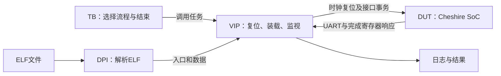
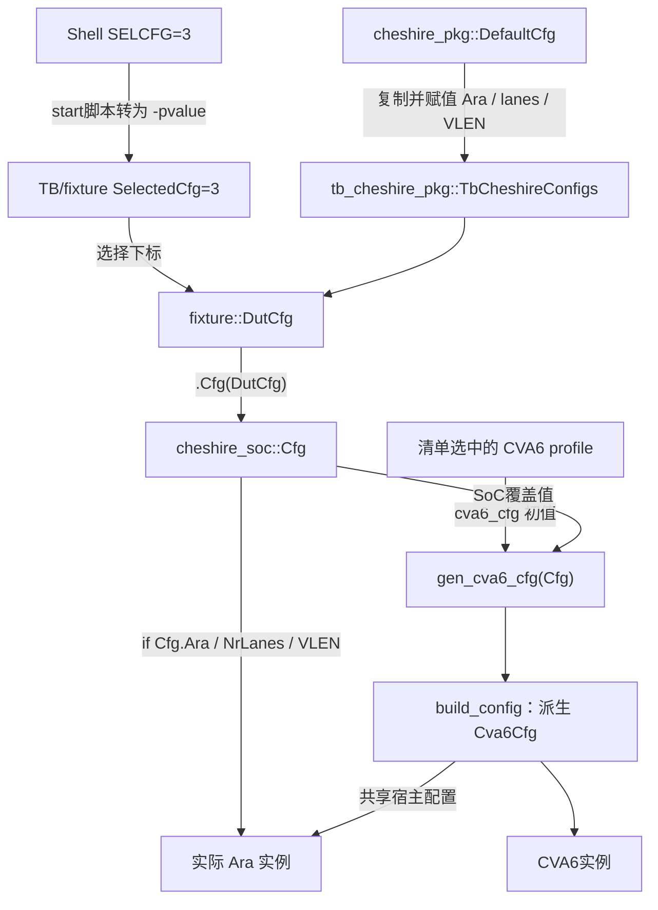

# 服务器参考工程使用与仿真上手指南

更新：2026-10-19，第7章补充波形采集与验证/Debug效率取舍：普通回归默认不采集，启用波形后默认全程记录指定层次；全层次、数组和限定窗口按需增加。沿用官方入口，不默认手动链接PLI。以服务器 `~/CheshireAraPULP` 和官方 `fmatmul` 为主线；通过 VNC Viewer 使用服务器桌面中的 Verdi。

**先重建，再使用：**安装与重建见[重建速查](../maintenance/E01/planning/server_reference_rebuild_guide.md)；本页解释日常使用。原理深入阅读链接已有教材，不要求先读完整套教材。本页命令由用户分步执行，Agent核查输出；不要把所有代码块连续粘贴运行。

| 基准 | 本页依据 |
| --- | --- |
| Cheshire | `e040b7bbc7851a37faff3c4657ff8d656cc6e20a` |
| Ara / CVA6 | `2895ba907e9eb14b3464609dc791a969d159a7c3` / `99eac9a649001bdf5b8f9da52e0ca73d5c48db1c` |
| 硬件 | `cv64a6_imafdcv_sv39`，Ara开启，2 lanes，VLEN=2048，`SelectedCfg=3`，`UseDramSys=0` |
| 工具 | RISC-V GCC 13.2.0；本机 G++ 13.3.1；VCS/Verdi W-2024.09-SP1 |
| 已有证据 | [核查报告](../maintenance/E01/reports/reference_rebuild_check.md)及[范围对比](../maintenance/E01/reports/local_server_build_comparison.md)：2026-10-18已核查修正FS后的单个32×32 fmatmul运行成功；完整RVV验收未完成 |
| 本页验证状态 | 2026-10-19已核查普通fmatmul通过；波形版原Tcl在0ps报错，现改用原生UCLI `dump`并完成独立20μs短测：FSDB生成、读取及时钟/复位变化已验证。完整波形版fmatmul、Verdi GUI及新增练习仍待实测，详见[E01交接](../handoffs/E01_fixed_vector_extraction.md) |

本地工作区有历史修改，服务器从上述固定版本恢复，两者不可混用。以下服务器源码路径均相对于 `CHS_ROOT` 或 `ARA_ROOT`；本地链接仅供导航，遇到差异以服务器固定版本为准。`~/CheshireAra` 的独立提取尚未验收，不是本教程运行目录。

## 阅读路线

**短时间上手只读[第0节](#quick-workflow)，运行后需要看波形时再读[第7章](#waves)。** 不必先读完参数表。下面第1—4章解释内部机制，第6章讲软件修改，第8章供排障；第0节的文件内容只需保存一次，后续不再向终端粘贴长参数串。

0. [文件配置与官方脚本](#quick-workflow)：先按此完成普通向量仿真。
1. [工程全貌与目录](#project)：先找到文件。
2. [一次仿真的输入与输出](#io)：知道每步在做什么。
3. [仿真平台设计](#platform)：读懂测试平台如何驱动SoC。
4. [RTL配置如何生效](#config)：分清编译、展开和运行配置。
5. [仿真脚本组织](#scripts)：运行现有ELF，保留完整结果。
6. [软件与向量测试](#software)：读懂并修改 `fmatmul`。
7. [VNC下查看波形](#waves)：采集有限信号，定位真实事务。
8. [实操练习与排障](#practice)：逐步练习，遇到问题再查。

<a id="quick-workflow"></a>

## 0. 快速上手：四项配置，两个官方入口

前提：服务器参考工程已完成重建，已有正确向量清单和修正FS后的`fmatmul.spm.elf`。工具环境沿用[重建速查第2节](../maintenance/E01/planning/server_reference_rebuild_guide.md#2-准备工具环境)，其中已设置`CXX/CXX_PATH`，这里不重复填写工具路径。

官网步骤短，是因为两个官方脚本已经封装了编译、展开和运行参数。本节只把所需的运行设置从终端移到启动脚本里；需要查看波形时再读[第7章](#waves)。

### 0.1 准备与备份

在服务器终端进入官方运行目录：

```bash
cd "$HOME/CheshireAraPULP/target/sim/vcs"
```

编辑前备份原启动脚本及需要保留的已有产物到未使用的目录；原成功/失败测试目录保持不动。官方入口会覆盖同名日志和仿真产物，重跑前先保存需留存的结果，不在同一目录并发运行。以下修改以原官方脚本为对照；若已应用旧版指南，先对照自己的备份撤回旧版新增配置与执行逻辑，再做下面的改动，不叠加两套方案。

### 0.2 编辑启动脚本：只设四项参数

编辑`start.cheshire_soc.sh`，在版权头之后、`TESTBENCH=tb_cheshire_soc`之前插入：

```bash
BINARY="../../../sw/tests/fmatmul.spm.elf"
BOOTMODE=0
PRELMODE=1
SELCFG=3
```

前三项对应官方示例：选择程序，经Serial Link预加载。第四项选择开启Ara的SoC配置。**`SELCFG=3`不会替换CPU profile**；已有清单仍须是`cv64a6_imafdcv_sv39`、Ara decoder、2 lanes/VLEN2048。

在上述配置之前额外加入这一行：

```bash
set -e -o pipefail
```

它使展开失败或日志管道失败时立即停止，避免继续运行旧`simv`。其余官方代码保持原样，不重写执行末尾，也不增加自动生成哈希或状态文件的逻辑。

### 0.3 编译、运行与判断

仍在`target/sim/vcs`，分步执行，上一条成功后才执行下一条：

```bash
bash compile.cheshire_soc.sh
bash start.cheshire_soc.sh
```

`compile`编译RTL；`start`展开、DPI联编并运行。仅换兼容ELF时修改`BINARY`，只执行`start`即可，接受它原有的展开检查。使用`bash`执行，无需修改原文件中被注释的解释器声明，也不要用`source`启动。

结果看`elaborate.log`和`simulate.log`。fmatmul应加载所选ELF，出现`Verifying result...`、`Passed.`和`[SLINK] SUCCESS`，并且没有未解释错误；命令结束后可立即用`echo $?`查看主机退出状态。退出0不能单独证明目标程序正确。若展开失败，旧`simulate.log`不是本次结果；官方`tee`只记录stdout，终端出现的stderr报错也需保留。

需要有限时验收时，沿用[重建速查第4节](../maintenance/E01/planning/server_reference_rebuild_guide.md#4-小程序编译与首次仿真)的限时执行命令，不在脚本中增加限时变量。历史fmatmul成功不替代本次运行检查；详细配置来源留到[第4章](#config)按需查阅。


<a id="project"></a>

## 1. 工程全貌与目录

**本节问题：我要改软件、查RTL、看日志，分别去哪里？** 对应入口为根 `Makefile`、`cheshire.mk`、`sw/sw.mk` 和 Ara 的 `cheshire/Makefile`。

```text
CheshireAraPULP/
├── Makefile / cheshire.mk      根入口、依赖路径及生成规则
├── Bender.yml / Bender.lock    源文件选择规则 / 锁定依赖版本
├── .bender/git/checkouts/      Ara、CVA6、AXI、LLC等依赖源码
├── hw/                        SoC、配置包、wrapper、寄存器、Boot ROM
├── target/sim/
│   ├── src/                   TB、fixture、VIP、ELF DPI loader
│   ├── models/                NOR Flash、EEPROM仿真模型
│   ├── vcs/                   生成清单、启动脚本及已有VCS产物
│   └── vsim/                  Questa脚本；本指南不以其作为操作主线
├── sw/
│   ├── include/               配置、寄存器定义、驱动声明
│   ├── lib/                   crt0、驱动实现及libcheshire.a
│   ├── link/                  链接脚本，规定程序的地址布局
│   ├── tests/                 根工程测试、复制的向量头文件及构建产物
│   └── deps/printf/           裸机printf实现
└── _e01/                      本项目证据和独立练习输出；非官方源码目录
```

`.bender` 在这里承载依赖源码，不是可随意删除的缓存。Ara测试的原始C文件位于 `$ARA_ROOT/cheshire/sw/src/`；官方整套软件规则会临时复制它们到根 `sw/tests/`，构建后删除这些C副本。因此，根目录有 `fmatmul.spm.elf` 而没有 `fmatmul.c`，不一定是缺文件。

在服务器 **Bash** 中先设置路径；这里只定位已有检出，不联网更新依赖：

```bash
export CHS_ROOT="$HOME/CheshireAraPULP"
export ARA_ROOT="$CHS_ROOT/.bender/git/checkouts/ara-2c7b103275a16c87"
test -f "$ARA_ROOT/cheshire/sw/src/fmatmul.c"
git -C "$CHS_ROOT" rev-parse HEAD
git -C "$ARA_ROOT" rev-parse HEAD
ls "$CHS_ROOT/target/sim/src"
```

该依赖目录名是当前已核对的路径。换了检出目录时应重新定位，不能随意替换为另一个Ara版本。后续示例沿用这两个变量；新终端需重新设置。

**检查点：**能指出 `fmatmul.c` 是输入、ELF是软件产物、`simv` 是主机上的硬件仿真可执行程序、`simulate.log` 是一次运行的输出。生成文件要回溯生成入口；不以手改生成清单作为长期维护方法。

<a id="io"></a>

## 2. 一次仿真的输入与输出

**本节问题：软件、RTL和仿真器怎样合到一起？** 对照 `sw/sw.mk`、`target/sim/vcs/compile.cheshire_soc.sh` 和 `start.cheshire_soc.sh` 阅读。

| 阶段 | 输入 | 执行者 | 输出 |
| --- | --- | --- | --- |
| 软件编译/链接 | C/汇编、头文件、库、链接脚本、ISA/ABI | RISC-V GCC及链接器 | `.o`、`.elf`，可另生成 `.dump`、`.map` |
| RTL编译 | 有序源文件、宏、include目录 | `vlogan` | VCS工作库 |
| 展开与联编 | 工作库、顶层、参数、`elfloader.cpp` | `vcs`与服务器本机C++编译器 | `simv`、`simv.daidir`、设计数据库 |
| 仿真运行 | `simv`、ELF或启动镜像、启动方式 | 主机执行`simv`，TB驱动DUT | UART文本、完成状态、指令trace、按需采集的波形 |

交叉编译器生成CVA6要执行的RISC-V指令；本机C++编译器生成主机运行的DPI代码。二者不可互换。ELF包含入口、代码和数据布局；DPI解析这些信息，VIP通过所选接口将其送入SoC，不是在主机上直接执行ELF。

| 名称 | 使用场景与含义 |
| --- | --- |
| `BINARY=…elf` | TB预加载程序；当前使用Serial Link |
| `IMAGE=…memh` | 外部模型预置的启动镜像；格式必须匹配模型及Boot ROM，不可将ELF简单改后缀 |
| `simulate.log` | 主机日志和TB/UART打印；应保留完整文件，不只保存PASS筛选结果 |
| `trace_hart_0*.log` | 指令/提交记录，可与反汇编对照，不包含所有内部信号 |
| `simv.daidir/simv.kdb` | 设计调试数据库，帮助查层次和源码；不是时间变化的波形 |
| `.fsdb` | 运行时实际采集的信号变化，需显式打开记录 |

**操作：**在运行前找出本次ELF与 `simv`；运行后按第0节核对加载路径、日志和退出状态。`simv` 通常还需要其 `simv.daidir` 等配套产物，不能只复制一个可执行文件就认为搬迁完成。

**检查点：**能区分三种“成功”：编译完成、程序结束、计算结果正确。仿真器退出0不能替代目标程序的结果判定。进一步阅读：[工具链与ELF](../learning/markdown/build.md)。

<a id="platform"></a>

## 3. 仿真平台设计

**本节问题：谁产生时钟、谁加载程序、谁判定结束？** 按以下源码顺序阅读，无需从几百个依赖文件开始。

| 源码 | 职责与关键位置 |
| --- | --- |
| `target/sim/src/tb_cheshire_soc.sv` | 读取plusargs，选择启动/预加载流程，等待结束并`$finish` |
| `fixture_cheshire_soc.sv` | 取出`DutCfg`、派生总线类型，实例化DUT/VIP并连接外部接口 |
| `vip_cheshire_soc.sv` | 时钟复位、UART监视、外部模型、JTAG/Serial Link/UART装载任务 |
| `elfloader.cpp` | 通过DPI向SystemVerilog提供ELF入口、段地址和数据 |
| `hw/cheshire_soc.sv` | 被测硬件，包含CPU、Ara、互连、LLC及外设 |



图表示调用与数据关系；`fixture` 在实例层次上同时容纳DUT和VIP。真实顶层为 `tb_cheshire_soc`，fixture为 `fix`，DUT为 `fix.dut`，VIP为 `fix.vip`。这不是UVM平台，不需要先学习UVM组件体系。

### 3.1 当前Serial Link启动路径

`BOOTMODE=0`、`PRELMODE=1` 的过程如下：

1. TB设置boot mode并等待复位。VIP提供系统时钟与复位；源码默认系统周期为5 ns，这是仿真条件，不是产品频率承诺。
2. CPU从Boot ROM入口 `0x02000000` 执行；ROM处理LLC/SPM初始化等启动事项。
3. `slink_elf_run()` 在当前LLC配置下轮询SPM配置状态，再调用DPI解析ELF并经Serial Link写入内容。
4. VIP写入入口地址和启动信号；ROM转入应用 `_start`。对 `fmatmul.spm.elf`，入口位于 `0x10000000`。
5. 应用crt0建立C运行环境，进入 `main()`；软件初始化UART并在向量指令前设置VS。
6. `main()`返回后，crt0把完成标志和返回值编码写入 `SCRATCH[2]`；VIP轮询并打印SUCCESS或FAILED，TB等待UART发送完后结束。

结束编码为 `(return_value << 1) | 1`，低位表示完成，VIP右移一位取回返回值。因此主机进程退出值与目标返回值不是同一件事。crt0源码注释写有“wait forever”，但当前实际指令在写寄存器后执行 `ret`，理解行为应看指令。

这里确实经过复位和Boot ROM，但程序由VIP预加载；它不证明SPI自主读镜像路径已通过。

### 3.2 存储模型与可观测范围

`UseDramSys=0` 使用fixture中的行为内存路径，不要求DRAMSys/SystemC。这可用于协议和功能验证，不代表真实DDR PHY、训练或板级时序。SPM使用LLC存储阵列；并非另有一个与LLC无关的教学RAM。

**操作：**打开上述TB，查 `case (preload_mode)`；再打开VIP查 `slink_elf_run` 和 `slink_wait_for_eoc`。将日志中的 `Wait for LLC configuration`、`Preload complete`、`SUCCESS` 分别定位到代码。

**检查点：**能指出CPU执行路径与TB装载路径的交点，解释程序卡在“等待LLC”与卡在“计算中”的定位差异。进一步阅读：[启动与调试](RUNTIME_AND_DEBUG.md)、[模块指南](../rtl_modules/README.md)。

<a id="config"></a>

## 4. RTL配置如何生效

本节从“在哪里写”追到“谁使用”，再判断改动影响。阅读时无需修改参数或执行构建；逐字段查询见[当前固定配置追踪表](../configuration/RECIPES.md#server-config-trace)。这两部分共同回答：**默认值是什么、谁覆盖它、当前取值是什么、影响哪里、改后重做哪些阶段。**

### 4.1 先区分结构、行为和观察方式

配置文件名不能决定配置性质。`tb_cheshire_pkg.sv`中的值可以改变DUT电路结构；VIP中的`parameter`也可能只设置测试端等待时间。判断标准是最终消费者。

| 作用 | 例子 | 改动的含义 |
| --- | --- | --- |
| 电路结构/固定能力 | Ara使能、lane数、LLC容量、CPU ISA、AXI位宽 | 改变模块实例、存储组织、译码能力或连线宽度；需新硬件构建 |
| 固定电路的运行行为 | 启动引脚、CSR里的FS/VS、LLC的SPM way设置 | 已存在的逻辑处理不同输入/状态；不凭空增加硬件能力 |
| 仿真平台 | 外部DRAM模型、VIP时钟周期、复位持续时间 | 改变环境或激励；其中模型/参数变化仍可能需要重新展开 |
| 程序与工具 | ELF路径、软件ISA选项、编译器路径、波形记录范围 | 分别决定软件内容、主机执行条件或观察数据；不能全部归为“RTL参数” |

“不改变SoC结构”不等于“对结果无影响”，也不等于“无需构建”。例如切换外部内存模型会改变响应行为，并可能需要新DPI库；改VIP参数仍须让新参数进入展开结果。

### 4.2 package、parameter、宏分别是什么

| 写法/载体 | 在本工程中的角色 | 阅读时看什么 |
| --- | --- | --- |
| `package` | 存放类型、常量、函数、枚举及默认配置的命名空间 | 不会自动生成一个“配置寄存器模块”；找哪个模块引用其成员 |
| `cheshire_cfg_t`等结构体类型 | 定义可填写的字段及位宽 | 类型声明没有决定某个实例最终填入的值 |
| `DefaultCfg` / `cva6_cfg` | 一份初始配置值 | 后续函数是否复制并覆盖；它不一定是最终值 |
| `parameter` | 实例可传入的常量或类型，既用于DUT也用于TB | 看实例上的实际绑定；不能仅看模块声明默认值 |
| `localparam` / 常量函数 | 固定值或从其他配置推导的值 | 找计算输入；不要另抄一份派生位宽独立维护 |
| 宏 / 文件清单target | 预处理替换、条件编译或源文件选择 | 只有读取该宏/target的代码才受影响；名称相同不表示自动联动 |
| Shell变量 / Make变量 | 构建入口的输入 | 看脚本是否真正把它转换成编译选项、展开参数或运行plusarg |
| `$value$plusargs` / CSR或MMIO写入 | 前者由TB读取运行输入，后者由CPU改变硬件状态 | 区分主机传入字符串与目标CPU执行寄存器写入 |

详细文件职责与阅读位置见[配置文件地图](../configuration/RECIPES.md#config-file-map)。`ara_pkg`中的微架构常量、寄存器生成包中的位域定义，也不是每次运行都需要填写的用户配置。

### 4.3 沿Ara开关追一次完整链路



图中的配置函数按常量参与展开，并不是CPU在开机时调用的配置程序。阅读[TB配置包](../../target/sim/src/tb_cheshire_pkg.sv)可见：配置3复制`DefaultCfg`，明确赋值`Ara=1`、`AraNrLanes=2`、`AraVLEN=2048`。默认配置本来就有2/2048，但`Ara=0`，所以“参数里有lane数”不代表Ara实例已经存在。

随后[fixture](../../target/sim/src/fixture_cheshire_soc.sv)选择`TbCheshireConfigs[SelectedCfg]`并传给[SoC](../../hw/cheshire_soc.sv)；SoC的`if (Cfg.Ara)`决定是否生成Ara，实例的`NrLanes/VLEN`决定其规模。另一方面，CPU是否带V来自清单选中的profile；`gen_cva6_cfg()`不会仅因`Cfg.Ara=1`就把标量profile的`RVV`自动改成1。

`ARA_CONFIGURATION=2_lanes`选择Make配置文件，用于生成宏和相关软件选项；**当前Cheshire TB的2/2048是独立写在函数中的常量**。FPGA wrapper会读取`NR_LANES/VLEN`宏，Ara自身独立TB也会读取这些宏，但不能据此推断Cheshire TB同样读取它们。只改Make文件而不检查消费者，会得到不一致的配置。

当前需核对的阶段如下：

| 层次 | 当前选择及来源 | 生效阶段 |
| --- | --- | --- |
| CPU profile | `cv64a6_imafdcv_sv39`；由Ara集成入口传给Bender的target选择对应包 | RTL编译 |
| decoder实现 | 选择Ara的`cva6_accel_first_pass_decoder`，排除CVA6同名stub | 清单生成、RTL编译 |
| 编译宏 | `ARA`、`NR_LANES=2`、`VLEN=2048` | RTL编译 |
| SoC配置 | `tb_cheshire_pkg`的配置3：Ara=1、AraNrLanes=2、AraVLEN=2048 | 展开时`SelectedCfg=3` |
| 派生类型 | fixture的`CHESHIRE_TYPEDEF_ALL`及SoC配置派生总线ID、数据宽度等 | 编译和展开 |
| 外存模型 | `UseDramSys=0` | 展开 |
| 程序与启动 | `BOOTMODE/PRELMODE/BINARY/IMAGE` | 运行 |

`SELCFG` 是启动脚本接收的Shell变量，被转成 `-pvalue+SelectedCfg=3`。直接执行现有 `simv` 时再设置 `SELCFG`，不会改变已经展开的硬件。类似地，软件 `-march=rv64gcv…` 不能使没有Ara的硬件自动增加向量单元。

需要核对具体构建时，再在服务器检查生成清单和源码；以下是只读诊断命令，不是日常运行前必须重复输入的配置：

```bash
grep -nE 'config_pkg.sv|first_pass_decoder|define.*(ARA|NR_LANES|VLEN)' \
  "$CHS_ROOT/target/sim/vcs/compile.cheshire_soc.sh"
sed -n '1,85p' "$CHS_ROOT/target/sim/src/tb_cheshire_pkg.sv"
grep -n 'SelectedCfg' "$CHS_ROOT/target/sim/vcs/elaborate.log"
```

应看到唯一目标CPU profile和真实decoder，以及一致的2/2048参数。一个文件中多次出现相同宏可能是多个编译组分别传入，不能仅按匹配行数判定重复实现。

保持官方有序清单、include路径和 `vlogan` 编译分组。package必须先于使用它的模块；`.svh`通常通过include引入；递归收集所有 `.sv` 可能同时引入替代模块和重复定义。首次固定提取会统一配置及wrapper，但不需要重写全部底层参数化模块。

### 4.4 再追三个例子：LLC容量、启动方式和波形

**LLC容量影响硬件结构。** `DefaultCfg`中的`LlcSetAssoc=8`、`LlcNumLines=256`、`LlcNumBlocks=8`、`AxiDataWidth=64`，在配置3中没有被覆盖。它们传到`i_llc`，也被`get_llc_size()`用于计算：`8 × 256 × 8 × 64 / 8 = 131072 B = 128 KiB`。改容量还会影响SPM地址规则和CPU缓存/执行区域；不能只改软件链接脚本就增加阵列容量。反过来，程序写LLC寄存器选择多少way用于SPM，是改变现有阵列用途，不是扩容。当前链接脚本64 KiB的区域限制又是单独的软件约束；具体存储组织见[固定资源指南](../engineering/Fixed_Vector_SoC_Resource_Guide.md#q4)。

**启动方式改变已有硬件的输入与运行路径。** `BOOTMODE`由TB读取，再经VIP驱动DUT的`boot_mode`输入；Boot ROM根据它选择路径。`PRELMODE`由TB在被动启动时选择JTAG、Serial Link或UART装载任务，`BINARY`由DPI解析。换这些值通常只重跑，但必须保证所需接口存在。不能关闭`Cfg.SerialLink`后仍选`PRELMODE=1`。当前TB对`BOOTMODE=1`明确报未支持，并不是所有编码都可直接使用。

**波形设置改变观察方式。** `-debug_access`决定仿真构建保留哪些调试能力，`-kdb`生成设计数据库；UCLI中的记录层次和时间窗口决定本次输出哪些信号变化。已有可见性足够时，换窗口只需重跑；缺少可见性则需新的调试构建。`VCSARGS`看起来像工具参数入口，但当前官方脚本没有追加其内容，不能只按变量名猜功能。

### 4.5 配置改动后重做哪些阶段

| 改动 | 最小重做范围 |
| --- | --- |
| 仅C程序/输入常量 | 重编软件并重跑；硬件配置匹配时不重编RTL |
| 仅换ELF或启动plusargs | 重跑`simv`；先核对新软件所需硬件和地址布局 |
| `SelectedCfg`或`UseDramSys` | 至少重新展开；若还改变文件选择或宏，也须重编 |
| RTL、profile、宏、package或include | 必要时重新导出清单，再RTL编译、展开、运行 |
| 增加波形可见性 | 先备份已有产物，按第7章调整调试选项并重新展开/运行 |

学习时先做三道只读判断题：①换成另一份兼容ELF——电路不变，只重跑；②改变`SelectedCfg`——选出的DUT配置可能改变，需重新展开，且CPU profile仍要单独匹配；③改变已有调试构建的波形窗口——电路不变，只重跑采集。再用PMP追一次覆盖：profile中为8，`gen_cva6_cfg()`用SoC字段覆盖为0，所以当前最终值不能从profile单独读出。

第0节仅给出普通仿真配置，第7章按需增加波形采集；二者复用同一官方启动入口。适配尚未目标实测，参数扩展仍需逐项核对。**检查点：**对于一个字段，能说清“声明→默认值→覆盖→消费者→作用→重做范围”；源码推导值与实际构建记录分开标记，见[追踪表证据口径](../configuration/RECIPES.md#server-config-trace)。

<a id="scripts"></a>

## 5. 仿真脚本组织

**本节问题：日常运行是否每次都要执行全部重建步骤？** 不需要。先识别官方脚本实际包含哪些阶段。

### 5.1 官方入口与日常职责

| 入口 | 实际工作 | 日常使用 |
| --- | --- | --- |
| Ara `cheshire/Makefile:update_vsim_src` | 选择向量组合，调用根规则生成Questa与VCS清单 | 文件选择或配置变化时才重新导出 |
| `compile.cheshire_soc.sh` | 顺序调用多个`vlogan`编译组 | RTL输入变化时运行 |
| `start.cheshire_soc.sh` | 调用`vcs`展开/DPI链接，再运行`simv` | 官方完整启动入口；会写`elaborate.log`和`simulate.log` |
| 直接执行已验证的`simv` | 只运行已有硬件模型 | 换软件、重复测试时使用 |

当前 `start` 脚本没有把 `VCSARGS` 的内容追加到 `flags`。设置该变量只会影响默认分支，**不能照搬 `export VCSARGS=-debug_access+all` 作为调试配置办法**。需要采集波形时，按第7章替换这段选项逻辑，普通仿真无需修改。

### 5.2 日常使用统一入口

按[第0节](#quick-workflow)修改官方启动脚本顶部的`BINARY`；首次执行`bash compile.cheshire_soc.sh`，成功后执行`bash start.cheshire_soc.sh`。只换兼容ELF或采集窗口时跳过RTL编译，继续用`start`，接受它原有的展开检查。官网步骤短，是因为这些阶段已封装在官方入口中；日常无需另写包装脚本。

已有`_e01/rvv_fmatmul_04`等历史目录继续保留。新流程在官方`target/sim/vcs`目录输出，会覆盖同名产物，需保留的结果按第0节先归档；不并发运行，不将这个目录视为独立提取工程。两个官方脚本都不负责重编软件，修改C代码后须按第6节先生成新ELF。

<a id="software"></a>

## 6. 软件与向量测试

**本节问题：怎样从“有ELF”进步到“知道计算了什么，并能修改它”？** 阅读顺序：

```text
Ara/cheshire/sw/src/fmatmul.c         main、输入、金值、比较
Ara/cheshire/sw/include/fmatmul.c.h   内核分派、分块循环、RVV汇编
Ara/cheshire/sw/include/fmatmul.h     内核声明
Ara/cheshire/sw/include/vector_util.h VS使能、计时、比较辅助函数
Ara/cheshire/sw/include/cheshire_util.h UART初始化/刷新
Cheshire/sw/lib/crt0.S               应用入口与退出
Cheshire/sw/link/spm.ld + common.ldh  代码/数据/栈相关符号和地址
```

### 6.1 fmatmul到底验证什么

默认 `_MM_SIZE_=32`，四个 `double` 数组分别为A、B、向量结果C和标量金值G。输入在 `main()` 中生成，无需外部数据文件；程序先用标量三重循环计算G，再调用 `fmatmul()`计算C，最后逐项比较，阈值为 `0.001`。

注意源码的 `k`、`j` 是无符号整数，`(double)(k-j)`先进行无符号减法再转double；不能按数学上的负数矩阵解释输入。本指南保留原基线，教学副本修改输入后须重新定义预期结果。

当前比较并非完整浮点测试：没有专门覆盖NaN/Inf等情况。性能打印也含 `int64_t` 与 `%d` 不匹配等局限，不把这些打印直接作为论文性能结论。

`fmatmul.c.h` 根据矩阵规模选择4/8/16行分块内核，并通过 `vsetvli` 设置实际VL；矩阵维度不是VL，2 lanes也不是VL。随意把矩阵规模改成33，可能先违反内核行分块要求或SPM容量约束，因此尾部练习使用专门的小数组例，不拿任意矩阵尺寸代替。

### 6.2 启动、ISA/ABI与链接

- 根软件默认 `-march=rv64gc_zifencei`；Ara入口把它替换为带V的 `rv64gcv_zifencei`，并补充lane、VLEN、EEW和PRINTF宏。`lp64d` 是调用约定，不等于启用了V。
- `crt0.S` 在浮点初始化指令前设置FS，但原版随后清位曾导致进入main前FS变Off。服务器已采用显式FS=Clean修正并通过单个fmatmul测试；见[速查Q07](../maintenance/E01/planning/server_reference_rebuild_guide.md#q07)。选用的`fmatmul`在`main()`中调用`enable_rvv()`，在首条向量指令前设置VS。FS/VS是运行状态，既不是新增FPU/Ara的开关，也不能只检查最早一次置位；旧ELF不一定已包含修正。
- `spm.ld` 将程序放到 `0x10000000` 起的SPM区域，当前链接脚本按64 KiB预算；硬件LLC/SPM默认128 KiB不意味着链接器自动允许128 KiB。
- 应用crt0与Boot ROM入口是两个程序的启动代码，不要把两个 `_start` 混成一次链接。

只读查看现有ELF：

```bash
/opt/riscv/bin/riscv64-unknown-elf-readelf -h -l \
  "$CHS_ROOT/sw/tests/fmatmul.spm.elf"
/opt/riscv/bin/riscv64-unknown-elf-objdump -d \
  "$CHS_ROOT/sw/tests/fmatmul.spm.elf" | less
```

在 `less` 中用 `/main`、`/vsetvli`、`/vfmacc` 搜索，按 `n` 跳转、`q`退出。核对FS/VS相关的 `mstatus` 写入先于对应指令。优化和LTO可能内联函数，源码一行不一定对应一条指令，函数名也可能消失。

### 6.3 构建独立教学副本

下面是**基于官方参数的单文件教学构建命令**，不是官方新增Make目标。它只读取现有头文件、启动库和链接脚本，将源码副本、ELF、map和dump写入 `_e01`，不修改Ara依赖或根软件库。前提是第5步已经构建好 `libcheshire.a`；命令已对照规则，尚待用户实际编译验证。

先创建副本；目录存在就停止：

```bash
export LAB_SW="$CHS_ROOT/_e01/learn_sw_01"
(
  set -e
  test -s "$CHS_ROOT/sw/lib/libcheshire.a"
  mkdir "$LAB_SW"
  cp "$ARA_ROOT/cheshire/sw/src/fmatmul.c" "$LAB_SW/fmatmul.c"
)
```

保留源文件版权头。第一轮不改内容，编译32×32基线：

```bash
(
  set -e
  cd "$LAB_SW"
  read -r -a BASE_FLAGS <<< "$(sed -n 's/^CHS_SW_FLAGS *?= *//p' \
    "$CHS_ROOT/sw/sw.mk" | sed 's/rv64gc/rv64gcv/')"
  test "${#BASE_FLAGS[@]}" -gt 0
  set +e
  /opt/riscv/bin/riscv64-unknown-elf-gcc "${BASE_FLAGS[@]}" \
    -ggdb -mcmodel=medany -mexplicit-relocs -fno-builtin \
    -DCHESHIRE -DNR_LANES=2 -DVLEN=2048 -DARA_NR_LANES=2 -DEEW=64 -DPRINTF=1 \
    -I"$CHS_ROOT/sw/include" -I"$CHS_ROOT/sw/deps/printf" \
    -I"$ARA_ROOT/cheshire/sw/include" \
    -nostartfiles -Wl,--gc-sections -Wl,-L"$CHS_ROOT/sw/link" \
    -T "$CHS_ROOT/sw/link/spm.ld" -Wl,-Map,fmatmul.spm.map \
    fmatmul.c "$CHS_ROOT/sw/lib/libcheshire.a" -o fmatmul.spm.elf \
    > build.log 2>&1
  rc=$?
  printf '%s\n' "$rc" > build.exit
  if [ "$rc" -ne 0 ]; then cat build.log; exit "$rc"; fi
  /opt/riscv/bin/riscv64-unknown-elf-objdump -d -S fmatmul.spm.elf > fmatmul.spm.dump
  /opt/riscv/bin/riscv64-unknown-elf-size fmatmul.spm.elf
  sha256sum fmatmul.c "$CHS_ROOT/sw/lib/libcheshire.a" fmatmul.spm.elf > inputs.sha256
)
```

`BASE_FLAGS`从当前官方规则取值，仅将ISA改为带V，避免手写一份长期漂移的全部默认选项。它依赖本页已核对的单行规则；改变Makefile格式后应重新检查。直接编译命令不自动重建库、不自动生成寄存器头文件，缺项应回到重建步骤定位。

检查`build.log`和map中的内存占用后，将官方`start.cheshire_soc.sh`顶部的`BINARY`改为`"$HOME/CheshireAraPULP/_e01/learn_sw_01/fmatmul.spm.elf"`，归档需保留的运行产物，再在`target/sim/vcs`执行`bash start.cheshire_soc.sh`。软件副本仍依赖参考工程头文件和库；这不是软件独立提取完成。

**检查点：**源文件时间或ELF存在不代表使用了新程序，日志加载路径与哈希应对应本次构建。进一步阅读：[软件构建参考](BUILD_AND_SDK.md)、[示例导读](EXAMPLES.md)。

<a id="waves"></a>

## 7. VNC下查看波形

**本节问题：如何从日志中的“程序卡住”找到具体硬件事务？** 先采集，再查看；已有 `-kdb`、`.vcd`文件名或指令trace都不能代替实际信号记录。

<a id="wave-tradeoffs"></a>

### 7.0 如何选择采集方式

**普通回归默认不导出波形；需要查看内部过程时，先记录相关层次的全程信号。** 未知故障时刻时，全程记录相关模块通常比反复猜窗口更便于定位；已知故障时刻后，再缩小时间范围。选择依据是一次运行开销与排障重跑次数的合计，不是单纯追求FSDB最小或记录信号最多。

| 场景 | 首先检查 | 何时使用波形、记录什么 |
| --- | --- | --- |
| 日常fmatmul回归、兼容软件改动 | 输入ELF、程序自检、SLINK状态、错误日志及退出状态 | 默认不采集；已有结果无法解释异常时再开启 |
| 编译/链接、许可、ELF路径或UCLI命令错误 | 最早报错、脚本参数及输入文件 | 通常不需要；模型未开始有效运行时，波形不能替代工具报错 |
| 非法指令、异常处理死循环 | 指令trace、PC、异常信息与反汇编 | 软件执行证据不足时，补采译码、CSR或相关接口 |
| 计算结果不一致 | 首个错误元素、输入、标量参考与对应指令 | 需要区分计算/搬运问题时，采集相关数据通路；数组按需开启 |
| AXI请求不返回、Ara响应异常、复位/中断时序问题 | 最后进展、已有断言或协议错误 | 通常需要相关请求/响应、时钟复位及状态机波形 |
| 学习架构、探索内部行为 | 模块层次、端口与源码 | 先看相关模块全程；无法确定范围时可全层次记录一次，再收敛范围 |

**不导出FSDB仍有验证依据。** 当前fmatmul会与标量金值比较，TB通过SLINK报告目标返回状态，`simulate.log`记录运行进展，两份hart trace可定位执行和提交过程。另可利用实际启用的断言/协议检查，但源码中存在断言或工具支持SVA，不代表所有实例的检查已开启、已触发或覆盖充分；本工程没有据此完成全面协议验收。

程序Passed、TB SUCCESS和主机退出码分别说明不同层面的结果，应结合判断。波形用于解释内部原因，人工看到“信号在变化”不是通过判据；单个自检通过也不证明完整RVV或所有时序场景正确。

**开销来自三处，不能只看有没有FSDB：**

| 开销 | 来源 | 取舍 |
| --- | --- | --- |
| 调试构建 | `-debug_access+all`保留更全面的调试能力，可能限制部分优化 | 关闭dump后，这部分开销仍可能存在；恢复普通构建需恢复官方选项并重新展开 |
| 波形采集与写盘 | 信号变化的捕获、编码和FSDB写入 | 信号更多、翻转更频繁、记录更久时通常更费时、占空间；全数组可能增加较大负担 |
| 文本输出 | 指令trace、UART监视及其他日志 | 不采集FSDB也仍有开销；当前先保留有用的trace，不为提速擅自关闭检查或修改RTL |

“仿真变慢”指服务器完成运行所需的墙钟时间增加，不是目标时钟周期被修改。若需要比较，使用相同ELF、硬件配置、测试终点、trace设置及相近主机负载，手动记录墙钟耗时与FSDB大小。同一调试构建切换dump用于观察采集开销；普通构建与调试构建的差异须另行说明。VCS报告的CPU Time不等于墙钟时间，`Time: ... ps`是目标仿真时间，程序内核cycles又是另一口径。本轮没有性能对比实测，不给出固定减速倍数，也不新增计时/归档脚本。

采集配置分为四个独立选择：

| 选择 | 设置位置 | 容易混淆的地方 |
| --- | --- | --- |
| 是否采集 | start执行行是否加载包含dump命令的`wave.tcl` | `-kdb`和`-debug_access`本身不会代替采集命令 |
| 实例与层次深度 | `dump -add`的路径及`-depth` | `1`为指定实例本层，`0`递归其全部下级；完整路径必须匹配本次设计 |
| 记录时段 | `run`与`dump -enable/-disable` | 全程记录不等于全层次记录；停采后仍可继续仿真 |
| 信号类型 | `-fsdb_opt` | `+struct`、`+mda`、`+packedmda`各有用途，`-depth 0`不替代数组类型选项 |

### 7.1 需要波形时，再修改官方启动入口

普通仿真无需本节改动。先保留原脚本及需留存的已有结果，再对第0节使用的`start.cheshire_soc.sh`做两处修改。沿用官方编译/启动入口，不新增包装脚本。**已有实测仅覆盖20μs短测中的前10μs本层采集、FSDB读取及时钟/复位变化；以下全程示例、全层次/数组采集、完整波形版fmatmul及Verdi GUI仍待实测。**

当前版本的[官方启动脚本](../../target/sim/vcs/start.cheshire_soc.sh)已有`-kdb`，并注释波形调试使用`-debug_access+all`；[官方仿真文档](../../docs/tg/sim.md)未提供完整FSDB采集流程。下面的`wave.tcl`是本项目补充的VCS命令文件，用于指定记录范围和时长。

**① 替换调试选项。** 将`flags="-full64 -kdb "`及紧随其后的`if [ -z "${VCSARGS}" ]; then … fi`整段替换为：

```bash
flags="-full64 -kdb -O2 -debug_access+all "
```

保留原有64位、KDB和O2优化设置，将受范围限制的读取调试改为`-debug_access+all`；后续`-cpp`、SoC参数及plusargs处理不变。原脚本未追加`VCSARGS`内容，因此直接修改此处。调试能力和设计数据库不等于已记录波形。

现有链接已含Verdi的`pli.a`，沿用当前环境，不额外添加`VERDI_HOME`或`-P`。本次短测确认下面的原生`dump`命令可加载FSDB dumper并生成可读文件。

**② 保存采集文件，再接入运行。** 在同一目录新建`wave.tcl`（若已有文件先保留原内容）：

```tcl
dump -file wave.fsdb -type FSDB
dump -add tb_cheshire_soc.fix -depth 1 -fsdb_opt +struct -fid FSDB0
dump -add tb_cheshire_soc.fix.dut -depth 1 -fsdb_opt +struct -fid FSDB0
run
quit
```

`FSDB0`是本脚本打开的第一个FSDB文件ID；后续命令显式指定它。此示例从启动记录到TB结束，范围为fixture和DUT本层及其结构体，不递归记录CPU内部PC或Ara内部状态。`run`等待仿真结束，波形存在不等于程序通过；程序若卡住，仍须按第8章检查进展。成功采集后得到`wave.fsdb`；原有日志和trace照常输出，Verdi需另行打开。

原写法`call fsdbDumpfile`已在当前版本实测报`UCLI-CALL-CMD-GENERAL`，不得继续使用。上述替换采用安装版本W-2024.09-SP1的《UCLI User Guide》第3章`dump`命令（手册页106—117），没有修改RTL或增加PLI包装。

将启动脚本末尾原有的`simv`执行行改为下面这一行。`-ucli -do wave.tcl`让VCS读取上述命令；只创建Tcl文件不会自动生效：

```bash
${VCS_VERSION} ${VERDI_VERSION} ./simv ${pargs} -ucli -do wave.tcl | tee simulate.log
```

随后仍执行`bash start.cheshire_soc.sh`，由官方入口重新展开并运行，无需为这些展开/运行选项重编RTL。只暂停采集时，移除执行行的`-ucli -do wave.tcl`即可；旧`wave.fsdb`不会更新，不能当作新结果。若要恢复普通运行的构建设置，还需从原脚本恢复`-O2 -debug_access=r -debug_region=1,${TESTBENCH}`所在选项段，保留第0节的四项参数和失败停止设置，再运行官方start重新展开。不要仅关闭dump就宣称恢复了普通构建速度。遇到PLI或许可错误保留首错，不混接多个工具版本。


### 7.2 按需调整层次、数组与时间窗口

**先选相关实例，再决定是否递归。** 若要观察Ara本层内部信号，在7.1两条`dump -add`之后、`run`之前添加：

```tcl
dump -add {tb_cheshire_soc.fix.dut.gen_cva6_cores[0].gen_ara.i_ara} -depth 1 -fsdb_opt +struct -fid FSDB0
```

路径中的`[0]`需要用Tcl花括号保护，防止被解释为命令替换；实际实例须在本次数据库中确认。只需Ara及其下级模块时，将这条命令的`-depth 1`改为`-depth 0`即可。

若学习探索确需整个fixture及所有下级层次，将7.1的两条`dump -add`替换为下面一条；这会包含VIP。只需要DUT及下级时，把路径改为`tb_cheshire_soc.fix.dut`。

```tcl
dump -add tb_cheshire_soc.fix -depth 0 -fsdb_opt +struct -fid FSDB0
```

**二维数组还需选择类型。** 根据当前版本UCLI手册第108—109页，按对象类型扩充相关`dump -add`的`-fsdb_opt`，不用为每类对象新增启动脚本：

| 选项 | 对象示例 | 适用情况 |
| --- | --- | --- |
| `+struct` | 请求/响应结构体 | 首个示例已开启 |
| `+mda` | `logic [31:0] mem [0:15]`等memory及非打包数组 | 查看寄存器阵列、存储器元素等 |
| `+packedmda` | `logic [3:0][31:0] data`等打包多维数组 | 查看packed多维信号 |

需要上述类型时，将该条命令的`-fsdb_opt +struct`改为`-fsdb_opt +mda+packedmda+struct`，其余参数不变。优先对需要观察的模块增加数组采集；全层次加全数组可能包含大量存储内容。选项已核对官方语法，具体数组的可见性和GUI显示仍须实际验证。

**最后按故障时刻缩小窗口。** 默认全程记录，无需设置采集时长。已知目标时段时，可以把7.1末尾的单独`run`替换为下面六行，保留最后的`quit`：

```tcl
dump -disable -fid FSDB0
run 2ms
dump -enable -fid FSDB0
run 10us
dump -disable -fid FSDB0
run
```

这样先跳过2ms，再记录10us，然后停止采集并继续到TB结束；两次带时长的`run`均为增量。2ms只是写法示例，不是已确认的向量窗口。仅看启动前10μs时，省去前三行即可。采集窗口应包含故障前的请求和状态变化，不能只记录报错后的现场。

从匹配ELF的反汇编找到相关指令，再从trace定位仿真时刻；旧运行时间只帮助初定位，最终以本次结果为准，不能用主机日志墙钟时间代替。若trace没有可用时间，可后续用调试器定位，或先记录相关模块全程。

修改采集层次、类型或窗口后，需重新运行生成新FSDB；已有文件无法补录信号。现有调试可见性足够时，这些变动不要求重编RTL；缺少构建能力时才调整调试选项并重新展开。继续复用官方start，保留需留存的旧产物，不创建新的运行框架。

<a id="verdi-gui"></a>

### 7.3 在Verdi里操作

在VNC桌面终端进入本次`target/sim/vcs`或保存完整产物的归档目录，直接执行：

```bash
verdi -dbdir simv.daidir -ssf wave.fsdb
```

若`PATH`中没有`verdi`，将命令名换成`/eda/synopsys/verdi/W-2024.09-SP1/bin/verdi`，其余不变。沿用VNC会话的显示环境，不手设`DISPLAY`。查看旧结果时必须同时使用旧设计数据库和旧FSDB；不要将新构建数据库配给旧波形。若FSDB不存在，先检查`simulate.log`中的UCLI/PLI错误；不把空文件或关闭采集后留下的旧文件当作本次波形。

1. 确认加载的是本次 `simv.daidir` 与FSDB。设计数据库能显示层次，不代表每个信号都已采集。
2. 在设计层次中找到 `tb_cheshire_soc → fix`，选择 `clk`、`rst_n`、`boot_mode`，加入nWave窗口；常见操作是选中信号后使用“Add to Wave”或拖入波形窗口，具体菜单位置依版本界面为准。
3. 时钟/复位保持二进制显示，地址、PC、指令设为十六进制，计数可设无符号十进制；结构体展开后查看字段，别把整串十六进制当握手解释。
4. 缩放到复位释放，设置两条游标测量时钟周期；当前源码默认5 ns。先确认时基和复位，再看业务信号。
5. 从波形信号定位驱动/负载或关联源码。数据库对应另一版设计时，源码跳转与波形解释均可能失真。
6. 保存信号分组与显示配置到本次运行目录（nWave通常使用 `.rc`），下次加载以复用视图；FSDB、设计数据库、日志仍分别保留。

GUI步骤尚未实测，不提供假造截图。若许可失败或窗口打不开，先处理工具/显示问题，不能据此判断RTL有错。

遇到信号`not found`或数组无法展开时，按以下顺序检查：

1. **名称与路径：**模块声明端口名、连接线名和完整实例路径可能不同；先在设计层次和源码中定位实际对象，不直接套用其他版本的名字。
2. **匹配关系：**确认当前FSDB、simv.daidir和源码属于同一构建/运行；新数据库不能替代旧波形对应的数据库。
3. **采集范围：**核对`dump -add`是否覆盖该实例，深度和数组/结构体选项是否充分，记录时段是否覆盖事件。设计中有对象不代表FSDB已记录。
4. **构建可见性：**若仍不可见，再检查调试访问选项及对象是否因参数裁剪或优化而不存在；不能假设`-depth 0`可以恢复未保留的对象。

范围或类型缺失需要重新采集，不能靠重新打开同一FSDB补出数据。

<a id="wave-signals"></a>

### 7.4 三组观察点与判断方法

以下名称来自当前源码；实际展开层次、优化后可见性及字段必须在本次数据库确认。

| 组别 | 起点 | 要回答的问题 |
| --- | --- | --- |
| 启动 | `fix.clk`、`fix.rst_n`、`fix.boot_mode`；CPU实例为`fix.dut.gen_cva6_cores[0].i_core_cva6` | 是否出复位？PC是否从ROM推进到应用？PC内部信号需在CPU层次另行采集 |
| CPU—Ara | `fix.dut.acc_req`、`acc_resp`；Ara位于`fix.dut.gen_cva6_cores[0].gen_ara.i_ara` | 是否发出向量请求、是否接受、是否返回异常或结果？请求/响应结构体需展开查看 |
| Ara访存 | `fix.dut.axi_ara_wide_req`、`axi_ara_wide_resp` | AR/AW/W是否握手？R/B是否返回？地址/长度/ID/RESP是否正确？ |

首个示例全程采集fixture和DUT本层，CPU内部PC、Ara内部状态并未自动记录。需要时按7.2对**已确认的具体实例**增加`dump -add`，选择全程或已定位的窗口重新运行；不能事后从未采集的信号恢复波形。

AXI接受发生在对应时钟采样边沿 `VALID && READY` 同时成立时，VALID一直高并不表示每拍都被接受。读跟踪AR→R，写跟踪AW/W→B，检查ID与last/响应；AW与W可独立握手，不能要求同一拍出现。CPU请求接受、Ara内部完成、CPU提交和最终访存完成也不是同一事件。

**检查点：**给出一次事务的输入、接受、响应及结果依据，而非“波形在动”。真实案例待用户采集后补充窗口时间、信号路径和观察结论。工具依据仅记录安装位置：`$VERDI_HOME/doc/verdi_linking_dumping.pdf` 与VCS的 `doc/UserGuide/pdf/vcs_ucli_ug.pdf`；不复制厂商手册正文。

<a id="debug-evidence-flow"></a>

### 7.5 从失败定位到修复后验证

1. **日志与自检：**先保留本次输入和失败日志，确认失败发生在编译/展开、ELF装载还是目标程序；检查最早错误、最后进展、Passed/SUCCESS或FAILED以及主机退出状态。不要用旧日志或检查命令的退出码替代本次结果。
2. **trace与反汇编：**涉及软件执行时，定位首个异常或错误附近的PC，区分陷阱死循环与持续推进。之前FS关闭故障依靠trace、CSR读回及反汇编定位，无需先看波形；UCLI命令在0ps报错则直接检查采集命令。
3. **定向波形：**现有证据无法解释内部响应、握手或数据变化时，再记录相关模块。时刻未知先全程、时刻已知再缩窗口；若仅凭相关模块仍无法定位，再扩大层次或增加数组，避免每次直接全量采集。
4. **修复后验证：**先复跑原失败用例，用自检/实际启用的断言确认问题不再出现，必要时用波形检查修复过程；随后执行与改动相关的无波形回归。单例修复不等于全部功能验收，也不要求为所有通过用例人工审波形。

当前步骤复用已有日志、trace、官方入口和wave.tcl，按实际需要手动切换。测试没有覆盖或检查的行为，应列为待验证，不能以“无错误日志”或“没有导出波形”直接判断正确与否。

<a id="practice"></a>

## 8. 实操练习与排障

### 8.1 六个渐进练习

每次完成一个练习并核对结果，再进入下一项。练习不改已确认硬件配置，副本与输出目录分别保留。

| 练习 | 动作 | 完成判据 |
| --- | --- | --- |
| 1 读懂现有运行 | 按第0节运行包含FS修正的fmatmul，定位源码中的进度和比较输出 | 所选ELF、加载路径、Passed、目标SUCCESS和进程状态彼此一致 |
| 2 只更换软件 | 归档前次结果，将`BINARY`改为已有的`helloworld.spm.elf`，重跑官方`start` | 能解释RTL未重编、start仍做展开检查、测试范围变为标量 |
| 3 修改教学副本 | 第6节先构建未修改副本并运行；再在新副本中把`_MM_SIZE_`默认值从32改为16，重新构建/运行 | 新ELF与加载路径匹配，仍有数值比较；16遵循当前内核分块，不当作尾部测试 |
| 4 识别故意失败 | 复制已通过的教学源码，在`verify_matrix`调用前加`g[1] += 1000000.0;` | 该次应出现`Error code 1`与`[SLINK] FAILED: return code 1`，不应有`Passed.`；即使主机退出0也判失败 |
| 5 观察真实事务 | 按第7章采集并查看启动，再选择向量执行窗口 | 能标出复位或一次请求/响应的时刻和信号依据 |
| 6 验证VL与尾部 | 后续独立小数组测试，用e64/m1运行长度1、31、32、33、65的向量加法；以实际`vsetvl`返回值推进指针和剩余长度 | 逐元素等于标量参考、数组边界哨兵不变，输出实际VL序列；不是仅打印HelloWorld |

故障注入选择索引1，避免官方错误路径在首元素失败时返回-1后又访问 `c[-1]`、`g[-1]`。仅修改教学副本，先保留无注入版本；本轮不修补依赖源码。故障注入完成说明“检查机制能抓住这一差异”，不表示覆盖所有硬件故障。

第6项是**后续练习规格，尚无已验证程序**。在VLEN=2048、SEW=64、LMUL=1时VLMAX为32；VL由硬件按AVL等规则选择，不能强制假定65一定分为32/32/1。采用ta策略时，尾部寄存器元素值不可作为固定金值；应验证有效元素、最终数组和边界哨兵。编写和运行该例时再单独核对FS/VS、编译器接口与结束协议，不擅自扩大本轮文档任务。

<a id="troubleshooting"></a>

### 8.2 遇到问题时，从哪一层查

先按[日志→trace→定向波形→修复后回归](#debug-evidence-flow)分类，不必每次失败都全量采集；是否开启及开销取舍见[7.0](#wave-tradeoffs)。安装阶段原始报错仍集中在[重建排障索引](../maintenance/E01/planning/server_reference_rebuild_guide.md#troubleshooting)，包括pip依赖冲突、GitHub超时、TLS证书、模型缺失、Bender W28及空EEW/PRINTF宏，不在本页再维护一份重复记录。

| 现象/关键原文 | 原因与处理 | 状态 |
| --- | --- | --- |
| `error[E31]: File .../s25fs512s.v doesn't exist.` | 清单生成需要外设模型。核对下载结果及文件内容后按原配置重新生成；不能用空文件占位 | 历史已解决，详见重建Q04 |
| `Warning-[SIOB] Select index out of bounds`，如`pc_j[2]`超出`[1:0]` | 部分出现在固定参数未选分支；须按参数和可达性审查，不按数量全局屏蔽 | 已有展开日志，尚未全部关闭 |
| `Warning-[ENUMASSIGN] Illegal assignment to enum variable` | 例如结构体默认赋零涉及枚举字段；检查零值和字段使用路径 | 已有日志，不能仅因编译通过就全部豁免 |
| `Warning-[RT-NCMUCS] No condition matches in statement`，`axi_inval_filter.sv:85`，`at time 0ps` | 当前记录仅在零时刻出现，与状态尚未复位相符；若复位后再现，核对状态与复位传播 | 暂保留启动瞬间警告；非全时段豁免 |
| 最后停在`[SLINK] Wait for LLC configuration` | 仅说明VIP尚未读到就绪，可能是ROM/复位/LLC或Serial Link访问问题；先看PC、复位及轮询响应，再查软件 | 定位规则，不是已确认的新故障 |
| `[SLINK] Failed to load ELF!` | 当前VIP在ELF解析失败时触发；查日志里的绝对路径、文件是否有效及DPI首错 | 源码对应的错误信息，未宣称本轮发生 |
| 程序到了vector阶段后停止，或异常处理器反复执行 | 查首个出问题PC、反汇编及`mcause/mepc/mtval`；核对profile、VS/FS、向量指令和访存地址 | 不能只凭进度就认定VS未开 |
| `Error code …` / `[SLINK] FAILED: return code …` | 目标程序明确失败；先定位首个差异和输入，再看硬件，不因主机退出0忽略 | 故障注入的预期症状；实际运行待确认 |
| 限时命令退出码为`124` | 墙钟超时；保留最后进展和trace，区分持续推进与死循环；不要先无限加长超时 | 与目标返回码不同 |
| `wave.tcl`第1行`UCLI-CALL-CMD-GENERAL`，退出时间0ps | 旧`call fsdbDumpfile`写法在此环境失败；改为第7章原生`dump`命令，无需补加PLI链接 | 2026-10-19短测确认修复；完整程序待用户重跑 |
| 有KDB但没有FSDB，或信号显示未记录 | 未启用dump、窗口没覆盖、层次不在采集范围或调试可见性不足；依次核对UCLI日志、窗口、层次和构建选项 | 启动短窗口已实测；其他窗口和GUI按实际记录判断 |
| Verdi无法打开、许可或PLI错误 | 先保留完整工具报错，确认同一安装版本、VNC显示会话及文件路径；不自动升级或混接库 | 尚无实际GUI错误，不编造错误码 |

另有已知工具链限制：特定libgcc 128-bit除法成员在DRAM高地址链接时出现 `R_RISCV_HI20` 溢出，见[工具链检查](../maintenance/E01/reports/toolchain_preflight.md)。SPM程序成功或其他DRAM ELF存在不能关闭该问题。

### 8.3 每次交给Agent检查的最小信息

给出服务器运行目录、所选ELF、脚本修改、日志和主机退出码；官方脚本不会自动生成`inputs.sha256`或`exit.status`。需要正式验收或区分同名ELF时，再补输入哈希和证据快照。若涉及波形，保留对应的设计数据库、采集Tcl和FSDB。错误截图可辅助说明GUI操作，但不替代可搜索日志。不保存许可证密钥或访问凭据。

文档中的命令核对只代表其输入与源码关系已检查；实际编译、目标运行、GUI可用和信号观察分别取得证据后再更新状态。最终应能回答：**改了什么输入，执行了哪些阶段，观察到了什么，结果为何成立，还有什么没有验证。**
