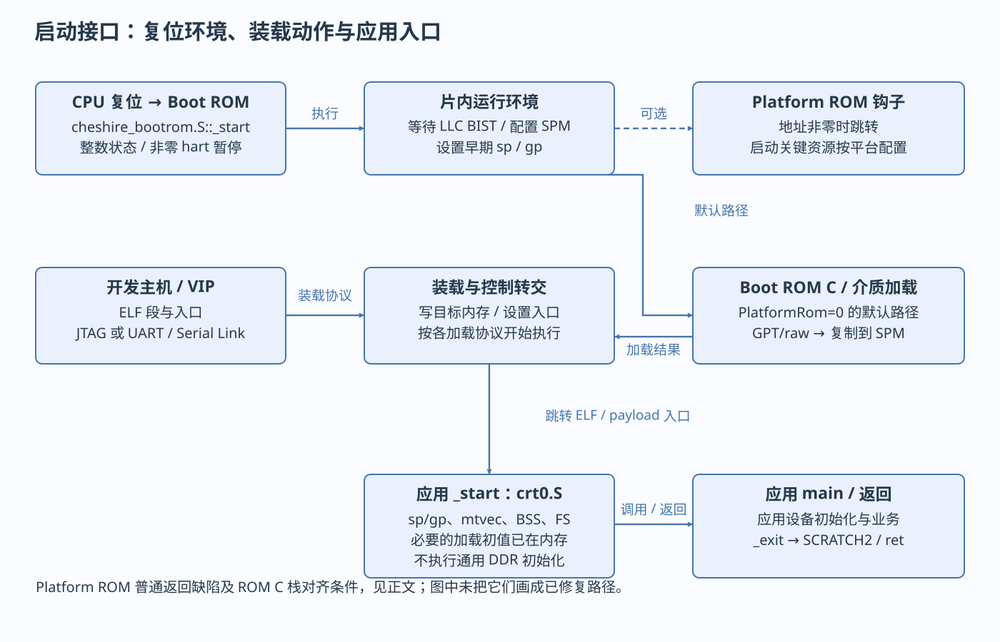

# 构建、加载与启动

从源码和 ELF 到 main

> 自动生成的 Markdown 阅读版；正文只维护 [HTML 内容源](../content/build-boot.html)，导航维护 [pages.json](../scripts/pages.json)。[本章 HTML](../build-boot.html) · [阅读路线](index.md)

- [从源文件到 ELF](#compile)
- [链接地址、装载地址和栈](#layout)
- [复位到应用的实际顺序](#boot)
- [加载协议与介质读取](#loaders)
- [资源可用时刻与平台运行](#ready)
- [构建规则把BSP实现和平台布局组成应用](#bsp-build)

程序启动要区分三个入口：CPU 复位地址、被加载 ELF 的 `_start`、C 的 `main`。它们可以属于两个甚至多个不同程序。先用已有 `journey.c` 观察数据和 BSS，再对照生产 `helloworld.c` 的 UART 输出链。

<a id="compile"></a>

## 从源文件到 ELF

[sw/sw.mk](../../../../sw/sw.mk)给出生产构建规则：C/汇编分别生成 `.o`，公共对象归档成 `libcheshire.a`，链接脚本把目标对象、运行库和需要的库函数放入地址空间。Make 在开发主机执行；只有生成的机器码在 CVA6 上执行。

```
# 原工程的单目标入口；会更新生产软件产物，本轮没有执行此命令。
make sw/tests/helloworld.spm.elf
# 同源代码但链接到 DRAM；执行前 DDR 必须已就绪。
make sw/tests/helloworld.dram.elf
```

| 输入 | 当前选项/文件 | 改变什么 |
| --- | --- | --- |
| 指令集 ISA | `-march=rv64gc_zifencei`；向量内核另外用 `rv64gcv_zifencei` | 允许编译器生成哪些指令；不会给硬件增加单元 |
| ABI（应用二进制接口） | `-mabi=lp64d` | 参数、返回值、寄存器保存、数据布局；要求与链接库及硬件兼容 |
| 地址形成 | `-mcmodel=medany` | 代码中形成符号地址的方式；不是让任意地址都可访问 |
| 启动 | `-nostartfiles` 与 [crt0.S](../../../../sw/lib/crt0.S) | 使用本平台入口，不套主机运行库 |
| 布局 | [common.ldh](../../../../sw/link/common.ldh) + `spm/dram/rom.ld` | 输出段、入口、基地址符号、栈策略 |
| 库 | `libcheshire.a`、`--gc-sections`、LTO | 归档与按需链接；优化后函数可能内联，不能要求反汇编仍有每一层函数名 |
| 生成头 | `sw/include/regs/*.h`、OT `sw/include/*_regs.h` | 偏移/位段来自 HJSON；通常不负责分配整个 SoC 基地址 |

`regtool.py --cdefines` 生成 C 宏，`regtool.py -r` 生成寄存器 package/top；[cheshire.mk](../../../../cheshire.mk) `REGTOOL` 指向 register\_interface 随附工具。`sw.mk` 也明确保留“头文件依赖追踪”的 TODO，修改头文件后不能仅因旧 `.o` 时间较新就认定重编充分。

`objcopy -O binary` 得到无符号/无入口元数据的二进制；`-O verilog` 得到按地址组织的 memh；`objdump -d -S` 生成反汇编。ELF 保留装载段、入口和调试符号，仿真 loader/GDB 使用这些信息。Flash raw 镜像与直接加载 ELF 是不同加载约定。

<a id="layout"></a>

## 链接地址、装载地址和栈

VMA（运行地址）是 CPU 实际执行/访问地址，LMA（装载地址）描述镜像中的装载布局。在 `.spm.elf` 中两者一致；`.rom` 镜像把运行地址和介质布局分开。

| 链接模式 | 代码/数据 | BSS | 栈 |
| --- | --- | --- | --- |
| [spm.ld](../../../../sw/link/spm.ld) | `.text`、`.misc`、`.bulk` 放 SPM，起点 `0x10000000` | NO 文件初值，由 crt0 清零 | `__stack_pointer$=0`，沿用调用者/Boot ROM 的有效栈 |
| [dram.ld](../../../../sw/link/dram.ld) | `0x80000000` 起；链接器声明 8 MiB 空间 | crt0 清零 | 先取 `0x80800000−8`，再由 crt0 预留 24 字节 |
| [rom.ld](../../../../sw/link/rom.ld) | `.misc > spm AT>extrom`；extrom LMA=0，最大48 KiB | 保留在 SPM，不随 raw 文件加载 | 沿用 ROM 栈；Boot ROM 把 raw/GPT 选区复制到 SPM 后跳转 |

链接器声明 SPM 64 KiB，是程序布局假设；默认硬件 LLC 阵列作为 SPM 为 128 KiB，两者不能相加。DRAM 的 8 MiB 也不是实际 DDR 容量证明。当前 crt0 **没有通用 `.data` 从 ROM 复制到 RAM 的循环**；ELF loader 或介质读取必须把 `.data` 的初值放到运行位置，crt0 负责清 `.bss`。更换 XIP（直接在非易失存储执行）布局后要重新定义搬移责任。

本轮新编的标量 `journey.spm.elf`：[readelf](../evidence/scalar-build/readelf.txt) 的 Entry=`0x10000000`，一个 LOAD 的 VMA/PAddr 同为 `0x10000000`，FileSiz=`0x17ec`，MemSiz=`0x1a14`；后者较大包含零初始化/对齐空间。`seed=1` 的初值来自镜像，137 个 `result` 元素由 crt0 清零。实际值只对应本次工具链/编译参数，其他程序不照抄这些段大小。

<a id="boot"></a>

## 复位到应用的实际顺序



复位、装载与应用的分工。图中箭头分别标注软件调用、总线事务或硬件事件。

图中箭头是执行控制或装载动作，虚线连接表示不同加载选择，不表示所有路径会顺序经过。

1. [SoC](../../../../hw/cheshire_soc.sv)向 CVA6 传递启动地址配置；[Boot ROM 汇编](../../../../hw/bootrom/cheshire_bootrom.S) `_start` 清整数寄存器、暂停非零 hart、先取链接器提供的 sp/gp。
2. 若 HW\_FEATURES 表示 LLC 存在，轮询 LLC `BIST_STATUS`，写全部 SPM way 位和 `CFG_COMMIT`，依据 `LLC_SIZE` 把 sp 设到 `__base_spm + size − 8`。此时可用的是 LLC 阵列中的 SPM，不意味着 DDR 就绪。
3. 读取 SoC `PLATFORM_ROM`。非零则 `jalr t0`；正常平台钩子应完成启动关键资源配置或明确转交后续阶段。**当前源码在该 jalr 后直接落入 `boot_next_stage`，普通返回不能按预期继续 `_boot`**。S01-B01 和[既有官方修复证据](../../../handoffs/L01_platform_rom_boot_review.md)记录了 #187；本轮未应用修复。默认值0跳过此缺陷路径。
4. `_boot` 执行 fence/fence.i，调用 [Boot ROM C main](../../../../hw/bootrom/cheshire_bootrom.c)。它先读 BOOT\_MODE/RTC\_FREQ、利用 CLINT 与 mcycle 估算时钟，再选择被动加载或介质启动。
5. 被动模式可以由 UART 服务执行代码、Serial Link 写入口/启动标志，也可以由 JTAG halt/load 后写 DPC/resume。介质模式则读 Flash/EEPROM/SD，经 GPT/raw 选择和复制，交给 `boot_next_stage`。
6. 应用 ELF 的 [crt0](../../../../sw/lib/crt0.S) `_start` 关闭 M/S 全局中断、停住非零 hart，按非零链接符号调整 sp/gp，留出24字节保存上下文，安装 `mtvec=_trap_handler_wrap`，清 BSS，设置 FS 并清浮点寄存器，然后 `call main`。VS 由向量应用另行开启。
7. main 返回后应用 `_exit` 恢复上下文，把 `(return_code << 1) | 1` 写到 `SCRATCH2` 再 ret。返回到 Boot ROM 后还有 Boot ROM 自己的 `_exit`/ebreak/wfi；JTAG 直载路径的返回上下文要按 loader 核对，不能假设存在 OS `exit()`。

默认128 KiB SPM使 ROM 的 sp=`0x1001fff8`。ROM 直接调用 C 时 sp模16为8，是既有 ABI 对齐待验项；应用 crt0 再减24，main 前变为16字节对齐。这解释了“ROM C 调用有待核查”与“应用调用可能已对齐”可以同时成立。此处是地址算术和源码事实，不是本轮复现的运行异常。

<a id="loaders"></a>

## 加载协议与介质读取

[Boot ROM C](../../../../hw/bootrom/cheshire_bootrom.c)实际 switch：0 被动、1 SPI SD、2 SPI NOR、3 I²C EEPROM。[本地官方 sw.md](../../../../docs/um/sw.md)把 EEPROM 误写为0b10；被动启动位也写为 `scratch[2][0]`，实际 `boot_passive()` 检查 `scratch[2] & 2` 即 bit1，bit0用于结束标记。应以当前 C 和 VIP 的一致路径为准。

UART debug 收到0x06进入服务，命令为 READ=0x11、WRITE=0x12、EXEC=0x13；地址/长度各64位按现有小端字节协议发送。READ 调 `uart_write_str(base,(void*)addr,len)`，在 CPU 上读该地址再发串口；WRITE 调 `uart_read_str`，CPU 收字节后存到该地址；EXEC 调 `invoke(addr)`，其内部先 fence.i再函数调用。返回发 **EOC=0x14 + 32位返回值**。本地旧文档的 EXEC 返回 ACK 描述与代码不同。非法地址不会被协议层自动验证成安全 RAM。

GPT（GUID Partition Table）是软件解析器：`gpt_check_signature`通过回调读字节偏移0x200；找到分区后按512字节 LBA 计算复制长度，末LBA包含在内。回调可能是 `spi_s25fs512s_single_read`、`spi_sdcard_read_checkcrc` 或 `i2c_24fc1025_read`。例如 Flash 回调构造读命令/器件地址→SPI DIF 排命令/TX→RTL发送→RX FIFO→CPU拷贝到SPM→`boot_next_stage`。GPT 不解析 ELF；介质上应是匹配 `.rom.bin` 约定的 raw 内容。根通用 GPT 测试镜像生成已注释，Linux GPT 规则仍在。

<a id="ready"></a>

## 资源可用时刻与平台运行

| 资源 | 可用的必要条件 | 当前边界 |
| --- | --- | --- |
| 片内 SPM | LLC BIST完成、way提交、地址映射存在 | 不可在执行代码/栈仍驻留时随意改为 cache way |
| UART | 控制器存在、SoC时钟/复位有效、分频/线路/流控配置、引脚连通 | main 中初始化；Boot ROM 被动服务另行初始化 |
| DDR | 控制器/PHY时钟复位、训练完成、地址/CDC可用 | FPGA MIG路径由[dram\_wrapper\_xilinx](../../../../target/xilinx/src/dram_wrapper_xilinx.sv)实现平台边界；普通 crt0 不初始化 DDR；采购IP流程待交付 |
| 中断 | 有效栈和trap入口、明确处理函数、源/控制器/CPU使能 | 默认weak处理函数死循环，不能把设mie当完整驱动 |

仿真从 [tb\_cheshire\_soc](../../../../target/sim/src/tb_cheshire_soc.sv) 的 BOOTMODE/PRELMODE/BINARY/IMAGE 选择开始：PRELMODE 0 JTAG、1 Serial Link、2 UART；SD boot在当前TB明确 fatal。VIP经 [elfloader.cpp](../../../../target/sim/src/elfloader.cpp)读取ELF段和入口，使用选定协议装载，不是CPU自行解析 ELF。

[JTAG VIP](../../../../target/sim/src/vip_cheshire_soc.sv) `jtag_elf_halt_load` 先等待相关LLC配置条件再halt/load；这不代表它等待ROM C完整执行。`jtag_elf_run`写DPC并恢复hart，随后`jtag_wait_for_eoc`读取SCRATCH2。FPGA可用既有OpenOCD/GDB流程加载ELF；烧入bitstream与装载程序是两件事。可复现命令和前提见[实践页](labs.md#run)。

<a id="bsp-build"></a>

## 构建规则把BSP实现和平台布局组成应用

`sw.mk`将本地启动/驱动/HAL与依赖库代码归档，链接脚本提供布局，装载工具把产物送到目标；三者共同支撑程序运行。库不包含板级连接和全部初始化条件。新增[库归档说明](foundation-software.md#libraries)及[主机工具表](foundation-software.md#tools)逐项解释头文件、对象、静态库、运行库和工具的职责。

---

[上一页：基础软件与BSP](foundation-software.md) · [下一页：指令、Ara 与 CSR](instructions.md)
