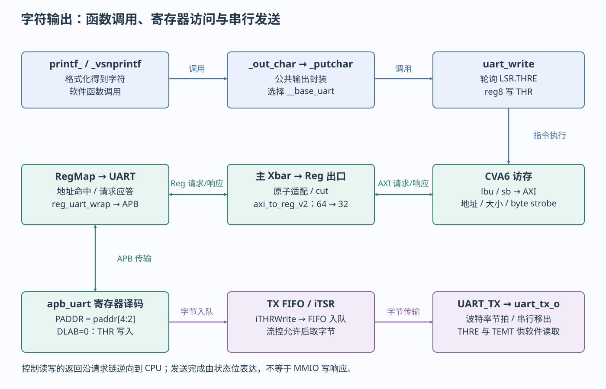
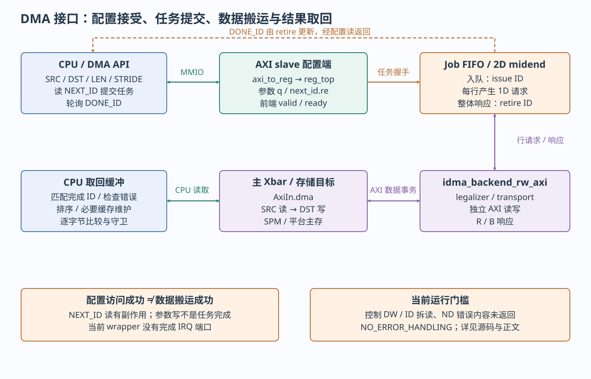

# 五条软件到 RTL 案例

UART、计时、DMA、GPIO 中断与向量加法

> 自动生成的 Markdown 阅读版；正文只维护 [HTML 内容源](../content/cases.html)，导航维护 [pages.json](../scripts/pages.json)。[本章 HTML](../cases.html) · [阅读路线](index.md)

- [字符输出抵达 UART 发送器](#uart)
- [定时读取与比较事件](#timer)
- [二维 DMA 从配置提交到结果校验](#dma)
- [GPIO 事件经过 PLIC 进入处理程序](#gpio-irq)
- [最小 Ara 加法与标量结果核对](#ara)
- [从接口行为回到可复用的软件服务](#bsp-services)

以下每个案例都沿软件操作追到实际RTL再返回观察点。图中实线箭头按标签分别表示调用、访存和数据传输，事件虚线另标IRQ；不存在用一根箭头把“调用驱动”直接变成“设备已完成”的省略。

<a id="uart"></a>

## 字符输出抵达 UART 发送器

**目标和前提。** 复用 [helloworld.c](../../../../sw/tests/helloworld.c) 或本轮编译的journey；需Cfg.Uart=1、运行存储/栈可用、实际UART频率/引脚和流控一致。`uart_init`关闭IER，配置DLAB及分频，再恢复8N1并设FIFO/自动流控。DLAB未恢复时写offset0会改分频低字节，不能发送字符。



printf到UART引脚的逐层对应。图中箭头分别标注软件调用、总线事务或硬件事件。

**软件链。** [printf.h](../../../../sw/deps/printf/printf.h)把printf映射为printf\_；[printf.c](../../../../sw/deps/printf/printf.c) `_vsnprintf → _out_char`按格式得到字符；[uart.c](../../../../sw/lib/dif/uart.c) `_putchar → uart_write`负责发送。它的关键访问为：

```
while (!__uart_write_ready(uart_base)) ;
*reg8(uart_base, UART_THR_REG_OFFSET) = byte;
```

`__uart_write_ready`读取LSR offset20(bit5 THRE)，THR offset0。基址为`__base_uart=0x03002000`；软件读`0x03002014`，写`0x03002000`。本轮编译中uart\_write被内联进`_putchar`；实际机器指令见下方摘录。一次printf的返回不是串行发送完成。

以下摘自本轮 [hello.dump](../evidence/hello-build/hello.dump) 的 `_putchar`（地址形成指令省略）：

```
10000246: lbu  a5,-558(a5)  # 0x03002014：LSR
1000024a: andi a5,a5,32      # bit5 THRE
1000024e: beqz a5,10000242   # 继续等待
10000254: sb   a0,-592(a5)   # 0x03002000：THR
```

**访问和RTL。** CVA6 AXI请求→Xbar Reg出口→原子适配/cut→`axi_to_reg_v2`→RegMap UART→[reg\_uart\_wrap](../../../../.bender/git/checkouts/apb_uart-38dcfab592cbc1a1/src/reg_uart_wrap.sv)的`i_reg_uart_reg_to_apb`→APB。包装传 `paddr[4:2]`，因此软件偏移每4字节对应一个UART寄存器编号。[apb\_uart](../../../../.bender/git/checkouts/apb_uart-38dcfab592cbc1a1/src/apb_uart.sv)中 `iWrite=PSEL && PENABLE && PWRITE`；PADDR=0且DLAB=0产生 `iTHRWrite`，低8位PWDATA经 `iTXFIFOWrite`写入 `UART_TXFF`。

**状态和完成。** TX FIFO非空且流控允许时，发送状态机取FIFO数据到 `iTSR`，`UART_TX`在波特率节拍下产生SOUT，SoC接到`uart_tx_o`。FIFO空时LSR.THRE置位，`!iTXRunning && THRE`形成TEMT；`uart_write_flush()`先fence再等THRE/TEMT。总线B响应、FIFO接受、最后停止位发送是三个时刻。驱动仍保留CVA6读写顺序核查TODO，没有超时，不能当作完整的关钟恢复协议。

**观察和排错。** UART文本及SCRATCH2作为软件观察；RTL看Reg地址/valid/ready、APB三控制线、iTHRWrite、FIFO占用、iTXRunning、SOUT。无字符依次查：是否到main→基址/译码→时钟/复位→DLAB/分频→CTS→TX引脚；乱码先核对实际时钟与baud，而非先改printf。HelloWorld会写VS但没有执行向量计算，不作为Ara验收。

<a id="timer"></a>

## 定时读取与比较事件

**目标和前提。** 使用HelloWorld或journey内的 `clint_get_core_freq(rtc,2500)`理解两种计数：CLINT `mtime`是MMIO，`mcycle`是CSR。RTC必须实际跳变，声明的RTC\_FREQ须对应硬件，否则测频等待可能挂住或结果错误。

**软件/访问。** [clint.c](../../../../sw/lib/dif/clint.c) `clint_get_mtime`读 `CLINT_MTIME_HIGH/LOW_REG_OFFSET`，基址`0x02040000`，偏移由 [clint.h](../../../../sw/include/regs/clint.h)生成；`get_mcycle`则执行CSR读。频率函数观察RTC边界，计算 `(end_mcycle-start_mcycle)*ref_freq/(end_mtime-start_mtime)`。FPGA RTC与SoC时钟的生成关系要对照顶层，这不是独立参考仪器测量。

**RTL变化。** CPU→Reg桥→CLINT译码→[clint\_reg\_top](../../../../.bender/git/checkouts/clint-de4a234303f657d0/src/clint_reg_top.sv)；[clint.sv](../../../../.bender/git/checkouts/clint-de4a234303f657d0/src/clint.sv)的`i_sync_edge`同步RTC上升沿成 `increase_timer`，通过hw2reg更新mtime。`mtime_q >= mtimecmp_q[0]`令`timer_irq_o[0]`有效，SoC接mtip→CVA6 time\_irq\_i→mip.MTIP。

**完成和清除。** 单次MMIO读完成不保证64位原子快照，现有高/低两读跨低32位翻转时需重试策略。定时ISR设置下一次mtimecmp到未来解除到期条件，不写PLIC complete；CPU的MTIE/MIE和有效trap处理要先准备。当前sleep\_until早退条件有静态问题，所以本轮只将计数读取列为现有可复用路径，定时中断列为待完善验收。

**观察和排错。** 反汇编应区分mtime的load与mcycle的csrr；调试器看RTC/mtime\_q/mtimecmp\_q/mtip，再看mie/mstatus/mtvec。恒0/不增长查RTC与复位；中断风暴查比较值是否仍在过去；卡在trap\_vector查是否覆盖weak默认。避免用会读清除的外设寄存器替代计数观察。

<a id="dma"></a>

## 二维 DMA 从配置提交到结果校验

**目标和前提。** 复用 [dma\_2d.spm.c](../../../../sw/tests/dma_2d.spm.c)。要求Dma使能、2D前端匹配、SPM与高别名合法，并先关闭控制位宽缺口；当前仅源码分析/编译探针，未声称可直接运行。



DMA参数、传输、完成与CPU取回。图中箭头分别标注软件调用、总线事务或硬件事件。

**软件配置。** [dma.h](../../../../sw/include/dif/dma.h)宏 `X(sys,&__base_dma)`生成 `sys_dma_2d_blk_memcpy`等函数，写SRC/DST/LENGTH、ND enable、两个stride和reps，随后**读NEXT\_ID提交**，轮询DONE\_ID等于返回ID。DMA基址`0x01000000`是独立AXI slave窗口，不挂主Regbus demux。

| 关键字段 | 生成偏移 | 软件/硬件含义 |
| --- | --- | --- |
| CONF | `IDMA_REG64_2D_CONF_REG_OFFSET` | ENABLE\_ND等配置；查[生成头](../../../../sw/include/regs/idma.h)，不是START位 |
| NEXT\_ID\_0 / DONE\_ID\_0 | 0x44 / 0x84 | 32位ID；前者读有提交副作用，后者只表示retire进度 |
| SRC/DST | 对应LOW/HIGH宏 | 物理byte地址组成；受wrapper实际地址位数限制 |
| LENGTH\_LOW/HIGH | 0xe0 / 0xe4 | 每行byte数；wrapper有效TfLenWidth=32，不能因有HIGH宏就使用64位长度 |
| DST\_STRIDE\_2 / SRC\_STRIDE\_2 | 0xe8/0xec；0xf0/0xf4 | 相邻行**起点**之差，单位byte，不是行末间隙 |
| REPS\_2 | 0xf8/0xfc | 行数；当前midend计数由1起到reps；有效宽度32 |

测试源`"This is a DMA test"`含19字节（含NUL），传 `sizeof(src_cached)-4=15`字节/行，dst\_stride=7、src\_stride=1、reps=4。四行源起点为src+0/1/2/3，目的起点dst+0/7/14/21，每行15字节；目的区域有重叠。最后一行末端为dst+35（不含dst+36），预先放在36/37的`!\0`用于检查越界，gold字符串为源码中的完整期望值。此例说明stride不必≥length；真实多行重叠写的顺序仍需后端/AXI动态验证。

**从写入到搬运。** [cheshire\_idma\_wrap](../../../../hw/cheshire_idma_wrap.sv)控制AXI→旧`axi_to_reg`→`dma_reg_req`→[idma\_reg64\_2d](../../../../.bender/git/checkouts/idma-77bf7fa56d324e6a/target/rtl/idma_reg64_2d_top.sv)。寄存器q存参数；NEXT\_ID读使`next_id.re`有效，`proc_launch`置arb\_valid；前端与Job FIFO入口valid/ready握手才issue任务ID。FIFO输出经 [idma\_nd\_midend](../../../../.bender/git/checkouts/idma-77bf7fa56d324e6a/src/midend/idma_nd_midend.sv)更新每行源/目的地址，向 [idma\_backend\_rw\_axi](../../../../.bender/git/checkouts/idma-77bf7fa56d324e6a/target/rtl/idma_backend_rw_axi.sv)给出1D请求；legalizer组织burst、transport发独立read/write，`i_axi_rw_join`合成AXI master接 `AxiIn.dma`，由它完成内存读取和写入。

**四种事件必须分开。** 参数MMIO被接受≠读NEXT\_ID任务入队≠整体ND响应retire≠CPU可见正确结果。2D wrapper以`idma_nd_rsp_valid & ready`推进DONE\_ID，不是任一行完成就推进；wrapper无完成IRQ端口，SoC可选bus-error IRQ也不是DMA DONE。当前backend `ErrorCap=NO_ERROR_HANDLING`且`nd_rsp_o`未连接内容，缺少可靠的软件错误结果。

**现有缺口。** 内部Reg typedef跟AxiDataWidth，当前64位；生成reg\_top的DW固定32。HAL把+0x44/+0x84的32位ID转成`volatile uint64_t*`；本轮探针`probe_next/probe_done`均生成两条`lwu`：分别访问+0x44/+0x48、+0x84/+0x88，不能靠类型名reg64证明兼容。普通 `sys_dma_memcpy()`设置reps=0；在2D wrapper中enable\_nd=0也使reps为0，而midend的zero路径抑制burst并生成ND\_MIDEND错误响应，wrapper却只计retire。**静态推断：即使完成ID变化也可能没有搬运**。需S01/V01用独立最小波形确认并另行修复，当前不把普通1D API作为规避2D问题的办法。

**可见性。** 原测试把源/目的转换到+0x04000000的SPM高别名，并把源值写到该别名，再从同一非缓存别名比较；不能混用缓存别名比较旧副本。API自身没有完整fence/缓存维护/超时闭环；CPU发布写和后续读取的排序需纳入验收。

**观察和排错。** 先看寄存器实际LOW/HIGH值和byte lane，再看NEXT\_ID的re次数/FIFO握手、各行src/dst/length、AXI R/B、ND retire、DONE\_ID及gold/sentinel。结果超时不能立即释放缓冲；坏数据先分“配置未接受/无burst/地址错/长度或stride错/传输错误/旧缓存”。修复授权后最小用例从单行、非重叠、短长度开始，再回到原2D重叠例。

<a id="gpio-irq"></a>

## GPIO 事件经过 PLIC 进入处理程序

**目标和前提。** 当前GPIO/PLIC/DIF有实现，但没有检索到根sw/tests中可直接运行的完整GPIO→PLIC C ISR测试。以下是源码支持的完整静态追踪及待补测试步骤，不是声称已运行的新例程。优先用GPIO `INTR_TEST`注入，避免默认fixture GPIO输入绑零造成无法产生边沿。

**软件链。** [dif\_gpio\_autogen.c](../../../../.bender/git/checkouts/opentitan_peripherals-7b624fb57f78de9a/sw/device/lib/dif/autogen/dif_gpio_autogen.c)的 `dif_gpio_irq_force`写INTR\_TEST、`dif_gpio_irq_set_enabled`设源使能、`dif_gpio_irq_acknowledge`以W1C清INTR\_STATE。[PLIC DIF](../../../../.bender/git/checkouts/opentitan_peripherals-7b624fb57f78de9a/sw/device/lib/dif/dif_rv_plic.c)设置priority、target enable/threshold，`dif_rv_plic_irq_claim/complete`使用目标CC寄存器。基址分别`0x03005000`和`0x04000000`；具体偏移来自 [gpio\_regs.h](../../../../.bender/git/checkouts/opentitan_peripherals-7b624fb57f78de9a/sw/include/gpio_regs.h)/[rv\_plic\_regs.h](../../../../.bender/git/checkouts/opentitan_peripherals-7b624fb57f78de9a/sw/include/rv_plic_regs.h)。

**访问和事件。** 每次DIF写经CPU→AXI→Reg桥→GPIO/PLIC译码。[gpio.sv](../../../../.bender/git/checkouts/opentitan_peripherals-7b624fb57f78de9a/src/gpio/rtl/gpio.sv) `intr_hw`消费 `reg2hw.intr_test.q/qe`、`intr_enable.q`并更新INTR\_STATE；IRQ接 `intr.intn.gpio`。当前packed结构低位是zero、uart和I²C等，GPIO\[0\]对应源20；这是从[cheshire\_int\_intr\_t](../../../../hw/cheshire_pkg.sv)的字段顺序静态推导，改变结构后须重算，不把20写成永久平台约定。默认无Router时fanout到PLIC，后者输出M目标xeip到CVA6。

**进入和返回。** 安装自己的trap\_vector→打开目标enable/priority/threshold和CPU MEIE/MIE→注入事件→GPIO state/IRQ置位→PLIC pending→CPU trap→读取mcause识别M external→claim拿到源ID→读取/记录设备原因→acknowledge GPIO对应位→必要排序→complete同一ID→普通C返回→crt0恢复整数现场并mret。硬件INTR\_TEST注入绕过外部引脚，但保留寄存器/IRQ/控制器/trap路径。

**观察和排错。** 后续测试应记录ISR计数恰好加1、claim ID、设备pending清零、complete后无持续重入以及返回主循环标志。先查源是否pending，再查PLIC优先级/enable/threshold、CPU mie/mstatus和mtvec。不要用调试器持续读取CC窗口，它会claim；现有64→32桥邻读还要求单独验证threshold/claim相邻布局。未补齐ISR和该副作用验收前，本例不是默认板测命令。

<a id="ara"></a>

## 最小 Ara 加法与标量结果核对

**目标和前提。** 复用 [journey.c](../../../learning/examples/journey.c)+[rvv\_add.S](../../../learning/examples/rvv_add.S)，硬件向量profile、Ara2/2048、单hart、全128KiB SPM、CSR\_ACC\_CONS开启。程序静态区在低64KiB，ROM/应用栈必须始终高于物理`0x10011000`；测试独占物理`[0x10010000,0x10011000)`，CPU和Ara只使用高别名。

**准备与执行。** a/b/c高别名分别为`0x14010000/0x14010400/0x14010800`；N=137，每槽使用548字节加一个守卫。CPU填a\[i\]=i、b\[i\]=2\*i+1、c哨值→fence→置VS→调用learn\_vadd。每轮vsetvli按剩余数量给vl；CVA6把指令/rs1等交给Ara，VLSU沿独立AXI加载两个数组，lane执行vadd，再写c。

**完成与消费。** 专用响应/在途计数及barrier配合函数返回后的fence；CPU从同一高别名读c，逐元素比较`3*i+1`，核对输入未改和边界守卫，总和应为28085。开启JOURNEY\_DEPTH还运行长度0/1/63/64/65/137和归约，覆盖部分尾部边界；这不是全部RVV ISA验证。

**运行、观察与排错。** 本轮已重编RVV ELF并看到vsetvli/vle32/vadd/vse32，不代表Ara执行通过。目标运行应记录 `RVV_DEPTH cases=6 errors=0`、`LEARN sum=28085 errors=0`及退出码，检查无访问/非法指令异常。非法指令先查profile/stub/VS/FS，挂起查专用ready和pending，坏结果查物理别名、vl指针增量、缓冲所有权与AXI响应；只有日志而无逐元素断言不算算法验收。

<a id="bsp-services"></a>

## 从接口行为回到可复用的软件服务

本页关注软件操作到RTL的链条。新增基础软件章用同一UART实例解释[printf、控制台回调与DIF的分工](foundation-software.md#uart-service)，并以[GPT回调、Flash HAL和SPI DIF](foundation-software.md#flash-service)说明初始化、参数单位及错误传播。HAL/DIF是实现接口使用的代码，不是每次操作都必须经过的统一阶梯。

---

[上一页：异常与中断](interrupts.md) · [下一页：自定义 IP 与 Linux 修改导航](integration.md)
