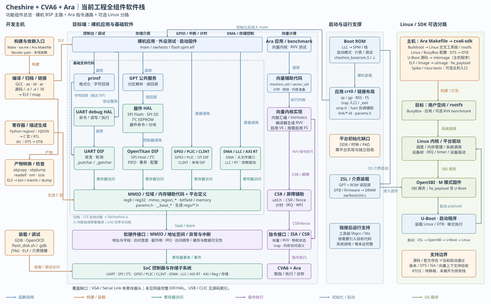
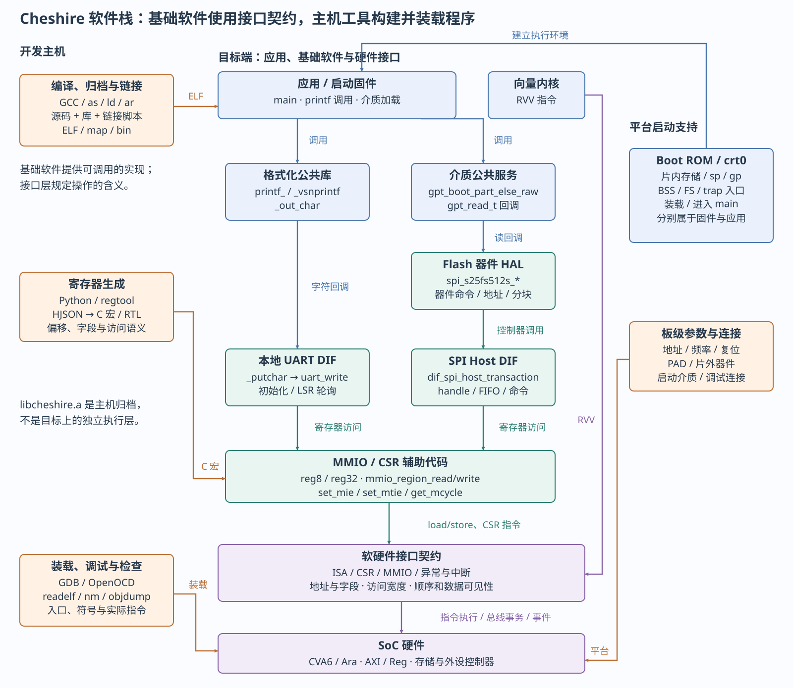

# 基础软件与BSP

HAL、DIF、MMIO、库与主机工具的源码对应

> 自动生成的 Markdown 阅读版；正文只维护 [HTML 内容源](../content/foundation-software.html)，导航维护 [pages.json](../scripts/pages.json)。[本章 HTML](../foundation-software.html) · [阅读路线](index.md)

- [基础软件实现对接口契约的使用](#layers)
- [软件栈与开发工具共同形成运行环境](#stack)
  - [当前工程全组件软件栈](#complete-stack)
  - [全组件源码索引与覆盖边界](#component-index)
  - [调用链案例图：UART与GPT/Flash](#case-stack)
- [BSP职责分散在启动、配置、驱动和工具中](#bsp-map)
  - [启动支持为后续驱动建立执行前提](#startup)
- [HAL、DIF和MMIO分别封装不同的知识](#drivers)
  - [访问辅助函数把地址和偏移变成CPU操作](#mmio-code)
- [库归档把实现交给链接器选择](#libraries)
  - [工程库、libgcc和libc提供不同服务](#runtime-libs)
- [主机工具把源码、布局与平台描述组成产物](#tools)
- [字符输出把公共库接到控制器驱动](#uart-service)
- [GPT通过回调复用Flash器件HAL](#flash-service)
  - [控制器初始化和器件就绪是两个步骤](#flash-init)
  - [统一读回调隐藏介质差异](#callback)
  - [返回值沿调用链传播但不保证所有故障被覆盖](#errors)
- [新IP的软件支持需要同步契约与实现](#extension)
- [RTOS和Linux改变基础软件的组织方式](#os)
- [用只读检查建立软件到产物的对应](#practice)
- [本轮证据与仍待验证的内容](#evidence)

本章把当前工程中分散的基础软件串成一条可查源码的路线：先理解公共支持代码的职责，再看它怎样使用硬件接口，最后理解主机工具怎样把这些代码组成可运行程序。以裸机为主，Linux/SDK补充当前源码分路，RTOS只比较职责变化，不假定已经完成移植。

**本章基线**：2026-10-13，`mp/ara-pulp-v2` / `bf1b4198dfd74cc78291c152b8b682d523e785c5`。本次重新检查了源码与主机工具；没有重新编译应用、仿真或板测。此前接口教程的编译证据属于`c4162204c`批次，见[历史实践记录](labs.md#evidence)。首次BSP扩充输入、工具版本及检查保存于[基础软件证据目录](../evidence/foundation-20261013/input.json)；追加全组件图的当前记录见[本章文末](#evidence)。

<a id="layers"></a>

## 基础软件实现对接口契约的使用

BSP（Board Support Package，板级支持包）是让软件能在某个具体硬件平台上启动、访问设备和运行的支持集合。本工程没有一个函数调用就能完成全部板级工作的统一BSP入口：相关职责分布在Boot ROM、应用启动汇编、链接脚本、DIF/HAL、寄存器定义及装载调试脚本中。这里用BSP作为职责分类，不把它描述成仓库已经打包好的独立产品。

| 比较项 | 软硬件接口层 | 基础软件层 |
| --- | --- | --- |
| 核心问题 | 软件可以操作什么？每次操作必须遵守什么规则？ | 怎样用代码完成初始化、访问、等待、交接和错误处理？ |
| 主要内容 | ISA、CSR、地址/寄存器、中断/异常、缓存属性和访问顺序 | 启动代码、公共库、驱动、HAL/DIF、MMIO/CSR辅助函数、平台支持 |
| UART例子 | THR/LSR地址、状态位、访问宽度、FIFO行为 | `uart_init()`、`uart_write()`、`uart_write_flush()` |
| 数据共享例子 | DMA完成语义、哪些访问可被CPU看到 | 驱动安排缓冲、提交、等待、必要的屏障/缓存维护和结果校验 |
| 修改关系 | 改地址、字段、副作用或IRQ路由会改变契约 | 对应宏、初始化、驱动、异常处理和测试必须同步 |

MMIO（Memory-Mapped I/O，内存映射I/O）**机制**属于接口层；通过指针产生MMIO访问的`reg8/reg32`、`mmio_region_*`是基础软件代码。同理，`mstatus`的语义属于接口层，封装CSR指令的`set_mie()`属于基础软件。两层是不同观察角度，不要求所有源码文件只能归到一侧。

`lib`是组织和复用代码的方式，驱动是控制设备的职责。一份库可装入驱动、启动代码、GPT解析器和printf；它们不会因此变成一个连续调用层。应用可以直接调用DIF或访问寄存器；Ara计算通过向量指令进入处理器，不必经过HAL。

[现有分层索引](../../LAYERS_AND_TOOLS.md)把构建、启动和运行支持另列为横向支撑。本章为建立BSP整体认识，将目标端启动/运行支持一并讲解；编译器、链接器和调试器仍明确放在**开发主机侧**，不把它们当成目标运行时调用链的一层。

<a id="stack"></a>

## 软件栈与开发工具共同形成运行环境

<a id="complete-stack"></a>

### 当前工程全组件软件栈

这张总览按功能组件展开当前裸机BSP、Ara软件入口及主机工具，并将Linux/SDK作为独立可选分路。横向分路是控制台与调试、存储介质、GPIO/中断/计时、DMA/存储控制和向量计算；纵向表示应用、公共服务、器件协议、控制器操作、访问辅助以及接口与硬件。具体应用可以跨层调用，不必经过每一个方框。

[](../../../diagrams/2026-10-13_complete_software_stack/complete-software-stack.svg)

点击打开原尺寸SVG，可放大查看。连续箭头区分调用、初始化、构建装载、寄存器访问及指令执行。存在源码、构建规则和可用平台是不同状态；本图不表示所有组件已启用或通过运行验证。

[图稿说明](../../../diagrams/2026-10-13_complete_software_stack/README.md) · [PNG](../../../diagrams/2026-10-13_complete_software_stack/complete-software-stack.png) · [原生可编辑PPTX](../../../diagrams/2026-10-13_complete_software_stack/export/diagrams.pptx) · [组件清单](../../../diagrams/2026-10-13_complete_software_stack/components.json)。

**怎样读图：**printf可以直接调用UART字符钩子，UART debug则先解释协议；GPT选择Flash、SPI SD或EEPROM读回调，再进入对应控制器DIF。GPIO/PLIC、CLINT、DMA/LLC/AXI RT可由应用直接使用。向量内核通过RVV指令进入CVA6/Ara，旁侧CSR/屏障辅助负责状态与同步。OpenTitan组内SPI与I²C各有独立DIF，不能把“合并展示”理解为所有介质都经过两种控制器。

**归档不是运行层：**虚线范围表示基础支持源码所在区域，其中C/S支持对象按`sw.mk`进入`libcheshire.a`；`crt0.S`虽画在启动侧栏也参与归档。DMA等头文件内联由调用者编译，平台参数和生成寄存器头属于编译输入。`libgcc/libc`按链接需求成为目标代码；编译器和链接器本身在主机执行。

**可选Linux分路：**本地SDK配方将U-Boot打包进OpenSBI的`fw_payload`，`mkimage`在主机生成`uImage`；ZSL装载firmware和DTB。图中的OpenSBI→U-Boot→Linux是启动关系，用户空间→Linux→SBI是服务关系，不能合并成每次系统调用都会执行U-Boot。实际启动尚未验收，选定平台的介质、环境变量、镜像布局、DTS及内核配置仍需核对；SDK还有面向Spike、直接包含Linux的另一payload规则，本图未把它拼入Cheshire启动链。

<a id="component-index"></a>

### 全组件源码索引与覆盖边界

下表是图中每类功能的源码入口及消费者，不是板级可用性认证。依赖路径保留当前checkout标识；“被构建规则收集”不表示本轮重建过归档。CLIC、USB、VGA/Serial Link等覆盖不足的地方明确列出；RTOS只列移植边界。寄存器/访问顺序等规则属于软硬件接口层，使用规则的HAL/DIF/辅助代码属于基础软件层。

手机端可横向滚动下表查看完整列。

| 组件 | 职责 | 真实源码/规则 | 调用者/消费者 | 使用条件与验证状态 |
| --- | --- | --- | --- | --- |
| 裸机应用 / 外设测试 | main、外设操作和返回值校验；包含标量、RVV和配置专用测试 | [`sw/tests`](../../../../sw/tests)<br>[`sw/sw.mk`](../../../../sw/sw.mk) | 应用 crt0 进入 main；Make 选择链接模式 | 源码存在；本轮未重编/运行。旧 tests\_wo\_ara 不作为独立软件层 |
| Ara 应用 / RiVec benchmark | 向量算法与标量对照；裸机和 Linux 构建入口不同 | [`.bender/git/checkouts/ara-2c7b103275a16c87/apps`](../../../../.bender/git/checkouts/ara-2c7b103275a16c87/apps)<br>[`.bender/git/checkouts/ara-2c7b103275a16c87/cheshire/sw/Makefile`](../../../../.bender/git/checkouts/ara-2c7b103275a16c87/cheshire/sw/Makefile)<br>[`.bender/git/checkouts/ara-2c7b103275a16c87/cheshire/sw/rivec.mk`](../../../../.bender/git/checkouts/ara-2c7b103275a16c87/cheshire/sw/rivec.mk) | sw/tests 中复制的测试、%-linux、rivec-bmark-\* | 构建规则/部分源码可查；可选数据及子模块完整性须逐项确认 |
| printf | printf\_/\_vsnprintf 格式化，通过 \_putchar 输出 | [`sw/deps/printf/printf.c`](../../../../sw/deps/printf/printf.c)<br>[`sw/lib/dif/uart.c`](../../../../sw/lib/dif/uart.c) | HelloWorld、ZSL、其他应用 | 源码与初版 HelloWorld 编译证据；本批次未运行 |
| GPT | gpt\_find\_partition / gpt\_boot\_part\_else\_raw 解析分区并调用 gpt\_read\_t | [`sw/lib/gpt.c`](../../../../sw/lib/gpt.c)<br>[`sw/include/gpt.h`](../../../../sw/include/gpt.h) | Boot ROM、ZSL | 回调连接可确认；本地通用 GPT 测试镜像生成规则已注释 |
| Ara / RVV 辅助代码 | 向量准备、计时、数据检查；不构成设备调度运行时 | [`.bender/git/checkouts/ara-2c7b103275a16c87/cheshire/sw/include/cheshire_util.h`](../../../../.bender/git/checkouts/ara-2c7b103275a16c87/cheshire/sw/include/cheshire_util.h)<br>[`.bender/git/checkouts/ara-2c7b103275a16c87/cheshire/sw/include/vector_util.h`](../../../../.bender/git/checkouts/ara-2c7b103275a16c87/cheshire/sw/include/vector_util.h)<br>[`sw/tests/rvv_test.h`](../../../../sw/tests/rvv_test.h) | 向量测试、向量算法 | 源码存在；须匹配 CPU profile、Ara 参数、ISA 和 VS/FS |
| UART debug HAL | uart\_debug\_init/check/serve：串口命令、内存读写与执行 | [`sw/lib/hal/uart_debug.c`](../../../../sw/lib/hal/uart_debug.c)<br>[`sw/include/hal/uart_debug.h`](../../../../sw/include/hal/uart_debug.h) | Boot ROM boot\_debug | 调用本地 UART；与主机 GDB/OpenOCD 的 JTAG 调试不同 |
| SPI Flash HAL | spi\_s25fs512s\_init/single\_read/single\_flash：器件命令与页/扇区操作 | [`sw/lib/hal/spi_s25fs512s.c`](../../../../sw/lib/hal/spi_s25fs512s.c)<br>[`sw/include/hal/spi_s25fs512s.h`](../../../../sw/include/hal/spi_s25fs512s.h) | Boot ROM、flash.c；GPT 读回调 | 调用 SPI Host DIF；器件/模式/时序需匹配，不代表所有 Flash 通用 |
| SPI SD HAL | spi\_sdcard\_init/read\_checkcrc/write\_blocks：SPI 模式 SD 协议 | [`sw/lib/hal/spi_sdcard.c`](../../../../sw/lib/hal/spi_sdcard.c)<br>[`sw/include/hal/spi_sdcard.h`](../../../../sw/include/hal/spi_sdcard.h) | Boot ROM、flash.c；GPT 读回调 | 调用 SPI Host DIF；不是原生 SD/MMC 总线驱动；板级引脚待核对 |
| I²C EEPROM HAL | i2c\_24fc1025\_init/read/write：器件寻址和分块 | [`sw/lib/hal/i2c_24fc1025.c`](../../../../sw/lib/hal/i2c_24fc1025.c)<br>[`sw/include/hal/i2c_24fc1025.h`](../../../../sw/include/hal/i2c_24fc1025.h) | Boot ROM、flash.c；GPT 读回调 | 调用 I²C DIF；分块推进等已有静态疑点，未关闭 |
| UART DIF | uart\_init/read/write/flush 和 printf 字符钩子 | [`sw/lib/dif/uart.c`](../../../../sw/lib/dif/uart.c)<br>[`sw/include/dif/uart.h`](../../../../sw/include/dif/uart.h) | printf、UART debug、应用 | MMIO 字节访问；有初版编译证据，不据此推及本轮板测 |
| CLINT DIF | mtime、mtimecmp、频率测量、忙等/休眠 | [`sw/lib/dif/clint.c`](../../../../sw/lib/dif/clint.c)<br>[`sw/include/dif/clint.h`](../../../../sw/include/dif/clint.h) | Boot ROM、器件 HAL、应用 | MMIO + CSR 辅助；sleep/read/compare 已有静态疑点 |
| DMA 接口 | 头文件宏生成 sys\_dma\_\*：提交、查询、等待 | [`sw/include/dif/dma.h`](../../../../sw/include/dif/dma.h)<br>[`sw/tests/dma_2d.spm.c`](../../../../sw/tests/dma_2d.spm.c) | DMA 测试、AXI RT 测试 | 无独立 dma.c；控制宽度、拆读及 reps=0 门槛仍在，不标成已可用 |
| SPI Host DIF | 控制器配置、FIFO 和事务 | [`.bender/git/checkouts/opentitan_peripherals-7b624fb57f78de9a/sw/device/lib/dif/dif_spi_host.c`](../../../../.bender/git/checkouts/opentitan_peripherals-7b624fb57f78de9a/sw/device/lib/dif/dif_spi_host.c)<br>[`.bender/git/checkouts/opentitan_peripherals-7b624fb57f78de9a/sw/device/lib/dif/autogen/dif_spi_host_autogen.c`](../../../../.bender/git/checkouts/opentitan_peripherals-7b624fb57f78de9a/sw/device/lib/dif/autogen/dif_spi_host_autogen.c) | Flash / SD HAL | 本地依赖源码被 sw.mk 收集；不代表已初始化、使能或运行验收 |
| I²C DIF | 控制器时序、格式 FIFO、收发和状态 | [`.bender/git/checkouts/opentitan_peripherals-7b624fb57f78de9a/sw/device/lib/dif/dif_i2c.c`](../../../../.bender/git/checkouts/opentitan_peripherals-7b624fb57f78de9a/sw/device/lib/dif/dif_i2c.c)<br>[`.bender/git/checkouts/opentitan_peripherals-7b624fb57f78de9a/sw/device/lib/dif/autogen/dif_i2c_autogen.c`](../../../../.bender/git/checkouts/opentitan_peripherals-7b624fb57f78de9a/sw/device/lib/dif/autogen/dif_i2c_autogen.c) | EEPROM HAL | 本地依赖源码被 sw.mk 收集；不代表已初始化、使能或运行验收 |
| GPIO DIF | 方向、输入输出及中断配置 | [`.bender/git/checkouts/opentitan_peripherals-7b624fb57f78de9a/sw/device/lib/dif/dif_gpio.c`](../../../../.bender/git/checkouts/opentitan_peripherals-7b624fb57f78de9a/sw/device/lib/dif/dif_gpio.c)<br>[`.bender/git/checkouts/opentitan_peripherals-7b624fb57f78de9a/sw/device/lib/dif/autogen/dif_gpio_autogen.c`](../../../../.bender/git/checkouts/opentitan_peripherals-7b624fb57f78de9a/sw/device/lib/dif/autogen/dif_gpio_autogen.c) | 调用者需编写板级 GPIO/ISR 逻辑 | 本地依赖源码被 sw.mk 收集；不代表已初始化、使能或运行验收 |
| PLIC DIF | 优先级、使能、claim/complete | [`.bender/git/checkouts/opentitan_peripherals-7b624fb57f78de9a/sw/device/lib/dif/dif_rv_plic.c`](../../../../.bender/git/checkouts/opentitan_peripherals-7b624fb57f78de9a/sw/device/lib/dif/dif_rv_plic.c)<br>[`.bender/git/checkouts/opentitan_peripherals-7b624fb57f78de9a/sw/device/lib/dif/autogen/dif_rv_plic_autogen.c`](../../../../.bender/git/checkouts/opentitan_peripherals-7b624fb57f78de9a/sw/device/lib/dif/autogen/dif_rv_plic_autogen.c) | 平台初始化与外部中断处理者 | 本地依赖源码被 sw.mk 收集；不代表已初始化、使能或运行验收 |
| DIF 公共定义 | dif\_base 与 autogen 公共返回值/句柄约定 | [`.bender/git/checkouts/opentitan_peripherals-7b624fb57f78de9a/sw/device/lib/dif/dif_base.c`](../../../../.bender/git/checkouts/opentitan_peripherals-7b624fb57f78de9a/sw/device/lib/dif/dif_base.c)<br>[`.bender/git/checkouts/opentitan_peripherals-7b624fb57f78de9a/sw/device/lib/dif/dif_base.h`](../../../../.bender/git/checkouts/opentitan_peripherals-7b624fb57f78de9a/sw/device/lib/dif/dif_base.h) | OpenTitan DIF 与其调用者 | 源码/头文件存在；错误传播须沿具体调用链确认 |
| LLC 支持 | axi\_llc\_reg32\_\*：SPM way、flush、BIST 状态等 | [`.bender/git/checkouts/axi_llc-5fb8850caad4fcfa/sw/lib/axi_llc_reg32.c`](../../../../.bender/git/checkouts/axi_llc-5fb8850caad4fcfa/sw/lib/axi_llc_reg32.c)<br>[`.bender/git/checkouts/axi_llc-5fb8850caad4fcfa/sw/include/axi_llc_reg32.h`](../../../../.bender/git/checkouts/axi_llc-5fb8850caad4fcfa/sw/include/axi_llc_reg32.h) | 启动/平台管理程序；Boot ROM 汇编也直接操作 LLC | 库源被收集；不能因此认定缓存维护及所有权协议完整 |
| AXI RT 支持 | \_\_axirt\_\*：region、budget、period、enable、isolation 查询 | [`.bender/git/checkouts/axi_rt-7cef46f372eaf0fb/sw/lib/axirt.c`](../../../../.bender/git/checkouts/axi_rt-7cef46f372eaf0fb/sw/lib/axirt.c)<br>[`.bender/git/checkouts/axi_rt-7cef46f372eaf0fb/sw/lib/axirt.h`](../../../../.bender/git/checkouts/axi_rt-7cef46f372eaf0fb/sw/lib/axirt.h)<br>[`sw/tests/axirt_budget.spm.c`](../../../../sw/tests/axirt_budget.spm.c) | AXI RT 测试、平台管理 | 依赖驱动被收集；测试依赖 DMA，存在运行门槛 |
| MMIO / 位域 / 内存辅助 | reg8/reg32、mmio\_region\_\*、bitfield、memory 辅助 | [`sw/include/util.h`](../../../../sw/include/util.h)<br>[`.bender/git/checkouts/opentitan_peripherals-7b624fb57f78de9a/sw/device/lib/base/mmio.c`](../../../../.bender/git/checkouts/opentitan_peripherals-7b624fb57f78de9a/sw/device/lib/base/mmio.c)<br>[`.bender/git/checkouts/opentitan_peripherals-7b624fb57f78de9a/sw/device/lib/base/bitfield.c`](../../../../.bender/git/checkouts/opentitan_peripherals-7b624fb57f78de9a/sw/device/lib/base/bitfield.c)<br>[`.bender/git/checkouts/opentitan_peripherals-7b624fb57f78de9a/sw/device/lib/base/memory.c`](../../../../.bender/git/checkouts/opentitan_peripherals-7b624fb57f78de9a/sw/device/lib/base/memory.c) | 本地 DIF、OpenTitan DIF、应用 | 辅助代码不替代寄存器副作用、宽度与顺序契约 |
| CSR / 屏障辅助 | set\_mie/set\_mtie/get\_mcycle、fence/fencei、wfi 等 | [`sw/include/util.h`](../../../../sw/include/util.h) | 启动、CLINT、应用及向量辅助 | 执行权限和硬件支持需匹配；mtime 的 MMIO 与 mcycle 的 CSR 分开 |
| 平台参数 / 生成寄存器头 | 地址、启动参数、偏移和位定义 | [`sw/include/params.h`](../../../../sw/include/params.h)<br>[`sw/link/common.ldh`](../../../../sw/link/common.ldh)<br>[`sw/include/regs`](../../../../sw/include/regs)<br>[`sw/sw.mk`](../../../../sw/sw.mk) | 启动、HAL/DIF、应用 | 头文件提供定义，不等于为每个 IP 实现完整驱动 |
| Boot ROM | 复位、LLC/SPM、栈、启动介质选择和跳转 | [`hw/bootrom/cheshire_bootrom.S`](../../../../hw/bootrom/cheshire_bootrom.S)<br>[`hw/bootrom/cheshire_bootrom.c`](../../../../hw/bootrom/cheshire_bootrom.c) | 复位入口/下一阶段装载 | Platform ROM 返回及 ROM 栈对齐等既有缺口仍待验收 |
| 应用启动 / trap / hart 辅助 | crt0：sp/gp、BSS、FS、trap 包装；smp.h：暂停/恢复 hart | [`sw/lib/crt0.S`](../../../../sw/lib/crt0.S)<br>[`sw/include/smp.h`](../../../../sw/include/smp.h)<br>[`sw/link`](../../../../sw/link) | 链接选入 crt0 后进入应用；smp.h 被 Boot ROM 汇编使用 | smp 宏不等于完整 SMP OS；默认 trap 不是 OS 向量上下文实现 |
| ZSL / 目标侧写盘工具 | ZSL 装载 DTB/firmware；flash.spm.elf 写入介质 | [`sw/boot/zsl.c`](../../../../sw/boot/zsl.c)<br>[`sw/boot/flash.c`](../../../../sw/boot/flash.c) | ROM 启动链；主机 flash\_disk 脚本 | 源码/构建规则存在；DRAM、介质、分区与镜像布局须匹配 |
| libcheshire.a / libgcc / libc | 前者归档工程支持对象；后两者按工具链链接需求提供目标代码 | [`sw/sw.mk`](../../../../sw/sw.mk) | GCC 驱动链接器；最终 ELF 选入需要的实现 | C/S 归档与头文件内联分开；libc 文件存在不证明系统调用/堆支持完整 |
| Make / Bender 路径入口 | 构建编排与定位依赖；不在目标运行链中 | [`Makefile`](../../../../Makefile)<br>[`cheshire.mk`](../../../../cheshire.mk)<br>[`sw/sw.mk`](../../../../sw/sw.mk)<br>[`.bender/git/checkouts/ara-2c7b103275a16c87/cheshire/sw/Makefile`](../../../../.bender/git/checkouts/ara-2c7b103275a16c87/cheshire/sw/Makefile) | 开发主机 | 本轮只读；不升级/清理依赖，不改变固定配置/静态清单方向 |
| GCC / as / ld / ar | C/汇编 → 对象；归档支持对象；按链接脚本生成 ELF/map | [`sw/sw.mk`](../../../../sw/sw.mk)<br>[`sw/link`](../../../../sw/link) | 主机 Make；GCC 驱动汇编/链接 | 裸机 riscv64-unknown-elf-\*；工具版本见先前 foundation 批次，不冒充本轮查询 |
| objcopy / objdump / readelf / nm / size | 转换 bin/memh，查看指令、段、符号和大小 | [`sw/sw.mk`](../../../../sw/sw.mk) | 开发主机检查与装载准备 | objcopy/objdump 有 Make 规则；readelf/nm/size 是诊断入口，非目标组件 |
| regtool / Python / dtc | HJSON → C 宏/RTL；DTS → DTB | [`cheshire.mk`](../../../../cheshire.mk)<br>[`sw/sw.mk`](../../../../sw/sw.mk)<br>[`sw/boot/cheshire.dtsi`](../../../../sw/boot/cheshire.dtsi) | 主机生成规则 | C 宏与 RTL 应匹配生成源；DTS 不会自动随 RTL 配置同步 |
| GDB / OpenOCD / 装载脚本 | ELF 装载、断点、JTAG；借助目标 flash 程序写介质 | [`util/openocd.common.tcl`](../../../../util/openocd.common.tcl)<br>[`util/openocd.hs2.tcl`](../../../../util/openocd.hs2.tcl)<br>[`util/flash_disk.sh`](../../../../util/flash_disk.sh)<br>[`util/flash_disk.gdb`](../../../../util/flash_disk.gdb) | 主机操作者/脚本 | 须匹配板卡、调试器及可访问内存；本轮未连接目标 |
| Ara Linux / SDK 构建入口 | %-linux / linux-img / rivec-\* 生成用户程序和镜像 | [`.bender/git/checkouts/ara-2c7b103275a16c87/cheshire/sw/cva6-sdk.mk`](../../../../.bender/git/checkouts/ara-2c7b103275a16c87/cheshire/sw/cva6-sdk.mk)<br>[`.bender/git/checkouts/ara-2c7b103275a16c87/cheshire/sw/rivec.mk`](../../../../.bender/git/checkouts/ara-2c7b103275a16c87/cheshire/sw/rivec.mk)<br>[`.bender/git/checkouts/ara-2c7b103275a16c87/cheshire/sw/cva6-sdk/Makefile`](../../../../.bender/git/checkouts/ara-2c7b103275a16c87/cheshire/sw/cva6-sdk/Makefile) | 开发主机 Make | Ara 路径 RVV\_LINUX=1；SDK 自身 RVV 默认0；需核对实际调用输入 |
| Buildroot / Linux 工具链 / BusyBox | 构建 Linux 交叉工具链、内核和 rootfs；BusyBox 在目标用户空间运行 | [`.bender/git/checkouts/ara-2c7b103275a16c87/cheshire/sw/cva6-sdk/Makefile`](../../../../.bender/git/checkouts/ara-2c7b103275a16c87/cheshire/sw/cva6-sdk/Makefile)<br>[`.bender/git/checkouts/ara-2c7b103275a16c87/cheshire/sw/cva6-sdk/configs/buildroot64_V_defconfig`](../../../../.bender/git/checkouts/ara-2c7b103275a16c87/cheshire/sw/cva6-sdk/configs/buildroot64_V_defconfig)<br>[`.bender/git/checkouts/ara-2c7b103275a16c87/cheshire/sw/cva6-sdk/configs/busybox64.config`](../../../../.bender/git/checkouts/ara-2c7b103275a16c87/cheshire/sw/cva6-sdk/configs/busybox64.config) | 主机 SDK；目标 Linux 用户空间 | riscv64-buildroot-linux-gnu-\* 与裸机工具链分开；配置存在不等于镜像可启动 |
| Linux / 设备树 | 目标 OS 调度、内存、系统调用及平台驱动；DTS 描述资源 | [`.bender/git/checkouts/ara-2c7b103275a16c87/cheshire/sw/cva6-sdk/configs/linux64_V_defconfig`](../../../../.bender/git/checkouts/ara-2c7b103275a16c87/cheshire/sw/cva6-sdk/configs/linux64_V_defconfig)<br>[`sw/boot/cheshire.dtsi`](../../../../sw/boot/cheshire.dtsi) | 用户进程；启动时接收固件/设备树 | 内核版本、DTS、ISA、驱动绑定和向量上下文尚未运行验收 |
| OpenSBI | M 模式 SBI 服务，Cheshire 平台适配；fw\_payload 含 U-Boot | [`.bender/git/checkouts/ara-2c7b103275a16c87/cheshire/sw/cva6-sdk/Makefile`](../../../../.bender/git/checkouts/ara-2c7b103275a16c87/cheshire/sw/cva6-sdk/Makefile)<br>[`.bender/git/checkouts/ara-2c7b103275a16c87/cheshire/sw/cva6-sdk/opensbi/platform/fpga/cheshire/platform.c`](../../../../.bender/git/checkouts/ara-2c7b103275a16c87/cheshire/sw/cva6-sdk/opensbi/platform/fpga/cheshire/platform.c) | ZSL 启动进入；S 模式软件调用 SBI | 该 Makefile 设置 fpga/cheshire；不能混同 Spike 的 Linux payload 规则 |
| U-Boot / mkimage | U-Boot 为目标启动程序；mkimage 是主机镜像打包工具 | [`.bender/git/checkouts/ara-2c7b103275a16c87/cheshire/sw/cva6-sdk/Makefile`](../../../../.bender/git/checkouts/ara-2c7b103275a16c87/cheshire/sw/cva6-sdk/Makefile)<br>[`.bender/git/checkouts/ara-2c7b103275a16c87/cheshire/sw/cva6-sdk/u-boot/configs/pulp-platform_cheshire_defconfig`](../../../../.bender/git/checkouts/ara-2c7b103275a16c87/cheshire/sw/cva6-sdk/u-boot/configs/pulp-platform_cheshire_defconfig)<br>[`.bender/git/checkouts/ara-2c7b103275a16c87/cheshire/sw/cva6-sdk/u-boot/include/configs/pulp-platform_cheshire.h`](../../../../.bender/git/checkouts/ara-2c7b103275a16c87/cheshire/sw/cva6-sdk/u-boot/include/configs/pulp-platform_cheshire.h) | OpenSBI payload → U-Boot；主机 SDK 制作 uImage | 源码和构建连接可确认；实际介质/env/镜像、U-Boot→Linux 路径待运行验证 |
| Spike / riscv-tests | SDK 可选 ISA 仿真器构建入口与 ISA 测试构建入口 | [`.bender/git/checkouts/ara-2c7b103275a16c87/cheshire/sw/cva6-sdk/Makefile`](../../../../.bender/git/checkouts/ara-2c7b103275a16c87/cheshire/sw/cva6-sdk/Makefile) | 主机验证与目标测试程序 | 构建入口存在；不等于 SoC 仿真或本轮已执行 |
| VGA / Serial Link / USB / CLIC 覆盖边界 | VGA/Link 有寄存器头；CLIC 有配置专用汇编测试；USB 未见纳入本地 BSP 的同级完整驱动 | [`sw/include/regs/axi_vga.h`](../../../../sw/include/regs/axi_vga.h)<br>[`sw/include/regs/serial_link.h`](../../../../sw/include/regs/serial_link.h)<br>[`sw/tests/clic_basic.spm.S`](../../../../sw/tests/clic_basic.spm.S)<br>[`sw/sw.mk`](../../../../sw/sw.mk) | 直接寄存器调用者或专用测试 | 不将硬件模块存在补画为已具备驱动；CLIC 测试不能套用于默认 PLIC 配置 |
| RTOS 与新增 IP | 职责及移植缺口的边界说明；不作为当前组件实现 | [`docs_codex/software/LAYERS_AND_TOOLS.md`](../../../../docs_codex/software/LAYERS_AND_TOOLS.md) | 后续平台移植工作 | RTOS 待移植；NPU/ISP/LVDS/GB 等未来软件不纳入现有栈 |

<a id="case-stack"></a>

### 调用链案例图：UART与GPT/Flash

全组件总览用于定位，以下原图保留，用于逐步追踪两个具体调用链。



中部是目标端软件和接口，左侧为开发主机，右侧为启动支持。箭头文字区分调用、构建装载及硬件操作；HAL与DIF不是所有程序都必须逐层通过的阶梯。图源与原生PPTX见图稿入口。

[SVG、PNG与可编辑PPTX](../../../diagrams/2026-10-13_foundation_software/README.md)对应本章源码关系。基础软件最终也由CPU取指执行；图中省略普通函数的逐条取指过程，突出它们调用设备服务、执行CSR或RVV指令的区别。

<a id="bsp-map"></a>

## BSP职责分散在启动、配置、驱动和工具中

| 职责/上层使用者 | 当前真实入口 | 下层依赖及修改边界 |
| --- | --- | --- |
| 复位后的基本环境 | [cheshire\_bootrom.S](../../../../hw/bootrom/cheshire_bootrom.S)、[Boot ROM C](../../../../hw/bootrom/cheshire_bootrom.c) | 片内ROM、LLC/SPM、时钟及启动模式；修改后涉及ROM重新生成 |
| 应用C入口和trap包装 | [crt0.S](../../../../sw/lib/crt0.S)：`_start`、`_trap_handler_wrap`、`_exit` | 有效栈、BSS边界、CSR权限和装载器返回上下文 |
| 程序布局/平台常量 | [common.ldh](../../../../sw/link/common.ldh)、[spm.ld](../../../../sw/link/spm.ld)、[params.h](../../../../sw/include/params.h) | `ENTRY(_start)`、MEMORY、`__base_*`；必须与RTL地址图一致 |
| 外设访问/公共服务 | [本地DIF](../../../../sw/lib/dif)、[HAL](../../../../sw/lib/hal)、[GPT](../../../../sw/lib/gpt.c) | 寄存器、器件协议、时钟与超时；不同函数的返回约定不同 |
| 寄存器定义 | [regs头文件](../../../../sw/include/regs)、[sw.mk生成规则](../../../../sw/sw.mk)、各IP HJSON | 宏定义不产生访问；UART偏移当前手写在`dif/uart.h`，不是所有头都来自同一个生成器 |
| 控制台与格式化 | [printf.h](../../../../sw/deps/printf/printf.h)、[printf.c](../../../../sw/deps/printf/printf.c)、[uart.c](../../../../sw/lib/dif/uart.c) | `printf`宏映射`printf_`，字符输出由`_putchar`接UART |
| 装载/调试支持 | [OpenOCD公共配置](../../../../util/openocd.common.tcl)、[HS2配置](../../../../util/openocd.hs2.tcl)、[flash\_disk.sh](../../../../util/flash_disk.sh) | 主机JTAG/GDB及已匹配的板级连接；不是目标库 |

这里要区分**SoC支持**和**板级适配**：UART控制器的寄存器驱动可复用，但基址、输入时钟、引脚连接、流控线及实际串口对端由平台决定。SPI控制器DIF可复用到不同器件，Flash操作码、地址模式和上电条件则属于器件HAL及板级初始化。

<a id="startup"></a>

### 启动支持为后续驱动建立执行前提

默认路径是`复位→Boot ROM汇编→Boot ROM C/加载→应用crt0→main`，条件和源码细节见[构建启动章](build-boot.md#boot)。Boot ROM等待LLC自测并准备SPM/早期栈；应用`crt0`使用链接符号建立或继承栈、设置gp和trap入口、清BSS、初始化浮点状态，随后调用`main`。应用crt0没有通用的`.data`从ROM到RAM复制循环，加载初值需要由实际装载路径放到应有位置。

`__base_uart`等在C侧声明为链接符号，驱动使用`&__base_uart`取得其地址值；不能把它误改成读取普通指针变量`__base_uart`，否则可能先访问设备地址处的内容。`common.ldh`定义地址，`params.h`提供C声明，生成寄存器头再定义**相对偏移/字段**，这三者职责不同。

`crt0`设置了trap包装，不等于安装了每个外设的处理程序。默认弱`trap_vector`停留在循环，完整PLIC分发需要软件补充；现场包装也不能被当成已具备RTOS的全量上下文切换，尤其不能据此声称支持浮点/向量抢占。

DDR训练、ASIC PLL和PAD配置不是调用任意`*_init()`就自动完成的公共步骤。现有FPGA控制器/时钟配置、Boot ROM及未来Platform ROM职责需按[平台启动约定](../../../03_Platform_ROM_Clock_IP_Configuration.md)对接；既有Platform ROM返回路径和ROM C栈对齐疑点仍保留。运行时调频后UART/SPI分频及计时基准也要重新核对，不能沿用过期的`core_freq`。

<a id="drivers"></a>

## HAL、DIF和MMIO分别封装不同的知识

DIF（Device Interface Function，设备接口函数）在本工程通常表示对**控制器/IP**寄存器的访问；HAL（Hardware Abstraction Layer，硬件抽象层）是更一般的名称，本地`hal/`主要封装**片外器件协议或服务协议**。名称不能代替看代码：`uart_debug`位于HAL，处理的是装载命令；它不是另一块UART硬件。

| 使用者/对象 | 调用与真实实现 | 软件接口及需要检查的条件 |
| --- | --- | --- |
| 控制台、UART debug | [uart.c](../../../../sw/lib/dif/uart.c)：`uart_init/read/write/write_flush` | 参数是base、频率、波特率或字节；多数操作阻塞且无统一超时，不返回设备错误码 |
| 计时/频率估计 | [clint.c](../../../../sw/lib/dif/clint.c)：`clint_get_mtime`、`clint_get_core_freq` | MTIME是MMIO，mcycle是CSR；读取快照、分拆比较写和sleep条件的既有疑点见[计时案例](cases.md#timer) |
| 应用搬运 | [dif/dma.h](../../../../sw/include/dif/dma.h)：`X(sys, &__base_dma)`生成`sys_dma_*` | 有实现在头文件中；任务ID不是错误结果；DW/ID拆读、reps=0问题未验收 |
| SPI NOR/SD HAL | [dif\_spi\_host.c](../../../../.bender/git/checkouts/opentitan_peripherals-7b624fb57f78de9a/sw/device/lib/dif/dif_spi_host.c)及[autogen](../../../../.bender/git/checkouts/opentitan_peripherals-7b624fb57f78de9a/sw/device/lib/dif/autogen/dif_spi_host_autogen.c) | `dif_spi_host_t`保存MMIO基址；`init`建立handle，配置/使能/transaction另有函数 |
| EEPROM HAL | [dif\_i2c.c](../../../../.bender/git/checkouts/opentitan_peripherals-7b624fb57f78de9a/sw/device/lib/dif/dif_i2c.c)与[i2c\_24fc1025.c](../../../../sw/lib/hal/i2c_24fc1025.c) | I²C时序/FMT FIFO与器件地址/分块协议分别处理；源码存在不代表全部边界已验收 |
| GPIO控制及事件 | [dif\_gpio.c](../../../../.bender/git/checkouts/opentitan_peripherals-7b624fb57f78de9a/sw/device/lib/dif/dif_gpio.c)及[GPIO autogen](../../../../.bender/git/checkouts/opentitan_peripherals-7b624fb57f78de9a/sw/device/lib/dif/autogen/dif_gpio_autogen.c) | 输出/输入与IRQ force/enable/ack分开；当前引脚接出条件独立检查 |
| 中断分发器 | [dif\_rv\_plic.c](../../../../.bender/git/checkouts/opentitan_peripherals-7b624fb57f78de9a/sw/device/lib/dif/dif_rv_plic.c)：`dif_rv_plic_irq_claim/complete` | 控制器claim/complete不代替设备清状态和CPU使能；不包含完整应用ISR |
| 存储模式管理 | [axi\_llc\_reg32.h](../../../../.bender/git/checkouts/axi_llc-5fb8850caad4fcfa/sw/include/axi_llc_reg32.h)及[C实现](../../../../.bender/git/checkouts/axi_llc-5fb8850caad4fcfa/sw/lib/axi_llc_reg32.c) | `get_bist_out/set_spm/flush_all`等；重配SPM必须保护栈和仍被使用的数据 |
| 总线流量预算 | [axirt.h](../../../../.bender/git/checkouts/axi_rt-7cef46f372eaf0fb/sw/lib/axirt.h)及[axirt.c](../../../../.bender/git/checkouts/axi_rt-7cef46f372eaf0fb/sw/lib/axirt.c) | `__axirt_set_region/set_budget/enable`等；API存在不证明本平台该功能已启用 |

OpenTitan驱动通常返回`dif_result_t`，本地HAL常返回`int`并用`CHECK_CALL`传播非零值。UART的`void uart_write()`则没有这种错误通道。调用方必须读实际声明，不能把所有驱动都当成“返回0就是硬件操作全部成功”。

<a id="mmio-code"></a>

### 访问辅助函数把地址和偏移变成CPU操作

下面两段摘自当前实现。第一种返回volatile指针，由调用者解引用；第二种直接执行32位访问。`offs/offset`均以**byte**计，不是第几个寄存器。

```
// sw/include/util.h
static inline volatile uint32_t *reg32(void *base, int offs) {
    return (volatile uint32_t *)((uint8_t *)base + offs);
}
// OpenTitan base/mmio.h：非mock路径
inline uint32_t mmio_region_read32(mmio_region_t base, ptrdiff_t offset) {
    return ((volatile uint32_t *)base.base)[offset / sizeof(uint32_t)];
}
```

对应源码：[util.h](../../../../sw/include/util.h)、[mmio.h](../../../../.bender/git/checkouts/opentitan_peripherals-7b624fb57f78de9a/sw/device/lib/base/mmio.h)。`reg8`用于字节访问，`reg32`用于32位访问；`mmio_region_read32`要求正确对齐，源码里的除法不是在帮调用者安全处理任意未对齐地址。将返回类型改成64位不会把硬件寄存器一起变宽。

`volatile`约束编译器对这些访问的处理，不能单独证明CPU/总线顺序或DMA数据可见性。`fence()`还发出指令并带编译器`memory` clobber；缓存维护是另一个问题。OpenTitan头文件的顺序描述需结合本平台CPU属性、桥和外设语义核对，不能直接扩展成“系统硬件一致”。具体路径见[MMIO与数据交接](memory-mmio.md)。

`set_mie()`、`set_mtie()`、`get_mcycle()`也定义在`util.h`，但使用CSR指令，不访问外设地址。调用所需特权、MIE/MTIE位语义属于[接口层CSR说明](instructions.md)；函数包装本身没有赋予低特权代码额外权限。

<a id="libraries"></a>

## 库归档把实现交给链接器选择

从应用写下`#include "dif/uart.h"`开始，预处理器让编译器看到函数声明和宏；**头文件搜索成功不等于实现已经参与链接**。编译器把调用转换成目标代码及尚待解析的符号，链接器再从对象和库中找到实现。`static inline`辅助函数可能直接进入调用者；`dma.h`的宏/inline形式则需连同实际编译与链接行为检查，不能凭目录名寻找一个并不存在的`dma.c`。

[sw/sw.mk](../../../../sw/sw.mk)的`CHS_SW_LIB_SRCS_*`和`CHS_SW_DEPS_SRCS`共同组成`libcheshire.a`：

| 来源 | 当前收集内容 | 在程序中的角色 |
| --- | --- | --- |
| `sw/lib/*.S`及下一层目录 | 当前包括`crt0.S` | 应用入口、trap包装和退出 |
| `sw/lib/*.c`及下一层目录 | UART、CLINT、GPT与HAL | 平台设备和公共服务 |
| `sw/deps/printf/printf.c` | 本工程小型printf | 格式化和字符回调 |
| LLC/AXI RT依赖的`sw`目录 | `axi_llc_reg32.c`、`axirt.c` | 对相应控制寄存器的访问 |
| OpenTitan base/DIF/autogen | 对应三个目录的C源 | MMIO/位操作及控制器驱动 |

归档规则将这些`.o`用`ar -rcsv`打包；原规则还传LTO插件。链接规则以GCC作为驱动，提供应用对象、链接脚本和`libcheshire.a`。这不是CPU运行时打开`.a`文件：归档在**主机链接时**被使用。`--gc-sections`以及LTO（Link-Time Optimization，链接时优化）还可能删除未使用代码或内联函数，所以库成员数不等于最终ELF中的函数数。

`.a`也不携带链接脚本、JTAG连接、板级引脚或供应商DDR训练资料。独立BSP的迁移清单需要同时包含这些依赖和工具条件，不能只复制`sw/lib/libcheshire.a`。本项目固定配置/静态清单方向不变，本轮只解释现有构建，不实施提取。

<a id="runtime-libs"></a>

### 工程库、libgcc和libc提供不同服务

- **工程printf**：`printf.h`把`printf`重命名到`printf_`；字符回调接本地UART，不需要据此假定Linux系统调用存在。
- **libgcc**：编译器运行支持库，提供编译器可能生成调用的辅助例程；不是外设驱动集合。
- **libc**：C标准库实现。本轮工具链能定位`libc.a`，但这不证明应用已经具备文件系统、堆扩展、锁或所有系统调用适配。要使用这些能力，需检查最终链接map、未解析符号及相应平台实现。

当前链接选项是`-nostartfiles`，并非`-nostdlib`：前者抑制默认启动文件，不能解释成禁用全部标准库。链接归档的位置也影响符号解析。这里依据与本机GCC对应的[15.2链接选项官方说明](https://gcc.gnu.org/onlinedocs/gcc-15.2.0/gcc/Link-Options.html)，工程实际库选择仍看完整命令和map。

<a id="tools"></a>

## 主机工具把源码、布局与平台描述组成产物

基本过程是`C/预处理汇编→编译/汇编→对象.o→归档或链接→ELF→装载`。ELF（Executable and Linkable Format，可执行与可链接格式）保留入口、段和符号；裸二进制不自动保留这些装载信息。调试/镜像工具消费产物，不会替应用执行目标端初始化。

| 工具 | 输入→输出/用途 | 本工程对应与使用边界 |
| --- | --- | --- |
| `riscv64-unknown-elf-gcc` | `.c/.S`→`.o`，也驱动链接得到ELF | `CHS_SW_CC`；运行在主机，生成RISC-V目标代码 |
| `riscv64-unknown-elf-as` | 汇编→目标对象 | 通常由GCC调用；`.S`还先经过预处理 |
| `riscv64-unknown-elf-ld` | 对象/归档/脚本→地址布局、符号解析、ELF | 原规则通过GCC传`-T`和`-Wl,...`，不建议照抄裸ld命令替换 |
| `riscv64-unknown-elf-ar` | 对象→静态归档；`t`列成员 | `CHS_SW_AR/ARFLAGS`，LTO对象需要匹配插件 |
| `objcopy` | ELF→`.bin`或Verilog `.memh` | `sw.mk`的`-O binary/verilog`；格式转换不是运行 |
| `objdump` | ELF/对象→反汇编、源码混排 | 核对真实load/store、CSR和V指令 |
| `readelf`、`nm`、`size` | ELF→段/入口、符号、段大小 | 判断装载/运行地址、栈符号和空间占用 |
| GNU Make | Makefile及依赖→执行构建命令 | [cheshire.mk](../../../../cheshire.mk)引入`sw.mk`；Make不是编译器 |
| Python/regtool | HJSON→C寄存器宏和RTL寄存器块 | [本地regtool](../../../../.bender/git/checkouts/register_interface-902ad5bfde7bb98c/vendor/lowrisc_opentitan/util/regtool.py)，不同IP另有模板/参数 |
| `dtc` | `.dts`→`.dtb`设备树 | [cheshire.dtsi](../../../../sw/boot/cheshire.dtsi)提供平台描述；不能据设备树节点创建硬件 |
| RISC-V GDB | ELF符号+目标连接→装载、断点、寄存器检查 | 通过OpenOCD等访问目标；`load`是否可用受内存初始化限制 |
| OpenOCD | 适配器/目标配置→JTAG调试服务 | HS2配置只适用于相应线缆；沿用用户已验证的VCU118参数 |
| SDK/Buildroot | 配方与多套源码→工具链、固件、内核、rootfs | [本地CVA6 SDK Makefile](../../../../.bender/git/checkouts/ara-2c7b103275a16c87/cheshire/sw/cva6-sdk/Makefile)，不是单个编译器 |

本轮只读查询：GCC **15.2.0**、GNU Binutils **2.46**、GDB **17.1**、Make **4.3**、DTC **1.7.0**、OpenOCD **0.12.0**，完整位置、输出和退出码见[tools.json](../evidence/foundation-20261013/tools.json)。它们是本机快照，不是项目最低版本要求。

根规则默认`-march=rv64gc_zifencei -mabi=lp64d`，不包含V。ISA（指令集架构）决定允许生成哪些指令，ABI（应用二进制接口）决定对象间如何传参和保存状态。`-DOT_PLATFORM_RV32`是库的平台宏，不会覆盖`-march`变成RV32。Ara入口另选向量选项，硬件profile和软件VS状态仍必须满足；参数含义参见[GCC 15.2 RISC-V选项](https://gcc.gnu.org/onlinedocs/gcc-15.2.0/gcc/RISC-V-Options.html)。

裸机`riscv64-unknown-elf-*`与SDK里的Linux工具链面向不同运行环境，不能只因为都生成RISC-V ELF就互换。Linux用户程序通常依赖系统ABI、运行库及内核服务；本章不更换工具链，也不据SDK旧镜像宣称当前Linux已启动。

`sw.mk`仍有“TODO: track headers with gcc -MM”的注释，并不自动追踪全部头依赖；改flags也不能默认让所有旧`.o`失效。验证构建应使用独立、来源明确的输出和匹配库，不能看到旧ELF就推断本次改动已编入。

<a id="uart-service"></a>

## 字符输出把公共库接到控制器驱动

[helloworld.c](../../../../sw/tests/helloworld.c)先读RTC\_FREQ，经`clint_get_core_freq()`估算当前时钟，再以`uart_init(&__base_uart, reset_freq, __BOOT_BAUDRATE)`初始化，之后才调用printf。它还写VS状态，但这不证明执行了向量计算。

调用链为`main→printf宏→printf_→_vsnprintf→_out_char→_putchar→uart_write→reg8解引用`。printf处理格式与数字转换；`_putchar`决定默认控制台；UART DIF知道寄存器与等待条件；MMIO辅助函数只处理地址和类型。以下摘自[uart.c](../../../../sw/lib/dif/uart.c)：

```
void uart_write(void *uart_base, uint8_t byte) {
    while (!__uart_write_ready(uart_base))
        ;
    *reg8(uart_base, UART_THR_REG_OFFSET) = byte;
}
void _putchar(char byte) {
    uart_write(&__base_uart, byte);
}
```

`__uart_write_ready`读取LSR bit5（THRE），随后向THR写一个字节。初始化先关IER、打开DLAB写分频，再恢复8N1、配置FIFO与自动流控；波特率计算使用传入频率，错误的频率不会被函数自动识别。

`uart_write()`返回`void`，表示软件已执行字节提交，不表示该字节已经全部从TX引脚移出。`uart_write_flush()`还等待THRE/TEMT，源码保留顺序TODO且没有超时；`printf_`返回字符计数，也不是UART错误状态。轮询卡住时要按时钟/基址、LSR、流控和硬件路径排查，而不是仅查看printf返回值。

完整寄存器、总线路径和UART状态机对应见[字符案例](cases.md#uart)。历史HelloWorld反汇编中，`_putchar`已经内联`uart_write`，实际是`lbu`轮询和`sb`提交。源码里有函数调用不保证反汇编还保留同名调用指令；这正是“软件组织”与“最终机器行为”需要对照阅读的原因。

<a id="flash-service"></a>

## GPT通过回调复用Flash器件HAL

目标场景是从SPI NOR读取启动内容到SPM；**本次只分析，不执行Flash擦写或启动**。调用链是`boot_spi_s25fs512s→HAL init→gpt_boot_part_else_raw→gpt_read_t回调→spi_s25fs512s_single_read→dif_spi_host_transaction→MMIO→SPI控制器`。

<a id="flash-init"></a>

### 控制器初始化和器件就绪是两个步骤

[Boot ROM C](../../../../hw/bootrom/cheshire_bootrom.c)中的Flash handle配置`csid=1`，`spi_freq=MIN(40 MHz, core_freq/4)`。这是当前源码值，不是未来板卡或采购器件的冻结要求。[spi\_s25fs512s.h](../../../../sw/include/hal/spi_s25fs512s.h)定义handle包含`dif_spi_host_t spi_host`、`spi_freq`和`csid`，后二者由调用者预先填写。

[spi\_s25fs512s\_init](../../../../sw/lib/hal/spi_s25fs512s.c)检查参数，将`&__base_spih`包装成MMIO region，调用`dif_spi_host_init`建立控制器handle，然后复位控制器、按时钟/模式配置CS、使能控制器和输出。`dif_spi_host_init`本身在autogen文件中只校验输出handle并记录base；不能仅调用它就认为SPI已经配置完成。

HAL头注释要求后续命令前满足器件上电等待。当前Boot ROM还用CLINT等待基于RTC的启动时刻；`clint_spin_until`使用绝对mtime门槛，不是从HAL返回起重新计一段延时。芯片上电相对复位的关系和板级连接仍须平台保证。

<a id="callback"></a>

### 统一读回调隐藏介质差异

[回调类型](../../../../sw/include/gpt.h)是：

```
typedef int (*gpt_read_t)(void *priv, void *buf,
                        uint64_t addr, uint64_t len);
```

`priv`携带设备handle，`buf`是CPU目标缓冲，`addr/len`是介质中的字节地址/字节长度。GPT先通过回调读偏移`0x200`的签名，再读取分区条目，按512-byte LBA计算复制范围。它不知道底层是SPI Flash、SD还是I²C EEPROM；更不会把`addr`自动解释成CPU物理地址。

Flash HAL将`priv`转为`spi_s25fs512s_t*`，把读取拆成不超过`4 * SPI_HOST_PARAM_RX_DEPTH` byte的块，构造三个segment：操作码`0x13`、4字节器件地址、RX缓冲与长度。这里的4来自FIFO每项的字节数。每块更新缓冲位置和器件地址，最后一块取剩余长度。对应函数为`spi_s25fs512s_single_read`和`__spi_s25fs512s_single_read_chunk`。

SPI DIF则写CSID，等待控制器ready，将各segment编码到TXDATA/COMMAND，再从RXDATA读取到缓冲。CPU在这条路径上排命令并搬出RX FIFO中的数据；没有因为API叫transaction就自动使用系统DMA。SPI寄存器语义由DIF与RTL约定，Flash操作码语义由器件HAL与器件约定。

<a id="errors"></a>

### 返回值沿调用链传播但不保证所有故障被覆盖

HAL通过`CHECK_ASSERT`返回本地检查码，通过`CHECK_CALL`把下层非零返回直接上传；DIF通常返回`kDifOk`或参数类错误。等待ready/RX的循环并没有因此得到统一超时机制。若器件未接、时钟错误或FIFO始终不满足条件，不能假设一定会及时得到非零返回。

还有一个具体例外：[gpt\_check\_signature](../../../../sw/lib/gpt.c)在读回调失败时返回“未发现签名”，随后`gpt_boot_part_else_raw`可能尝试raw读取；它没有把首次读错误原样上传。后续分区读取与最终复制使用`CHECK_CALL`，复制成功后写SCRATCH信息并调用`boot_next_stage`，所以该函数不是只读数据后返回的普通文件API。不能把它当作不会跳转执行的介质探测工具。

最小后续验证应先在独立测试中只调用HAL读取已知字节，比较长度、内容和缓冲守卫，再验证跨块边界及错误/超时；确认这些之后才使用带控制转移的GPT启动路径。当前没有新增器件运行证据；EEPROM分块等已登记疑点也不因这一解释而关闭。

<a id="extension"></a>

## 新IP的软件支持需要同步契约与实现

| 变更 | 基础软件要同步的内容 | 最小检查及失败处理 |
| --- | --- | --- |
| 新增寄存器/窗口 | HJSON及生成头、平台base、DIF访问宽度和字段组合 | reset/readback、边界地址、byte使能、副作用；错误不能被当作命令成功 |
| 新增任务型NPU/搬运器 | 配置/提交/完成ID/错误读取API，缓冲所有权协议 | 小任务golden与守卫、超时、错误、重入；保存错误并停止新提交，恢复方法由IP定义 |
| 新增中断 | 源使能/清状态API、PLIC配置、trap分发及应用通知 | 注入一次事件，确认清源/complete后正确返回，不发生重复服务 |
| 增加器件HAL | 型号协议、handle参数、初始化依赖、单位和边界 | 先只读已知内容，再增加写入；供电/引脚/时钟由平台保证 |
| 改启动/内存布局 | 链接脚本、crt0/加载器假设、DDR就绪及栈位置 | 比对ELF与地址图，初始化失败时保持在可执行的片内路径 |
| 加入库构建 | 新实现及头路径、生成依赖、ISA/ABI、归档选择 | 查看实际对象/符号/map；不把include成功当作链接成功 |

这些是设计建议和修改导航，不是本轮新增API。优先复用[本地官方集成入口](../../../../docs/tg/integr.md)，具体NPU/ISP/LVDS/DDR/GB边界见[集成章](integration.md)和[现行IP契约](../../../engineering/IP_DDR_Interface_Contract.md)。本轮不定义供应商寄存器、不冻结新地址/IRQ/频率，也不修复旧驱动。

<a id="os"></a>

## RTOS和Linux改变基础软件的组织方式

| 方面 | 当前裸机路径 | RTOS需要补充 | Linux平台支持的变化 |
| --- | --- | --- | --- |
| 启动与调度 | ROM/loader→crt0→main | 内核入口、tick、上下文切换和每任务栈 | 固件/内核入口、设备树、驱动初始化次序 |
| 设备访问 | 应用直接调用DIF/HAL | 与任务锁、ISR限制、阻塞/唤醒结合 | 内核驱动管理资源，用户态通过系统接口访问 |
| 计时和IRQ | 轮询或应用trap | 调度时钟、ISR到任务通知、嵌套规则 | 内核IRQ/定时设施及设备驱动注册 |
| DMA和缓存 | 软件自行遵守所有权/可见性契约 | 纳入任务同步及平台缓存维护 | 使用内核DMA映射/同步接口，仍依赖平台正确实现 |
| 库/错误处理 | 静态库与本地返回约定 | libc锁、堆策略、超时与并发保护 | 内核/用户运行库分离，错误恢复由驱动和系统协作 |

当前仓库含SDK配方、Linux相关源码和镜像，不等于已验证系统启动；RTOS具体选型/移植未完成。向量使用还要求操作系统正确保存和恢复相关状态。Linux对照的官方依据和当前DTS差异见[既有集成章](integration.md)，这里不把裸机DIF直接改称Linux驱动。

<a id="practice"></a>

## 用只读检查建立软件到产物的对应

以下命令在仓库根执行，使用已安装工具；它们是练习，不是本轮重新构建/运行应用的记录。

```
# 检查本机工具身份和运行库查找位置
riscv64-unknown-elf-gcc -dumpmachine
riscv64-unknown-elf-gcc -print-file-name=libc.a
riscv64-unknown-elf-gcc -print-libgcc-file-name

# 查看旧库成员和符号；不要据此认定旧库与当前源码匹配
riscv64-unknown-elf-ar t sw/lib/libcheshire.a
riscv64-unknown-elf-nm -A sw/lib/libcheshire.a

# 阅读上一批次保存的HelloWorld产物
riscv64-unknown-elf-readelf -h -l docs_codex/software/interfaces/evidence/hello-build/hello.spm.elf
riscv64-unknown-elf-objdump -d docs_codex/software/interfaces/evidence/hello-build/hello.spm.elf
```

若旧归档不存在则跳过对应两行；LTO插件不匹配时记录工具/归档来源，不能因此清理`.bender`或重建全部工程。历史[hello.map](../evidence/hello-build/hello.map)链接的是当时新编的最小`libsupport.a`，不是完整`libcheshire.a`；不能用它证明HAL/LLC/AXI RT都已编入。

| 练习 | 操作与预期判断 | 排错入口 |
| --- | --- | --- |
| 追踪一个字符 | 找到printf宏、回调、LSR轮询、THR写；在历史dump核对`lbu/sb` | 头文件宏、`uart.c`、内联优化及构建身份 |
| 追踪一次介质读 | 找到GPT回调参数、HAL分块和SPI segment，说明地址单位 | `gpt.h/gpt.c`、Flash HAL、SPI DIF；不能误用会执行payload的函数作只读探测 |
| 解释一个地址 | 从`&__base_uart`追到链接符号、偏移宏和RTL映射 | `params.h/common.ldh`与[地址路径](memory-mmio.md) |
| 解释库的边界 | 对比源清单、归档成员、ELF符号/map | LTO、链接顺序、节裁剪、旧对象来源 |
| 增加一项软件支持 | 先写清时钟/复位/地址/完成/错误契约，再列需同步的文件 | [新IP导航](integration.md)；本轮不修改生产代码 |

<a id="evidence"></a>

## 本轮证据与仍待验证的内容

**全组件总览追加批次（2026-10-13）：**[输入保护](../evidence/complete-stack-20261013/input.json)、[引用源码身份](../evidence/complete-stack-20261013/sources.json)、[图文检查](../evidence/complete-stack-20261013/validation.json)及[桌面/手机预览](../evidence/complete-stack-20261013/browser-release/browser.json)单独保存。新增39类组件索引和一张全组件图；旧UART/Flash图未修改。本批次只复核源码和图文，没有重新查询工具版本、编译应用或运行目标。PPTX经过原生结构检查，未执行Office显示/编辑验收。

[工具查询](../evidence/foundation-20261013/tools.json)、[引用输入清单](../evidence/foundation-20261013/sources.json)、[图文检查](../evidence/foundation-20261013/validation.json)和[浏览器记录](../evidence/foundation-20261013/browser-final/browser.json)属于此前基础软件初次扩充批次，只对当时输入有效。原调用链图结构检查与视觉记录见[图稿说明](../../../diagrams/2026-10-13_foundation_software/README.md)。

本次验证只覆盖源码解释、工具查询、文档和图稿。既有UART顺序TODO、CLINT读取/等待、DMA控制与完成、Platform ROM返回/栈对齐、GPIO/PLIC完整ISR、采购DDR初始化以及OS平台支持的缺口仍保留。原有编译日志与哈希不被新记录覆盖；“有源码、库里有符号、已编译、已仿真、已板测”分别记录。

---

[上一页：软硬件接口专题](index.md) · [下一页：构建、加载与启动](build-boot.md)
