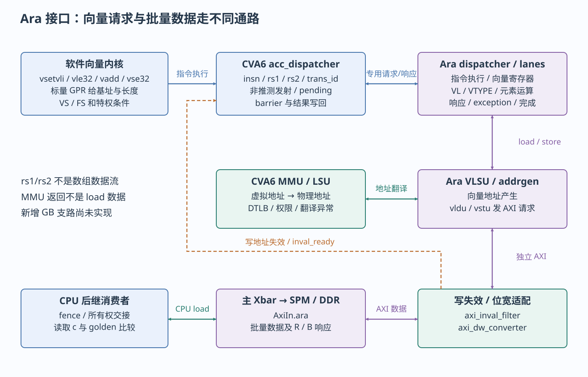

# 指令、Ara 与 CSR

处理器内部接口与向量数据通路

> 自动生成的 Markdown 阅读版；正文只维护 [HTML 内容源](../content/instructions.html)，导航维护 [pages.json](../scripts/pages.json)。[本章 HTML](../instructions.html) · [阅读路线](index.md)

- [C 运算、机器指令与提交](#scalar)
- [三种 RVV 编程入口](#rvv-entry)
- [CVA6 与 Ara 的请求、翻译和完成](#ara-path)
- [CSR 的访问指令与工程调用](#csr)
- [特权与异常的边界](#privilege)

本章分开三种软件动作：算术/访存指令、控制状态寄存器访问、向量专用请求。CSR（Control and Status Register，控制与状态寄存器）是处理器内部按指令编码寻址的状态；它没有 UART 那样的 MMIO 基址。

<a id="scalar"></a>

## C 运算、机器指令与提交

[已有 journey.c](../../../learning/examples/journey.c) 的 `make_value(i)` 返回 `3u*i+seed`。编译器可把乘3化为移位加法，把局部临时量放寄存器甚至消去；只有地址可见/必须保存的值才需要内存对象。不能把每个 C 变量对应成一块 SRAM。

从本轮 [scalar-build/journey.dump](../evidence/scalar-build/journey.dump) 搜索 `<make_value>`，可以看到整数运算、读取 seed 和返回；从 `<_putchar>` 可见内联后的字节读写。CVA6 的 [frontend](../../../../.bender/git/checkouts/cva6-20c9d7cbe0dd6995/core/frontend/frontend.sv) 根据PC发取指请求，经地址转换/I-cache取得机器码；[id\_stage](../../../../.bender/git/checkouts/cva6-20c9d7cbe0dd6995/core/id_stage.sv)/[decoder](../../../../.bender/git/checkouts/cva6-20c9d7cbe0dd6995/core/decoder.sv)解析，[issue\_stage](../../../../.bender/git/checkouts/cva6-20c9d7cbe0dd6995/core/issue_stage.sv)调度，执行结果按事务ID写回 scoreboard，最后 [commit\_stage](../../../../.bender/git/checkouts/cva6-20c9d7cbe0dd6995/core/commit_stage.sv)落实架构状态或精确异常。

“软件看到执行完成”由架构提交和指令语义决定，并不意味着所有后续总线写响应已返回。整数加法主要改GPR（通用寄存器），store进入访存/缓存系统，CSR改内部状态，向量指令还有专用完成/在途信息。

<a id="rvv-entry"></a>

## 三种 RVV 编程入口

RVV（RISC-V Vector，RISC-V 向量扩展）按 `vl` 个元素执行向量操作；VLEN是每个向量寄存器的位数，lane是硬件执行资源数，二者不同。更改lane不等于直接更改C数组长度。

| 入口 | 仓库已有例子 | 使用条件 |
| --- | --- | --- |
| 显式汇编 | [rvv\_add.S](../../../learning/examples/rvv_add.S) `learn_vadd` | 精确控制 `vsetvli/vle32/vadd/vse32`；调用者负责VS和缓冲区 |
| intrinsic（编译器向量内建函数） | [rvv\_intrinsics.c](../../../learning/examples/rvv_intrinsics.c) | 本机工具链支持对应头文件/API；检查输出指令 |
| 自动向量化 | [rvv\_auto.c](../../../learning/examples/rvv_auto.c) | 循环依赖和编译优化满足条件；使用V编译不保证循环真的向量化 |
| 现有算法 | [fmatmul\_test\_4x4.c](../../../../sw/tests/fmatmul_test_4x4.c)、Ara apps | 浮点要求FS，数据布局和工具链也要匹配；打印矩阵不能替代golden比较 |

已有汇编核心如下，这是仓库源码片段，非虚构反汇编：

```
vsetvli t0, a3, e32, m1, ta, ma
vle32.v v0, (a0)
vle32.v v1, (a1)
vadd.vv v2, v0, v1
vse32.v v2, (a2)
sub a3, a3, t0
slli t1, t0, 2
```

a0/a1/a2是三个数组的基址，a3是剩余元素数。`vsetvli`返回本轮实际vl，`e32`表示32位元素、m1表示一个向量寄存器组；因此指针增量是 `vl*4` 字节。尾部元素通过再次设置vl处理，不能每轮固定加一个假设的硬件向量长度。`v0/v1/v2`是Ara向量寄存器，不是CPU GPR，也不是可从AXI寻址的MMIO区域。

<a id="ara-path"></a>

## CVA6 与 Ara 的请求、翻译和完成



向量指令请求与独立数据通路。图中箭头分别标注软件调用、总线事务或硬件事件。

[cheshire\_soc.sv](../../../../hw/cheshire_soc.sv)使用 `cva6_to_acc_t / acc_to_cva6_t`，把CVA6的 `cvxif_req_o/resp_i` 接到Ara的 `acc_req_i/resp_o`。虽然端口名含cvxif，`gen_cva6_cfg()`把 `CvxifEn=0`；此组合承载专用加速器/MMU契约，不是通用NPU插槽。

| 阶段 | 定义 → 发送/接收 | 对软件的含义 |
| --- | --- | --- |
| 初步识别 | Ara [cva6\_accel\_first\_pass\_decoder](../../../../.bender/git/checkouts/ara-2c7b103275a16c87/hardware/src/cva6_accel_first_pass_decoder.sv) → CVA6 decoder | 辨别向量指令及VS/FS条件；必须排除CVA6同名stub |
| 发射 | CVA6 [acc\_dispatcher](../../../../.bender/git/checkouts/cva6-20c9d7cbe0dd6995/core/acc_dispatcher.sv) `acc_req_o.acc_req` → Ara [ara\_dispatcher](../../../../.bender/git/checkouts/ara-2c7b103275a16c87/hardware/src/ara_dispatcher.sv) | 非推测发射协调；传递insn、rs1、rs2、frm、trans\_id及valid/ready |
| 内部执行 | [ara.sv](../../../../.bender/git/checkouts/ara-2c7b103275a16c87/hardware/src/ara.sv) → dispatcher/sequencer/lanes | 向量寄存器和lane执行运算；不由CPU逐元素写Ara寄存器 |
| 标量结果/异常返回 | [intf\_typedef.svh](../../../../.bender/git/checkouts/ara-2c7b103275a16c87/hardware/include/ara/intf_typedef.svh) `accelerator_resp_t` → CVA6写回/提交 | `result/trans_id/exception/resp_valid`关联原指令；fflags更新浮点状态 |
| 向量地址 | [vlsu/addrgen.sv](../../../../.bender/git/checkouts/ara-2c7b103275a16c87/hardware/src/vlsu/addrgen.sv) → `acc_mmu_req` → CVA6 [load\_store\_unit](../../../../.bender/git/checkouts/cva6-20c9d7cbe0dd6995/core/load_store_unit.sv) | 传虚拟地址和store属性，CVA6返回物理地址/DTLB信息/异常；不是DMA IOMMU |
| 向量数据 | VLSU的[vldu](../../../../.bender/git/checkouts/ara-2c7b103275a16c87/hardware/src/vlsu/vldu.sv)/[vstu](../../../../.bender/git/checkouts/ara-2c7b103275a16c87/hardware/src/vlsu/vstu.sv) → Ara AXI → filter → DW converter → `AxiIn.ara` | Ara自己发AR/AW/W并收R/B；批量数据不经过CPU专用请求的rs1/rs2字段 |
| 在途与排空 | `load_complete/store_complete/store_pending` → CVA6 acc\_dispatcher | 与标量访存、fence/barrier配合；函数ret本身不是总线排空证明 |

访问翻译请求的 `CVA6Cfg.VLEN` 在此指虚拟地址相关宽度，不能与 `Cfg.AraVLEN=2048` 的向量寄存器位数混淆。读写的MMU返回错误与外部AXI错误是不同层次；本地 `vstu.sv` 仍标注B通道错误处理TODO，所以“store\_complete出现”不能独自证明所有数据正确。

软件使用Ara需要同时满足：带V的CPU profile、真实译码、SoC Ara使能及合法lane/VLEN、ELF指令集匹配、VS非Off；浮点向量还要FS可用。共享存储要可达且满足[可见性规则](memory-mmio.md#visibility)。OS多任务还需保存/恢复向量状态，不能从一次裸机向量成功推导为抢占正确。

<a id="csr"></a>

## CSR 的访问指令与工程调用

`csrr`是读CSR的汇编别名，`csrw`写，`csrs/csrc`按掩码置/清位。指令携带CSR编号，不产生AXI寄存器地址事务。[util.h](../../../../sw/include/util.h) 的 `set_mie(1)`使用 `csrsi mstatus,8`，`set_mtie(1)`对mie置bit7；`get_mcycle()`使用 `csrr ...,mcycle`。与 `*reg32(&__base_clint,offset)` 会产生访存指令形成对照。

| CSR/字段 | 本地软件使用位置 | RTL消费者与典型修改影响 |
| --- | --- | --- |
| `mstatus.MIE/SIE` | crt0关闭；util `set_mie` | [csr\_regfile](../../../../.bender/git/checkouts/cva6-20c9d7cbe0dd6995/core/csr_regfile.sv)与decoder中断判断；M模式示例需MIE及相应mie都开 |
| `mie.MTIE` / `mie.MEIE` | clint\_sleep接口；外设ISR初始化需另写MEIE | 定时与PLIC外部中断是不同位；开MTIE不放行PLIC |
| `mip` | 诊断待处理事件 | `time_irq_i/ipi_i/irq_i`形成待处理条件；不是所有位都能靠写mip清掉 |
| `mtvec` | crt0设置 `_trap_handler_wrap` | trap入口与模式；普通直接模式和CLIC模式要分开 |
| `mepc/mcause/mtval` | 自定义trap诊断；默认处理不解码 | 提交异常写入返回PC/原因/附加值；错误修改mepc会跳错指令 |
| `mstatus.MPP/MPIE` | trap硬件及 `mret` | 保存/恢复先前特权和中断使能；mret不清设备pending |
| `mstatus.FS[14:13]` | crt0设Initial并初始化FP寄存器 | 浮点执行/状态跟踪；FS=Off可触发非法指令 |
| `mstatus.VS[10:9]` | HelloWorld置位；journey在向量内核前置位 | 允许向量状态使用；仅写VS不证明执行过V指令 |
| `vl/vtype/vstart` | RVV内核和Ara dispatcher | 当前元素数、类型/组大小和重启位置；与向量上下文相关 |
| `mcycle` | util、clint\_get\_core\_freq | csr\_regfile `cycle_q`；CPU周期计数，非CLINT RTC tick |
| `satp` | 后续S-mode/Linux；当前crt0未建页表 | load\_store\_unit/MMU选择Sv39页表；改映射还需相应TLB同步 |
| `pmpcfg*/pmpaddr*` | 当前裸机例不建立完整隔离方案 | 物理内存保护PMP，按`Cfg.Cva6NrPMPEntries`生成，当前DefaultCfg为0，不能据profile原始值宣称PMP隔离已启用；不能拿C/I/E代替权限 |
| `medeleg/mideleg`、`mcounteren/scounteren` | OS/固件移植入口 | 异常/中断委托、低特权读计数器权限；软件栈必须匹配实现 |
| `CSR_ACC_CONS`（0x7c2 bit0） | 当前向量协作依赖其复位开启状态 | csr\_regfile `acc_cons_en_o` → acc\_dispatcher/filter；关闭会改变访存协调前提 |
| `CSR_DCACHE/ICACHE` | 平台调试时按本地实现核对 | 本地自定义cache控制CSR；不是通用逐行clean/invalidate API |

具体编码和可写字段以本地[csr\_regfile.sv](../../../../.bender/git/checkouts/cva6-20c9d7cbe0dd6995/core/csr_regfile.sv)及[riscv包](../../../../.bender/git/checkouts/cva6-20c9d7cbe0dd6995/core/include/riscv_pkg.sv)为准。`satp`、PMP等这里只建立接口导航，本轮没有新增页表/权限配置程序。

<a id="privilege"></a>

## 特权与异常的边界

现有裸机按M模式运行。S模式通常承载Linux内核，U模式承载用户进程；向量profile未启用H扩展，不把默认另一个带H的profile能力混进来。低特权代码访问不允许的CSR、写只读CSR、执行未实现指令会进入异常路径；某些已实现的WARL字段（写任意值、读合法值）会约束写入值，因此应读回核对，而不是假定每一非法字段值都trap。

本地csr\_regfile通过CSR编码、读写意图、特权及配置控制合法性；MMIO访问则经翻译、PMP/属性和总线目标判定。U-mode代码通常不能直接 `csrs mstatus` 或访问任意物理寄存器。Linux应通过系统调用/驱动获得服务，不能把裸机指针强转后原样搬到用户程序。

标准背景参见[RISC-V 20240411特权规范](https://docs.riscv.org/reference/isa/v20240411/_attachments/riscv-privileged.pdf)，用于解释M/S/U、trap状态和CSR访问规则；CLIC及本地自定义CSR仍按当前源码核对，不把规范最新扩展当作现有硬件能力。

---

[上一页：构建、加载与启动](build-boot.md) · [下一页：内存、MMIO 与数据交接](memory-mmio.md)
